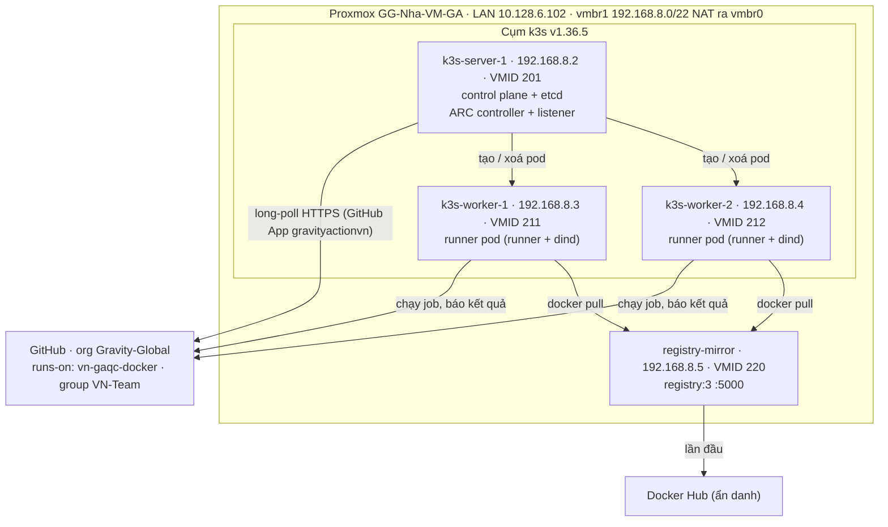

# Self-hosted GitHub Runner autoscale trên Proxmox với k3s + ARC

Cập nhật lần cuối: 2026-10-22 · @Y Nguyen

Tài liệu này có hai phần. Phần đầu là **hồ sơ hiện trạng**: hệ thống đang chạy thế nào, mọi giá trị cụ thể nằm ở đâu, các quyết định đã chốt và các sự cố đã gặp. Phần sau là **hướng dẫn vận hành và dựng lại** từ đầu. Đọc mục 1–5 là đủ để nắm toàn bộ bối cảnh mà không cần lục lại lịch sử chat.

Tài liệu liên quan:

- [docs/github-app.md](github-app.md): GitHub App `gravityactionvn`, private key, đổi key và các lỗi xác thực.
- [scripts/](../scripts/): `pve-discovery.sh` (kiểm tra host), `pve-create-vms.sh` (tạo VM), `node-prep.sh` (chuẩn bị OS), `k3s-plan.env.example` (kế hoạch).
- [k8s/](../k8s/): `controller-values.yaml` và `runner-values.yaml`, đúng bản đang cài.
- [mirror/](../mirror/): `config.yml` và `compose.yaml` của registry mirror, đúng bản đang chạy.

---

## 1. Hiện trạng

### 1.1 Tóm tắt

- **Trạng thái:** đang chạy production cho `runs-on: vn-gaqc-docker` từ 2026-10-22 khoảng 15:00 UTC. Đã chạy thật job `SonarQube-Scan` của repo `gg-ai-command-center-app`.
- **Quy mô:** `minRunners: 0`, `maxRunners: 8`. Mỗi job chạy trong một pod riêng, xong job thì pod bị xoá.
- **Runner LXC cũ:** các container 111–135 đã xoá. Các container 100–110 đang **dừng nhưng chưa xoá**, để còn quay lại được (mục 2, TODO).



### 1.2 Proxmox host

| Mục | Giá trị |
| --- | --- |
| Tên | `GG-Nha-VM-GA`, đơn node (không cluster) |
| Phiên bản | PVE 9.2.21, kernel 7.0.14-12-pve |
| CPU / RAM | Intel Xeon Silver 4109T, 32 thread / 376,5 GiB |
| Tải CPU (2026-10-22) | Bận 73–89% khi còn chạy các LXC runner cũ. Phần lớn đến từ 11 LXC 100–110 và các VM khác |
| Ổ đĩa | `sda`, `sdb` 893,8 GB và `sdc` 3,5 TB (PERC H740P, SSD) |
| Storage | `local-lvm` (LVM-thin, còn khoảng 40 GB), `local-lvm2` (LVM thick, còn khoảng 1762 GB sau khi xoá LXC). **Cụm dùng `local-lvm2`** |
| Storage `local` | `/var/lib/vz`, đã bật content **Snippets** |
| `vmbr0` | LAN `10.128.6.102/24`, gateway `10.128.6.1`, chạy trên `bond0` (LACP `ens1f0np0` + `ens1f1np1`) |
| `vmbr1` | `192.168.8.1/22`, không gắn card vật lý, NAT ra `vmbr0` (MASQUERADE) |
| DHCP trên `vmbr1` | `dhcpd` (ISC) chạy trên host, cấp `192.168.8.10`–`192.168.11.254`, DNS `10.128.6.2`, `8.8.8.8` (file `/etc/dhcp/dhcpd.conf`) |
| IP tĩnh còn trống ngoài dải DHCP | `192.168.8.6`–`.9` (cụm đang dùng `.2`–`.5`) |
| MTU đường ra Internet | Khoảng 1480, đã có **MSS clamp 1440** cho `192.168.8.0/22` (mục 6.2) |
| Backup job | Chưa có. Khi tạo, nhớ exclude 211, 212, 220 |
| SSH key quản trị | `/root/.ssh/id_ed25519` (tạo ngày 2026-10-22, comment `proxmox-k3s-admin`). Public key đã được cài vào user `ubuntu` của mọi VM |

### 1.3 VM của cụm

| VMID | Tên | IP | vCPU / RAM / Disk | Vai trò |
| --- | --- | --- | --- | --- |
| 9000 | `ubuntu-2404-k3s-tpl` | – | 2 / 2 GiB / 3,5 GB | Template cloud-init Ubuntu 24.04 (noble), tag `k3s` |
| 201 | `k3s-server-1` | `192.168.8.2` | 2 / 4 GiB / 30 GB | k3s server (embedded etcd), có taint `CriticalAddonsOnly`; chạy ARC controller và listener |
| 211 | `k3s-worker-1` | `192.168.8.3` | 8 / 16 GiB / 100 GB | k3s agent, label `gha-runner=true`, chạy runner pod |
| 212 | `k3s-worker-2` | `192.168.8.4` | 8 / 16 GiB / 100 GB | Như worker-1 |
| 220 | `registry-mirror` | `192.168.8.5` | 2 / 4 GiB / 50 GB | Docker + `registry:3`, cache Docker Hub |

Chung cho mọi VM: `--balloon 0`, `--cpu host`, `virtio-scsi-single` + `iothread`, full clone trên `local-lvm2`, `--onboot 1`, `--startup order` (server = 1, còn lại = 2), gateway `192.168.8.1`, DNS `10.128.6.2 8.8.8.8`, user `ubuntu`. Mật khẩu console nằm trong password manager. Worker có allocatable khoảng 7 CPU và 13,1 GiB RAM, tối đa 110 pod.

### 1.4 Phần mềm và phiên bản

| Thành phần | Phiên bản (2026-10-22) | Ghi chú |
| --- | --- | --- |
| OS của VM | Ubuntu 24.04.5 LTS, kernel 6.8.0-147 | Cloud image `noble-server-cloudimg-amd64.img` |
| k3s | `v1.36.5+k3s1` (containerd 2.3.4) | Cài qua `get.k3s.io` với `INSTALL_K3S_VERSION`, flannel `host-gw`, đã tắt traefik và servicelb |
| ARC (2 chart) | `0.15.0` | `gha-runner-scale-set-controller` + `gha-runner-scale-set` |
| Runner image | `ghcr.io/actions/actions-runner:2.338.1` | Phải cập nhật khoảng hằng tháng (mục 3) |
| dind | `docker:dind` (Docker 29.9.2 lúc cài) | Chưa pin version |
| `docker compose` trong runner | Plugin compose v5.x, lấy từ image `docker:dind` qua init container `init-compose-plugin` | Thêm ngày 2026-10-22: image runner chuẩn không có compose |
| helm | v3.22.1 | Cài trên `k3s-server-1` |
| Registry mirror | `registry:3` + Docker (`get.docker.com`) | |

### 1.5 GitHub

| Mục | Giá trị |
| --- | --- |
| Org | `Gravity-Global` (khoảng 1003 repo) |
| GitHub App | `gravityactionvn` (GravityActionVN). App ID **`1192728`**, Installation ID **`63354448`** |
| Quyền App | Organization `Self-hosted runners` = Read and write (thứ ARC cần), cùng nhiều quyền rộng khác: code, administration, workflows… (xem [github-app.md](github-app.md)) |
| Repository access của installation | All repositories |
| Private key ARC dùng | Tạo ngày 2026-10-22, fingerprint **`SHA256:HIWdluCnKDj2e85r2D5+LlbprcdZyt0d/LXvhydrvas=`**. File `.pem` chỉ lưu trong password manager và secret `github-app` của cụm. Các key khác của App thuộc hệ thống khác, **không được xoá** |
| Runner group | `VN-Team` (giống runner LXC cũ) |
| Scale set | `vn-gaqc-docker` (= `runs-on`), Helm release `vn-gaqc-docker`, namespace `arc-runners` |
| Workflow đã chạy thật | `Gravity-Global/gg-ai-command-center-app` → reusable `Gravity-Global/gravity-workflows-github-action-vn-team/.github/workflows/sonarqube-quality-gate.yml@production` (job `SonarQubeQualityGateCheck / SonarQube-Scan`) |
| Docker Hub | Không dùng tài khoản, mirror kéo ẩn danh |

### 1.6 Vị trí file

| Máy | Đường dẫn | Nội dung |
| --- | --- | --- |
| Proxmox host | `/root/selfhost-auto-scale/` | `k3s-plan.env`, `pve-discovery.sh`, `pve-create-vms.sh`, `node-prep.sh`, tải từ repo (mục 6.1) |
| Proxmox host | `/root/k3s-token` | Token của cụm k3s (quyền 600) |
| Proxmox host | `/root/.ssh/id_ed25519` | Private key SSH vào các VM |
| Proxmox host | `/etc/network/interfaces` | Khối `vmbr1`: NAT + MSS clamp (mục 6.2) |
| Proxmox host | `/etc/dhcp/dhcpd.conf` | Dải DHCP của `vmbr1` (do hệ thống khác quản lý, **không sửa**) |
| Proxmox host | `/var/lib/vz/snippets/k3s-vendor.yaml` | cloud-init vendor-data: cài `qemu-guest-agent`, `curl`, `chrony` |
| Proxmox host | `/var/lib/vz/template/iso/noble-server-cloudimg-amd64.img` | Cloud image dùng để tạo template |
| Mọi node k3s | `/etc/rancher/k3s/config.yaml` | Config k3s (có token) |
| Mọi node k3s | `/etc/rancher/k3s/registries.yaml` | Trỏ `docker.io` tới mirror `192.168.8.5:5000` |
| Mọi node k3s | `/etc/sysctl.d/90-k3s-runners.conf`, `/etc/apt/apt.conf.d/52unattended-no-reboot` | Tạo bởi `node-prep.sh` |
| `k3s-server-1` | `~/controller-values.yaml`, `~/runner-values.yaml` | Values đang cài. Bản sao trong repo: [k8s/](../k8s/) |
| `k3s-server-1` | `~/.kube/config`, `~/.bashrc` (`KUBECONFIG`, `ARC_VERSION`, `RUNNER_VERSION`), `/etc/environment` (`KUBECONFIG`) | Để `kubectl`/`helm` chạy được, cả khi chạy qua SSH một dòng |
| `k3s-server-1` | `/var/lib/rancher/k3s/server/db/snapshots` | Snapshot etcd tự động 12 giờ/lần, giữ 10 bản |
| `registry-mirror` | `/opt/mirror/config.yml`, `/opt/mirror/compose.yaml`, `/srv/registry` | Config mirror và cache. Bản sao trong repo: [mirror/](../mirror/) |
| Cụm | Secret `github-app` (namespace `arc-runners`) | `github_app_id`, `github_app_installation_id`, `github_app_private_key` |
| Cụm | ConfigMap `runner-sudoers` (namespace `arc-runners`) | `/etc/sudoers` cho container runner ([k8s/runner-sudoers.yaml](../k8s/runner-sudoers.yaml)) |

### 1.7 Secrets

| Secret | Lưu ở đâu | Dùng khi |
| --- | --- | --- |
| Mật khẩu console `ubuntu` (`CI_PASSWORD`) | Password manager | Vào Console noVNC khi SSH hỏng |
| Token cụm k3s | `/root/k3s-token` + password manager | Thêm node, cài lại k3s |
| Private key GitHub App (`.pem`) | Password manager + secret `github-app` trong cụm | Tạo lại secret, đổi key |
| SSH private key | `/root/.ssh/id_ed25519` trên Proxmox host | SSH vào VM |

Không secret nào nằm trong repo. **Không** commit `k3s-plan.env` nếu có thêm mật khẩu vào đó, và không commit `.pem` hay token.

### 1.8 Runner LXC cũ

| VMID | Tên | Trạng thái |
| --- | --- | --- |
| 100–110 | `github-runner-<id>-<ngày>` | **Dừng** từ 2026-10-22, chưa xoá. Có thể còn đăng ký Offline trên GitHub |
| 111–135 | `github-runner-<id>-20261020MAY` | Đã xoá (`pct destroy --purge`) ngày 2026-10-22 |

Các LXC này được tạo bởi script cũ, nằm trên branch `master` của repo: `lxc_create_github_actions_runner.master.sh` tạo LXC mẫu, `lxc_create_github_actions_runner.clone.sh` clone và đăng ký runner. Script cũ đã bị gỡ khỏi branch `v2` ở commit `facbe3d`. Đặc điểm của runner cũ:

- LXC privileged (`unprivileged 0`, `nesting=1,keyctl=1`), 5 core / 32 GiB / swap 32 GiB / disk 50 GB trên `local-lvm2`, `vmbr1` lấy IP qua DHCP, có `/dev/net/tun` (cho OpenVPN).
- Đăng ký bằng **PAT** (`GITHUB_TOKEN` có quyền `admin:org`), không dùng GitHub App. Labels: `vn-gaqc-docker,test-setup` cùng các label mặc định `self-hosted, linux, x64`. Group `VN-Team`. Runner `2.334`–`2.338`.
- Runner chạy bằng **root** (`RUNNER_ALLOW_RUNASROOT=1`, `svc.sh install root`), `LANG/LC_ALL=en_US.UTF-8`.
- Công cụ cài sẵn: Chrome, Edge, Firefox (PPA), Xvfb và thư viện đồ hoạ; Node.js 24 + npm; Playwright (global, có deps và browser); OpenVPN, net-tools, iptables, iproute2; Docker (`get.docker.com`, có `docker compose`); AWS CLI v2; git, curl, unzip.

Image `ghcr.io/actions/actions-runner` của ARC không có các công cụ trên (riêng `docker compose` đã được bổ sung qua init container), mặc định chạy bằng user `runner` (cụm đã cấu hình chạy root như LXC cũ) và không có `NET_ADMIN`/`tun`. Workflow nào tự cài thứ mình cần (ví dụ job screenshot tự cài browser) thì chạy được ngay. Nếu nhiều workflow cần sẵn browser, Playwright, AWS CLI hay OpenVPN, dùng image tương đương LXC cũ ở [runner-image/Dockerfile](../runner-image/Dockerfile) (bản nháp, chưa build).

---

## 2. Việc còn lại (TODO)

- [ ] Theo dõi 1–2 ngày: job `vn-gaqc-docker` xanh, không có OOM hay evict, thời gian chờ runner hợp lý.
- [ ] Chạy load test 16 job (mục 6.9) để xác nhận cụm scale lên 8, xếp hàng đúng và về lại 0.
- [ ] Dọn LXC cũ: xoá các runner Offline trên GitHub, rồi `pct destroy` 100–110 (mục 7).
- [ ] Chạy lại `pve-discovery.sh` sau khi dọn LXC, rồi tăng `maxRunners` (mục 3). Cần thêm sức chứa thì thêm worker bằng IP `.6`–`.9`.
- [ ] Báo người quản lý App `gravityactionvn` rằng ARC đang dùng key có fingerprint ở mục 1.5.
- [ ] Cân nhắc tạo App riêng chỉ có quyền `Self-hosted runners` để giảm rủi ro ([github-app.md](github-app.md)).
- [ ] Đặt lịch hằng tháng cập nhật runner image, và hằng năm đổi private key.
- [ ] (Tuỳ chọn) Pin `docker:dind` theo major, gắn monitoring (Prometheus) và cảnh báo.

---

## 3. Cheat sheet

Lệnh `kubectl`/`helm` chạy trên `k3s-server-1`: vào bằng `ssh ubuntu@192.168.8.2`, hoặc chạy một dòng `ssh ubuntu@192.168.8.2 '<lệnh>'`. Lệnh `qm`/`pct`/`ssh` chạy trong Proxmox Shell. Nếu `ARC_VERSION` trống sau khi mở phiên mới, chạy `source ~/.bashrc`.

**Xem tình trạng**

```bash
kubectl get nodes -o wide
kubectl get autoscalingrunnerset,ephemeralrunners -n arc-runners
kubectl get pods -n arc-systems -o wide          # controller + listener phải ở k3s-server-1
kubectl get pods -n arc-runners -o wide          # runner pod đang chạy job
kubectl top nodes
kubectl logs -n arc-systems $(kubectl get pods -n arc-systems -o name | grep listener) --tail=30
```

**Đổi `maxRunners`** (ví dụ lên 16). Sửa cả file values để lần `helm upgrade -f` sau không bị quay về giá trị cũ:

```bash
sed -i 's/^maxRunners: .*/maxRunners: 16/' ~/runner-values.yaml
helm upgrade vn-gaqc-docker -n arc-runners -f ~/runner-values.yaml --version "${ARC_VERSION}" \
  oci://ghcr.io/actions/actions-runner-controller-charts/gha-runner-scale-set
```

Sau đó cập nhật [k8s/runner-values.yaml](../k8s/runner-values.yaml) trong repo cho khớp. Hai worker 8 vCPU / 16 GiB chứa được khoảng 20 runner. Giới hạn thật là CPU rảnh của host, xem bằng `pve-discovery.sh`.

**Tạm dừng nhận job** (job đang chạy vẫn chạy cho xong, job mới xếp hàng):

```bash
helm upgrade vn-gaqc-docker -n arc-runners --reuse-values --set maxRunners=0 --version "${ARC_VERSION}" \
  oci://ghcr.io/actions/actions-runner-controller-charts/gha-runner-scale-set
# Bật lại:
helm upgrade vn-gaqc-docker -n arc-runners -f ~/runner-values.yaml --version "${ARC_VERSION}" \
  oci://ghcr.io/actions/actions-runner-controller-charts/gha-runner-scale-set
```

**Quay lại runner LXC cũ** (chỉ làm được khi chưa xoá LXC và chưa xoá runner cũ trên GitHub):

```bash
helm uninstall vn-gaqc-docker -n arc-runners                                                        # k3s-server-1
for id in $(pct list | awk '$NF ~ /^github-runner-/ { print $1 }'); do pct start "$id"; done        # Proxmox Shell
```

**Cập nhật runner image** (khoảng hằng tháng, bắt buộc: GitHub ngừng giao job cho runner quá cũ):

```bash
# k3s-server-1
NEW=$(curl -s https://api.github.com/repos/actions/runner/releases/latest | sed -n 's/.*"tag_name": *"v\([^"]*\)".*/\1/p'); echo "$NEW"
sed -i "s#actions-runner:[0-9.]*#actions-runner:${NEW}#g" ~/runner-values.yaml && grep -n 'actions-runner:' ~/runner-values.yaml
# Proxmox Shell: kéo sẵn image
for ip in 192.168.8.3 192.168.8.4; do ssh ubuntu@$ip "sudo k3s crictl pull ghcr.io/actions/actions-runner:<NEW>"; done
# k3s-server-1
helm upgrade vn-gaqc-docker -n arc-runners -f ~/runner-values.yaml --version "${ARC_VERSION}" \
  oci://ghcr.io/actions/actions-runner-controller-charts/gha-runner-scale-set
sed -i "s/^export RUNNER_VERSION=.*/export RUNNER_VERSION=${NEW}/" ~/.bashrc
```

Cập nhật luôn bảng phiên bản ở mục 1.4 và file [k8s/runner-values.yaml](../k8s/runner-values.yaml).

**Đổi private key GitHub App:** làm theo [github-app.md, mục "Đổi private key"](github-app.md#đổi-private-key-khuyến-nghị-1-lần-mỗi-năm-hoặc-ngay-khi-nghi-key-bị-lộ). Nhớ cập nhật fingerprint ở mục 1.5.

**Bảo trì 1 worker** (reboot, update kernel, nâng k3s):

```bash
NODE=k3s-worker-1
kubectl cordon "$NODE"
while kubectl get pods -n arc-runners --field-selector spec.nodeName="$NODE" --no-headers 2>/dev/null | grep -q .; do
  echo "$(date +%T) còn runner trên $NODE"; sleep 30
done
kubectl drain "$NODE" --ignore-daemonsets --delete-emptydir-data
# ... bảo trì, ví dụ: ssh ubuntu@192.168.8.3 'sudo apt-get update && sudo apt-get -y upgrade && sudo reboot'
kubectl uncordon "$NODE"
```

**Reboot Proxmox host:** các VM có `--onboot 1`, và server lên trước. Sau khi host lên lại:

```bash
iptables -t nat -S POSTROUTING | grep 192.168.8.0/22          # còn MASQUERADE
iptables -t mangle -S FORWARD | grep TCPMSS                   # còn MSS 1440
ssh ubuntu@192.168.8.2 'kubectl get nodes; kubectl get pods -n arc-systems'
ssh ubuntu@192.168.8.5 'cd /opt/mirror && sudo docker compose ps'   # restart: unless-stopped
```

**Thêm worker:**

1. Trong `/root/selfhost-auto-scale/k3s-plan.env`, đổi `WORKER_IDS="211 212 213"` và `WORKER_IPS="192.168.8.3 192.168.8.4 192.168.8.6"`.
2. Chạy `set -a; source k3s-plan.env; set +a`, rồi `bash pve-discovery.sh`, rồi `DRY_RUN=1 bash pve-create-vms.sh`, rồi `bash pve-create-vms.sh`. VM đã có sẽ được bỏ qua.
3. Chạy `node-prep.sh` trên `192.168.8.6` (mục 6.5).
4. Ghi `registries.yaml` (mục 6.7) và cài agent (mục 6.6, phần worker), chỉ với IP mới.
5. Kiểm tra bằng `kubectl get nodes`.

Mỗi worker 8 vCPU / 16 GiB thêm khoảng 10–12 slot. Cập nhật mục 1.3.

---

## 4. Thiết kế và các quyết định

| Quyết định | Lý do | Phương án đã loại |
| --- | --- | --- |
| ARC (Actions Runner Controller) trên k3s | Giải pháp GitHub hỗ trợ chính thức (GA), scale-to-zero, mỗi job một pod ephemeral | Tự viết autoscaler; GARM; Runner Scale Set Client (mới ở bản preview) |
| Mỗi pod có dind riêng | Runner Docker cũ chết giữa chừng vì nhiều job dùng chung `docker.sock` (`prune`, `rm -f`, trùng tên), vì OOM và vì disk đầy | Mount `docker.sock` của node |
| `vmbr1` (NAT qua host) | Không tốn IP LAN; cụm tách khỏi LAN vì dind chạy privileged | `vmbr0` (tốn IP LAN) |
| IP tĩnh `192.168.8.2`–`.5` | `dhcpd` của host cấp `.10`–`.11.254`. Kế hoạch đầu tiên dùng `.201/.211/.212/.220` nằm trong dải DHCP nên đã đổi | IP trong dải DHCP |
| Storage `local-lvm2` (thick) | `local-lvm` (thin) chỉ còn khoảng 40 GB | |
| 2 worker 8 vCPU / 16 GiB, `maxRunners: 8` | CPU host đã bận 73–89%, RAM cấp phát đã gấp 3,6 lần RAM vật lý | 4 worker 16 vCPU / 32 GiB, 100 runner |
| Scale set tên `vn-gaqc-docker` ngay từ đầu, dừng LXC trước khi cài | Workflow không phải sửa; không có lúc nào cả LXC lẫn scale set cùng nhận job | Chạy thử với tên tạm |
| GitHub App có sẵn `gravityactionvn` + key riêng cho ARC | Có sẵn quyền `Self-hosted runners`; không hết hạn; thêm key không ảnh hưởng hệ thống khác | PAT (gắn với người, có hạn dùng); tạo App mới (có thể làm sau) |
| Controller + listener chạy trên server | App có quyền rộng; job privileged trên worker không được đọc được key | Để Kubernetes tự xếp |
| Làm mọi thứ từ Proxmox Shell | Người vận hành chỉ dùng web UI; host là gateway của `vmbr1` | SSH từ laptop qua ProxyJump |
| MSS clamp 1440 | MTU đường ra Internet khoảng 1480; tránh `git clone`/`docker pull` bị treo khi ICMP bị chặn | `--mtu` cho dind |
| Registry mirror ẩn danh | Không có tài khoản Docker Hub. Cache giảm số lần pull | Tài khoản + token (thêm sau nếu gặp `toomanyrequests`) |
| Embedded etcd (`cluster-init`) | Sau này nâng lên 3 server HA mà không phải cài lại | SQLite |

Request/limit của mỗi runner pod: runner 250m CPU / 512Mi (limit 2Gi), dind 250m / 512Mi (limit 2Gi). Không đặt CPU limit. `emptyDir`: work 10Gi, Docker 20Gi. Sau khoảng 1 tuần chạy thật, chỉnh request về mức dùng p90 (`kubectl top pod -n arc-runners --containers`).

---

## 5. Sự cố đã gặp và cách xử lý

| Sự cố | Nguyên nhân | Cách xử lý / phòng tránh |
| --- | --- | --- |
| Chạy script xong thì phiên Shell tự `logout` | Script được `source` hoặc dán thẳng, nên lệnh `exit` thoát luôn shell | Bọc toàn bộ script trong `main() ( ... )` (subshell). Chạy bằng `bash script.sh` |
| Hàng trăm dòng `[1] 835988` khi quét IP | Thông báo job control của shell tương tác | `set +m` và chuyển hướng stderr của vòng ping |
| Discovery báo thiếu RAM / ZFS ARC 375 GiB | Script tính cả RAM của VM đang tắt; tính ARC dù không có pool ZFS | Tính theo `MemAvailable`; bỏ qua ARC khi không có pool |
| IP `.201/.211/.212/.220` bị báo "trống" nhưng nằm trong dải DHCP | Script chưa đọc `dhcpd.conf` | Đọc dải DHCP (dhcpd, dnsmasq, Kea, SDN) và báo FAIL nếu IP nằm trong dải; đổi sang `.2`–`.5` |
| Có 3 rule MASQUERADE trùng nhau | `post-up iptables -A` chạy lại mỗi lần `ifreload` hay Apply Configuration | Dùng dạng `-C ... \|\| -A ...`. Các rule trùng vô hại |
| `Chưa có /root/admin.pub` | Biến `SSH_PUBKEY` cũ còn sót trong shell | `unset SSH_PUBKEY`; key nằm ở đường dẫn mặc định `/root/.ssh/id_ed25519.pub` |
| Tên DHCP server hiện trống `( )` | Lệnh `sed` cắt mất tên tiến trình | Đã sửa trong script |
| `kubectl` qua `ssh ... 'kubectl ...'` báo `permission denied` với `/etc/rancher/k3s/k3s.yaml` | SSH không tương tác không đọc `~/.bashrc` | Thêm `KUBECONFIG=/home/ubuntu/.kube/config` vào `/etc/environment` (mục 6.6) |
| Job trên GitHub kẹt ở "Job is about to start running on the runner" | Giao diện GitHub cập nhật chậm; runner đã nhận job | Tải lại trang; xem `kubectl get ephemeralrunners -n arc-runners` |
| Log dind có `Failed to find nft tool` | Docker 29 dò `nftables` trước, không có thì dùng iptables | Vô hại |
| Job `check-console` lỗi `unknown flag: --rm` ở bước `docker compose run --rm ...` | Image runner chuẩn của ARC chỉ có `docker` + buildx, không có plugin compose (LXC cũ có, vì cài Docker bằng `get.docker.com`) | Thêm init container `init-compose-plugin` copy `docker-compose` từ `docker:dind` vào `/usr/local/libexec/docker/cli-plugins` của container runner ([k8s/runner-values.yaml](../k8s/runner-values.yaml)) |
| Job `screenshot` lỗi `Initialize Browser: Server terminated early with status 127` | `.github/scripts/setup-browsers.sh` của repo gọi `apt-key`/`apt` không có `sudo` → `E: This command can only be used by root`, Chrome không được cài (bước vẫn xanh vì `\|\| true`), chromedriver thoát 127 | Container runner chạy bằng root như LXC cũ: `runAsUser: 0` + `RUNNER_ALLOW_RUNASROOT=1` ([k8s/runner-values.yaml](../k8s/runner-values.yaml)). Lâu dài: image có sẵn browser để khỏi cài lại mỗi job |
| Sau khi chạy root, action `setup-hosts` lỗi `root is not in the sudoers file` | Image `actions-runner` ghi đè `/etc/sudoers` chỉ còn dòng `%sudo`, mất dòng `root` | ConfigMap `runner-sudoers` ([k8s/runner-sudoers.yaml](../k8s/runner-sudoers.yaml)) mount vào `/etc/sudoers` của container runner (subPath, mode 0440) |
| Dán HTML nguồn của trang GitHub để lấy thông tin | | Không dán HTML nguồn (có giá trị gắn với phiên đăng nhập). Chụp màn hình hoặc copy chữ |

---

## 6. Dựng lại từ đầu

Làm theo đúng thứ tự đã chạy ngày 2026-10-22. Mọi lệnh chạy trong Proxmox Shell, trừ khi ghi rõ chạy trên `k3s-server-1` hay VM khác.

### 6.1 Tải script về host

```bash
REF=v2          # hoặc mã commit cụ thể để cố định nội dung
BASE=https://raw.githubusercontent.com/ynguyengravity/setup-github-runner/$REF
mkdir -p /root/selfhost-auto-scale && cd /root/selfhost-auto-scale
curl -fsSL "$BASE/scripts/k3s-plan.env.example" -o k3s-plan.env
for f in pve-discovery.sh pve-create-vms.sh node-prep.sh; do curl -fsSL "$BASE/scripts/$f" -o "$f"; done
bash -n pve-discovery.sh && bash -n pve-create-vms.sh && bash -n node-prep.sh && echo OK
```

Repo `ynguyengravity/setup-github-runner` đang public. Nếu chuyển sang private, `curl` sẽ cần token; khi đó có thể dán nội dung file bằng `nano` thay cho `curl`.

### 6.2 Chuẩn bị host (một lần)

**SSH key:**

```bash
ls /root/.ssh/id_ed25519.pub 2>/dev/null || ssh-keygen -t ed25519 -f /root/.ssh/id_ed25519 -N '' -C 'proxmox-k3s-admin'
```

**Snippets:** vào Datacenter → Storage → `local` → Edit → Content, tick thêm **Snippets** (giữ nguyên các mục đang có).

**NAT và MSS clamp trên `vmbr1`.** Khối `vmbr1` trong `/etc/network/interfaces` phải như dưới đây:

```
auto vmbr1
iface vmbr1 inet static
        address 192.168.8.1/22
        bridge-ports none
        bridge-stp off
        bridge-fd 0
        post-up echo 1 > /proc/sys/net/ipv4/ip_forward
        post-up iptables -t nat -C POSTROUTING -s '192.168.8.0/22' -o vmbr0 -j MASQUERADE 2>/dev/null || iptables -t nat -A POSTROUTING -s '192.168.8.0/22' -o vmbr0 -j MASQUERADE
        post-down iptables -t nat -D POSTROUTING -s '192.168.8.0/22' -o vmbr0 -j MASQUERADE
        post-up iptables -t mangle -C FORWARD -s 192.168.8.0/22 -o vmbr0 -p tcp --tcp-flags SYN,RST SYN -j TCPMSS --set-mss 1440 2>/dev/null || iptables -t mangle -A FORWARD -s 192.168.8.0/22 -o vmbr0 -p tcp --tcp-flags SYN,RST SYN -j TCPMSS --set-mss 1440
        post-down iptables -t mangle -D FORWARD -s 192.168.8.0/22 -o vmbr0 -p tcp --tcp-flags SYN,RST SYN -j TCPMSS --set-mss 1440
```

Hiện trên host, dòng MASQUERADE có thể vẫn ở dạng cũ `-A`. Cách đó vẫn chạy được, chỉ để lại rule trùng mỗi lần reload.

`vmbr1` còn có VM khác đang dùng, nên **không chạy `ifreload -a`** và không bấm Apply Configuration. Muốn rule có hiệu lực ngay thì chạy trực tiếp:

```bash
iptables -t mangle -C FORWARD -s 192.168.8.0/22 -o vmbr0 -p tcp --tcp-flags SYN,RST SYN -j TCPMSS --set-mss 1440 2>/dev/null \
  || iptables -t mangle -A FORWARD -s 192.168.8.0/22 -o vmbr0 -p tcp --tcp-flags SYN,RST SYN -j TCPMSS --set-mss 1440
iptables -t mangle -S FORWARD | grep TCPMSS
```

### 6.3 Discovery

```bash
cd /root/selfhost-auto-scale
unset SSH_PUBKEY
set -a; source ./k3s-plan.env; set +a
bash ./pve-discovery.sh
```

Script chỉ đọc, không thay đổi gì trên host. Nó kiểm tra CPU/RAM thật, storage, bridge/NAT/DHCP/MTU, IP và VMID, backup job, kết nối tới GitHub/Docker Hub, rồi gợi ý `maxRunners`. Phải không còn `FAIL` mới đi tiếp. Thêm `SCAN=1` để in danh sách IP trống (đã loại dải DHCP); thêm `CPU_SAMPLE_SEC=30` để đo CPU lâu hơn.

### 6.4 Tạo VM

```bash
DRY_RUN=1 bash ./pve-create-vms.sh            # chỉ in lệnh, không tạo gì
read -rsp 'Mật khẩu console cho user ubuntu: ' CI_PASSWORD; echo; export CI_PASSWORD
bash ./pve-create-vms.sh                      # gõ YES khi được hỏi; mất khoảng 10–20 phút
unset CI_PASSWORD
```

Script lần lượt: ghi snippet, tải cloud image (kiểm tra SHA256), tạo template 9000, clone 4 VM, rồi chờ từng VM lên SSH, chạy xong cloud-init, có guest agent và ra được github.com. VM đã có thì bỏ qua. Nếu bị ngắt giữa chừng mà một VM tạo dở, chạy `qm stop <id>; qm destroy <id> --purge` (chỉ với VMID của cụm) rồi chạy lại.

### 6.5 Chuẩn bị OS (`node-prep.sh`)

```bash
for ip in 192.168.8.2 192.168.8.3 192.168.8.4; do
  ssh -o StrictHostKeyChecking=accept-new ubuntu@$ip 'bash -s' < node-prep.sh
done
# Mong đợi: inotify=8192, swap: off, time: Normal; worker cpu=8 mem=15G disk=96G
```

Script tăng giới hạn inotify/file (mọi container dind dùng chung giới hạn inotify của root), tắt auto-reboot của unattended-upgrades và bật chrony.

### 6.6 Cài k3s

```bash
cd /root/selfhost-auto-scale
[ -f /root/k3s-token ] || (umask 077; openssl rand -hex 32 > /root/k3s-token)
export K3S_TOKEN=$(cat /root/k3s-token)
# Dựng lại đúng bản đang chạy: K3S_VERSION=v1.36.5+k3s1. Muốn bản stable mới nhất thì dùng dòng dưới
export K3S_VERSION=$(curl -sI https://update.k3s.io/v1-release/channels/stable | awk -F/ 'tolower($1) ~ /^location:/ {print $NF}' | tr -d '\r')
echo "K3S_VERSION=$K3S_VERSION"

# Server
ssh ubuntu@192.168.8.2 "sudo mkdir -p /etc/rancher/k3s && sudo tee /etc/rancher/k3s/config.yaml >/dev/null" <<EOF
cluster-init: true
token: "${K3S_TOKEN}"
tls-san:
  - 192.168.8.2
disable:
  - traefik
  - servicelb
flannel-backend: host-gw
node-taint:
  - "CriticalAddonsOnly=true:NoExecute"
kubelet-arg:
  - "system-reserved=cpu=500m,memory=1Gi"
  - "kube-reserved=cpu=500m,memory=1Gi"
etcd-snapshot-schedule-cron: "0 */12 * * *"
etcd-snapshot-retention: 10
EOF
ssh ubuntu@192.168.8.2 "curl -sfL https://get.k3s.io | sudo INSTALL_K3S_VERSION='${K3S_VERSION}' sh -s - server"

# Worker
for ip in 192.168.8.3 192.168.8.4; do
  ssh ubuntu@$ip "sudo mkdir -p /etc/rancher/k3s && sudo tee /etc/rancher/k3s/config.yaml >/dev/null" <<EOF
server: "https://192.168.8.2:6443"
token: "${K3S_TOKEN}"
node-label:
  - "gha-runner=true"
kubelet-arg:
  - "system-reserved=cpu=500m,memory=1Gi,ephemeral-storage=10Gi"
  - "kube-reserved=cpu=500m,memory=1Gi,ephemeral-storage=5Gi"
  - "eviction-hard=memory.available<500Mi,nodefs.available<10%,nodefs.inodesFree<5%,imagefs.available<10%"
  - "max-pods=110"
  - "image-gc-high-threshold=75"
  - "image-gc-low-threshold=60"
EOF
  ssh ubuntu@$ip "curl -sfL https://get.k3s.io | sudo INSTALL_K3S_VERSION='${K3S_VERSION}' sh -s - agent"
done

# kubectl + helm cho user ubuntu trên server (cả khi chạy qua ssh một dòng)
ssh ubuntu@192.168.8.2 'bash -s' <<'EOF'
set -e
mkdir -p ~/.kube
sudo cp /etc/rancher/k3s/k3s.yaml ~/.kube/config
sudo chown "$(id -u):$(id -g)" ~/.kube/config && chmod 600 ~/.kube/config
grep -q 'KUBECONFIG=' ~/.bashrc || echo 'export KUBECONFIG=~/.kube/config' >> ~/.bashrc
grep -q KUBECONFIG /etc/environment || echo 'KUBECONFIG=/home/ubuntu/.kube/config' | sudo tee -a /etc/environment >/dev/null
curl -fsSL https://raw.githubusercontent.com/helm/helm/main/scripts/get-helm-3 | bash
sudo apt-get install -y -qq jq >/dev/null
EOF
sleep 20
ssh ubuntu@192.168.8.2 'kubectl get nodes -o wide'    # 3 node Ready
```

Một số điểm cần nhớ:

- `flannel-backend: host-gw` phải chọn trước khi cài, vì đổi về sau rất phức tạp. Cách này chạy được vì mọi node cùng L2 trên `vmbr1`.
- Server có taint `CriticalAddonsOnly`, nên runner không bao giờ chạy trên server. Riêng controller và listener được cấp toleration để chạy ở đó.
- Kiểm tra mạng từ trong pod: `kubectl run nettest --rm -i --restart=Never --image=busybox:1.36 -- sh -c 'nslookup github.com && wget -qO- https://api.github.com/zen'`.

### 6.7 Registry mirror

```bash
ssh ubuntu@192.168.8.5 'curl -fsSL https://get.docker.com | sudo sh >/dev/null 2>&1 && sudo mkdir -p /opt/mirror /srv/registry'
curl -fsSL "$BASE/mirror/config.yml"   | ssh ubuntu@192.168.8.5 'sudo tee /opt/mirror/config.yml >/dev/null && sudo chmod 600 /opt/mirror/config.yml'
curl -fsSL "$BASE/mirror/compose.yaml" | ssh ubuntu@192.168.8.5 'sudo tee /opt/mirror/compose.yaml >/dev/null'
ssh ubuntu@192.168.8.5 'cd /opt/mirror && sudo docker compose up -d && sudo docker compose ps'

for ip in 192.168.8.2 192.168.8.3 192.168.8.4; do
  ssh ubuntu@$ip "sudo tee /etc/rancher/k3s/registries.yaml >/dev/null" <<'EOF'
mirrors:
  docker.io:
    endpoint:
      - "http://192.168.8.5:5000"
EOF
done
ssh ubuntu@192.168.8.2 'sudo systemctl restart k3s'
for ip in 192.168.8.3 192.168.8.4; do ssh ubuntu@$ip 'sudo systemctl restart k3s-agent'; done

ssh ubuntu@192.168.8.3 'sudo k3s crictl pull docker.io/library/alpine:3.20'
curl -s http://192.168.8.5:5000/v2/_catalog          # {"repositories":["library/alpine"]}
```

Biến `$BASE` lấy từ mục 6.1. Mirror chạy ẩn danh. Cách thêm tài khoản Docker Hub được ghi ở đầu file [mirror/config.yml](../mirror/config.yml). Nếu mirror chết, containerd và dockerd tự kéo thẳng từ Docker Hub. Không NAT hay port-forward port 5000 ra ngoài `vmbr1`.

### 6.8 GitHub App, ARC controller và scale set

**Secret `github-app`** (trên `k3s-server-1`):

1. Dán key vào file bằng `nano ~/arc-app.pem`.
2. Kiểm tra key và fingerprint. Fingerprint phải khớp với giá trị ở mục 1.5:
    ```bash
    openssl rsa -in ~/arc-app.pem -check -noout && \
      echo "SHA256:$(openssl rsa -in ~/arc-app.pem -pubout -outform DER 2>/dev/null | openssl sha256 -binary | openssl base64)"
    ```
3. Tạo secret rồi xoá file key:
    ```bash
    kubectl create namespace arc-systems
    kubectl create namespace arc-runners
    kubectl create secret generic github-app -n arc-runners \
      --from-literal=github_app_id=1192728 \
      --from-literal=github_app_installation_id=63354448 \
      --from-file=github_app_private_key=$HOME/arc-app.pem
    shred -u ~/arc-app.pem
    ```

Chi tiết và cách xử lý lỗi xem [docs/github-app.md](github-app.md).

**Controller** (trên `k3s-server-1`):

```bash
REF=v2; BASE=https://raw.githubusercontent.com/ynguyengravity/setup-github-runner/$REF
curl -fsSL "$BASE/k8s/controller-values.yaml" -o ~/controller-values.yaml
curl -fsSL "$BASE/k8s/runner-values.yaml"     -o ~/runner-values.yaml
export ARC_VERSION=0.15.0          # bản mới nhất: helm show chart oci://ghcr.io/actions/actions-runner-controller-charts/gha-runner-scale-set-controller | grep ^version
grep -q ARC_VERSION ~/.bashrc || echo "export ARC_VERSION=$ARC_VERSION" >> ~/.bashrc
helm install arc --namespace arc-systems -f ~/controller-values.yaml --version "${ARC_VERSION}" \
  oci://ghcr.io/actions/actions-runner-controller-charts/gha-runner-scale-set-controller
kubectl get pods -n arc-systems -o wide            # Running trên k3s-server-1
kubectl get crd | grep actions.github.com          # 4 CRD
```

**ConfigMap sudoers** (trên `k3s-server-1`, phải có trước khi cài scale set):

```bash
curl -fsSL "$BASE/k8s/runner-sudoers.yaml" | kubectl apply -f -
```

**Kéo sẵn image runner** (Proxmox Shell). Dùng đúng version trong `runner-values.yaml`:

```bash
for ip in 192.168.8.3 192.168.8.4; do
  ssh ubuntu@$ip "sudo k3s crictl pull ghcr.io/actions/actions-runner:2.338.1 && sudo k3s crictl pull docker.io/library/docker:dind"
done
```

**Scale set** (trên `k3s-server-1`). Nếu runner LXC cũ còn chạy, dừng chúng trước (mục 7):

```bash
helm template vn-gaqc-docker -n arc-runners -f ~/runner-values.yaml --version "${ARC_VERSION}" \
  oci://ghcr.io/actions/actions-runner-controller-charts/gha-runner-scale-set >/dev/null && echo VALUES_OK
helm install vn-gaqc-docker --namespace arc-runners -f ~/runner-values.yaml --version "${ARC_VERSION}" \
  oci://ghcr.io/actions/actions-runner-controller-charts/gha-runner-scale-set
kubectl get autoscalingrunnerset -n arc-runners    # vn-gaqc-docker 0 8 Running
kubectl get pods -n arc-systems -o wide            # ...-listener Running trên k3s-server-1
kubectl logs -n arc-systems $(kubectl get pods -n arc-systems -o name | grep listener) | tail -20
```

Log listener bình thường sẽ có `getting access token for GitHub App auth`, `Starting listener` và `Calculated target runner count`, không có `401`/`403`/`404`. Trên GitHub (Org → Settings → Actions → Runners), scale set `vn-gaqc-docker` hiện ra trong group `VN-Team`.

Cách hoạt động của các phần trong `runner-values.yaml`:

| Thiết lập | Vai trò |
| --- | --- |
| dind sidecar `restartPolicy: Always` | Mỗi pod có Docker riêng; sidecar tắt theo runner, pod kết thúc sạch |
| `dind-storage` tại `/var/lib/docker` | Docker dùng `overlay2` trên disk của node. Thiếu mount này, Docker rơi về `vfs`, rất chậm và nhanh đầy disk |
| `sizeLimit` | Job ghi quá giới hạn thì chỉ pod đó bị evict |
| `--registry-mirror` | `docker pull` trong job đi qua mirror |
| `RUNNER_WAIT_FOR_DOCKER_IN_SECONDS` | Runner chờ dockerd sẵn sàng rồi mới nhận job |
| `init-compose-plugin` + volume `docker-plugins` | Có `docker compose` trong job; plugin lấy từ image `docker:dind` đã có sẵn trên node |
| `runAsUser: 0` + `RUNNER_ALLOW_RUNASROOT=1` | Job chạy bằng root như LXC cũ (script gọi `apt` không `sudo` vẫn chạy). Container runner vẫn không privileged; chỉ dind privileged |
| Volume `sudoers` (ConfigMap `runner-sudoers`) | `/etc/sudoers` có dòng `root`, để các action gọi `sudo` vẫn chạy khi job chạy bằng root |
| `listenerTemplate` / `nodeSelector` của controller | Credential GitHub không nằm trên worker |
| `topologySpreadConstraints` | Rải runner đều giữa các worker |

### 6.9 Load test

Image runner rất tối giản và có thể thiếu tool mà LXC cũ có sẵn. Job cần tool nào thì dùng action `setup-*`, chạy job trong `container:`, hoặc build image riêng `FROM ghcr.io/actions/actions-runner:<version>`.

Số job nên test vào khoảng 2 × `maxRunners`. Tạo `.github/workflows/arc-load-test.yml` trong một repo mà group `VN-Team` cho phép:

```yaml
name: arc-load-test
on:
  workflow_dispatch:
    inputs:
      sleep:
        description: "Giây giữ mỗi job"
        default: "60"
jobs:
  load:
    runs-on: vn-gaqc-docker
    timeout-minutes: 15
    strategy:
      fail-fast: false
      matrix:
        a: [0, 1, 2, 3]
        b: [0, 1, 2, 3]
    steps:
      - run: echo "job ${{ matrix.a }}${{ matrix.b }} on $(hostname), $(nproc) cpu"
      - run: docker run --rm alpine:3.20 sh -c 'wget -qO- https://api.github.com/zen'
      - run: sleep ${{ inputs.sleep }}
```

Theo dõi trên server:

```bash
watch -n2 'kubectl get autoscalingrunnerset -n arc-runners; kubectl get pods -n arc-runners -o wide --no-headers | awk "{print \$3, \$7}" | sort | uniq -c; kubectl top nodes'
```

Tiêu chí đạt:

- 8 pod chạy cùng lúc, rải đều 2 worker. 8 job còn lại chờ rồi được nhận lần lượt.
- 16/16 job xanh, không có `toomanyrequests` hay `OOMKilled`/`Evicted` (kiểm tra bằng `kubectl get events -n arc-runners`).
- Chạy xong thì về 0 pod.

---

## 7. Dừng và dọn runner LXC cũ

**Dừng** (đã làm ngày 2026-10-22, trước khi cài scale set):

```bash
for id in $(pct list | awk '$NF ~ /^github-runner-/ && $2 == "running" { print $1 }'); do   # còn job không (không in gì = không)
  pct exec "$id" -- pgrep -fa Runner.Worker 2>/dev/null | sed "s/^/$id đang chạy job: /"
done
for id in $(pct list | awk '$NF ~ /^github-runner-/ && $2 == "running" { print $1 }'); do pct stop "$id"; done
pct list | awk 'NR == 1 || $NF ~ /^github-runner-/'
```

**Dọn** (TODO, sau 1–2 ngày chạy ổn). Thao tác này **không hoàn tác được**, và sau khi xoá thì không quay lại LXC được nữa.

1. GitHub → Org → Settings → Actions → Runners: xoá các runner cũ đang Offline trong group `VN-Team`.
2. Xoá LXC (Proxmox Shell):
    ```bash
    ids=$(pct list | awk '$NF ~ /^github-runner-/ && $2 == "stopped" { print $1 }')
    echo "Sẽ xoá: $ids"; read -rp 'Gõ YES để xoá: ' ok
    [ "$ok" = YES ] && for id in $ids; do pct destroy "$id" --purge --destroy-unreferenced-disks 1; done
    pct list | awk '$NF ~ /^github-runner-/'      # không in gì là đã xoá hết
    ```
    Nếu một LXC báo lỗi `protection`, chạy `pct set <ID> --protection 0` rồi xoá lại.
3. Chạy lại discovery (mục 6.3) rồi tăng `maxRunners` (mục 3).
4. Cập nhật mục 1.8 và mục 2.

---

## 8. Nâng cấp

- **ARC bản patch** (ví dụ 0.15.0 → 0.15.1): `helm upgrade` controller rồi đến scale set, dùng cùng version mới. Cập nhật `ARC_VERSION` trong `~/.bashrc` và mục 1.4.
- **ARC bản minor** (ví dụ 0.15 → 0.16): Helm không nâng cấp CRD, nên làm theo thứ tự:
    1. `--set maxRunners=0` rồi chờ về 0 pod.
    2. `helm uninstall vn-gaqc-docker -n arc-runners`, rồi `helm uninstall arc -n arc-systems`.
    3. Nếu bản mới đổi CRD: `kubectl get crd -o name | grep actions.github.com | xargs kubectl delete`.
    4. Cài lại controller và scale set (mục 6.8) với version mới.

    Trong lúc làm, job xếp hàng trên GitHub (tối đa 24 giờ).
- **k3s**: nâng từng minor một, server trước, worker sau. Mỗi node làm theo quy trình cordon ở mục 3, rồi chạy lại lệnh cài với `INSTALL_K3S_VERSION` mới (`sh -s - server` hoặc `sh -s - agent`). Config giữ nguyên. Không dùng system-upgrade-controller kèm drain tự động, vì nó sẽ evict runner đang chạy job.
- **Lên 3 server HA**: tạo thêm 2 VM bằng IP `.6`/`.7`. Dùng config giống server đầu, chỉ thay `cluster-init: true` bằng `server: "https://192.168.8.2:6443"`, rồi cài với `sh -s - server`.

---

## 9. Xử lý sự cố

```bash
# k3s-server-1
kubectl get events -n arc-runners --sort-by=.lastTimestamp | tail -30
kubectl logs -n arc-systems deploy/arc-gha-rs-controller --tail=50
kubectl logs -n arc-runners <pod> -c runner --tail=50
kubectl logs -n arc-runners <pod> -c dind --tail=30
kubectl get pod -n arc-runners <pod> -o jsonpath='{range .status.containerStatuses[*]}{.name}{" "}{.lastState.terminated.reason}{"\n"}{end}'
# Proxmox Shell
ssh ubuntu@192.168.8.3 'sudo journalctl -u k3s-agent --since "1 hour ago" | tail -50; sudo dmesg -T | grep -iE "oom|killed process" | tail'
dmesg -T | grep -iE 'oom|killed process' | tail          # host có kill VM vì hết RAM không
```

| Triệu chứng | Nguyên nhân thường gặp | Xử lý |
| --- | --- | --- |
| Job "Waiting for a runner", không có pod nào được tạo | `runs-on` khác `vn-gaqc-docker`; repo không thuộc group `VN-Team`; listener không chạy; runner LXC cũ vẫn còn đăng ký | So `runs-on`; xem Repository access của group; xem log listener; xoá runner Offline |
| Job kẹt ở "about to start running" | Giao diện GitHub cập nhật chậm | Tải lại trang; xem `kubectl get ephemeralrunners -n arc-runners` |
| Listener `401`/`403`/`404`, lỗi JWT | Sai App ID, Installation ID hoặc key; App thiếu quyền; node lệch giờ | [github-app.md, mục Xử lý lỗi](github-app.md#xử-lý-lỗi) |
| Pod `Pending` | Thiếu CPU, RAM hoặc disk trên worker | Giảm `maxRunners` hoặc thêm worker |
| `OOMKilled` | Job vượt RAM limit 2Gi | Tăng limit trong `runner-values.yaml` |
| `Evicted` vì ephemeral-storage | Vượt `sizeLimit` hoặc disk node đầy | Tăng `sizeLimit` hoặc disk worker |
| `Cannot connect to the Docker daemon` | dind chưa sẵn sàng | Xem log `dind`; kiểm tra mount `/var/run` |
| `toomanyrequests` khi pull | Hạn mức ẩn danh của Docker Hub | Thêm tài khoản vào `mirror/config.yml`; kiểm tra `curl http://192.168.8.5:5000/v2/_catalog` |
| `git clone`/`npm install` treo | Mất rule MSS (ví dụ sau khi reboot host) | `iptables -t mangle -S FORWARD \| grep TCPMSS`; kiểm tra `post-up` trong `/etc/network/interfaces` |
| `too many open files` | Thiếu sysctl | Chạy lại `node-prep.sh` |
| `kubectl` qua SSH báo `permission denied` | Thiếu `KUBECONFIG` trong `/etc/environment` | Mục 6.6 |
| Nhiều job trên cùng worker chết với `lost communication` | Node hết RAM hoặc disk, VM bị pause, host hết RAM | `kubectl describe node` (phần Conditions), Task log của Proxmox, `dmesg` trên host |

---

## 10. Nguồn

- [GitHub Changelog – ARC 0.15.0](https://github.blog/changelog/2026-09-30-actions-runner-controller-release-0-15-0/)
- [GitHub Changelog – ARC 0.14.0](https://github.blog/changelog/2026-03-19-actions-runner-controller-release-0-14-0/)
- [GitHub Docs – Deploying runner scale sets with ARC](https://docs.github.com/en/actions/tutorials/use-actions-runner-controller/deploy-runner-scale-sets)
- [Docker Hub pull usage and limits](https://docs.docker.com/docker-hub/usage/pulls/)
