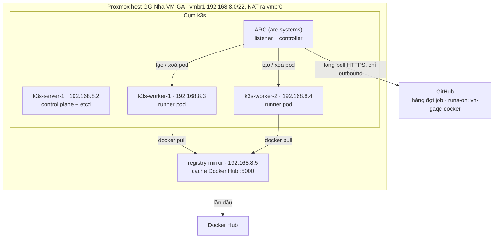

# Self-hosted GitHub Runner autoscale trên Proxmox với k3s + ARC

Oct 22, 2026 · @Y Nguyen

Guide này dành cho host Proxmox `GG-Nha-VM-GA` (đơn node, PVE 9.2) và các workflow đang chạy `runs-on: vn-gaqc-docker`. Mọi giá trị cụ thể nằm trong [`scripts/k3s-plan.env.example`](../scripts/k3s-plan.env.example). Nếu dùng cho host khác: sửa file đó, chạy lại [`scripts/pve-discovery.sh`](../scripts/pve-discovery.sh), rồi thay các giá trị tương ứng trong lệnh.

## Tổng quan

Cụm k3s gồm 1 server và 2 worker VM, chạy Actions Runner Controller (ARC). Mỗi job GitHub chạy trong một pod riêng. Pod được tạo khi có job và xoá ngay khi job xong, nên số pod tự scale từ 0 lên `maxRunners`. Lúc đầu đặt `maxRunners: 8`, vì CPU host đang bận 73–89%. Sau khi gỡ các runner LXC cũ thì tăng dần, mục tiêu là 100.



Luồng một job:

1. Job có `runs-on: vn-gaqc-docker` vào hàng đợi trên GitHub.
2. Listener của ARC long-poll GitHub (chỉ cần HTTPS outbound, không webhook, không mở port) và thấy có job.
3. Controller tạo 1 pod (runner + Docker riêng) với JIT config. Pod này chỉ nhận đúng 1 job.
4. Job xong thì pod bị xoá. Hết job thì còn 0 pod.

| Mục | Giá trị |
| --- | --- |
| Mạng | `vmbr1` `192.168.8.0/22`, gateway và NAT là chính host (`192.168.8.1`) |
| DHCP trên vmbr1 | `dhcpd` của host cấp `192.168.8.10`–`192.168.11.254`, nên IP tĩnh của cụm dùng `.2`–`.9` |
| k3s server | `k3s-server-1`, VMID 201, `192.168.8.2`, 2 vCPU / 4 GiB / 30 GB |
| k3s worker | `k3s-worker-1..2`, VMID 211–212, `192.168.8.3`–`.4`, 8 vCPU / 16 GiB / 100 GB |
| Registry mirror | `registry-mirror`, VMID 220, `192.168.8.5`, 2 vCPU / 4 GiB / 50 GB |
| IP dự phòng | `192.168.8.6`–`.9` (thêm worker, server HA) |
| Template, storage | VMID 9000 `ubuntu-2404-k3s-tpl`, `local-lvm2` (LVM thick) |
| Scale set (= `runs-on`) | `vn-gaqc-docker`, trùng label của runner LXC cũ nên workflow không phải sửa |
| Nơi chạy lệnh | `qm`, `pct`, `ssh`: **Proxmox Shell** trên web UI. `kubectl`, `helm`: trên **`k3s-server-1`** (`ssh ubuntu@192.168.8.2`) |

## Vì sao runner cũ chết giữa chừng và cụm mới tránh thế nào

| Nguyên nhân thường gặp | Cách cụm mới xử lý |
| --- | --- |
| Hết RAM (container hoặc cả host), kernel kill process | Mỗi pod có request/limit RAM; kubelet giữ RAM dự phòng và có ngưỡng eviction; VM tắt balloon |
| Nhiều job dùng chung `docker.sock` của host: `docker system prune`, `docker rm -f` hoặc trùng tên làm chết job khác | Mỗi pod có Docker daemon riêng (dind sidecar) |
| Disk đầy do runner dùng lại, rác tích luỹ | Pod dùng một lần rồi xoá; `emptyDir` có `sizeLimit`; kubelet tự dọn image |
| Runner tự update, container restart; registration token hết hạn; trùng tên runner | Pin version runner image; dùng JIT config một lần, tên runner do ARC sinh |
| Script scale-down hoặc `restart: always` kill container đang chạy job | ARC không bao giờ xoá runner đang bận |
| Host reboot tự động, backup làm VM đứng | Tắt auto-reboot (bước 2); worker không nằm trong backup |
| Thiếu `inotify`/`nofile`, MTU sai | Tăng sysctl (bước 2); MSS clamp trên host (phần Mạng) |

## Sizing

| VM | Số lượng | vCPU | RAM | Disk |
| --- | --- | --- | --- | --- |
| `k3s-server-1` | 1 | 2 | 4 GiB | 30 GB |
| `k3s-worker` | 2 | 8 | 16 GiB | 100 GB |
| `registry-mirror` | 1 | 2 | 4 GiB | 50 GB |
| **Tổng** | **4** | **20** | **40 GiB** | **280 GB** (`local-lvm2` còn 348 GB) |

Request/limit của mỗi runner pod:

| Container | CPU request | RAM request | RAM limit | Ephemeral storage |
| --- | --- | --- | --- | --- |
| `runner` | 250m | 512Mi | 2Gi | 2Gi |
| `dind` | 250m | 512Mi | 2Gi | 4Gi |
| **Tổng** | **500m** | **1Gi** | **4Gi** | **6Gi** |

- **Không đặt CPU limit**, để tránh throttling. **Có đặt RAM limit**, để một job dùng quá RAM chỉ làm chết chính nó.
- Sau khoảng 1 tuần chạy thật, đặt request bằng mức dùng p90, xem bằng `kubectl top pod -n arc-runners --containers`.
- Công thức ước lượng: `maxRunners ≈ min( (tổng RAM allocatable − 2 GiB) / 1 GiB , (tổng CPU allocatable − 1) / 0,5 )`. Mỗi worker có allocatable khoảng vCPU − 1 và RAM − 2,5 GiB. Theo công thức, 2 worker chứa được khoảng 20 runner.
- Giới hạn thật là CPU host, chỉ còn khoảng 4–9 thread rảnh, nên bắt đầu với `maxRunners: 8`. Sau khi gỡ LXC thì chạy lại `pve-discovery.sh`, script sẽ gợi ý con số mới.

## Mạng (vmbr1)

Mỗi VM chỉ tốn 1 IP trên `vmbr1`, tức 0 IP của LAN công ty, dù chạy bao nhiêu runner. Các dải nội bộ không đụng tới LAN:

| Dải | Dùng cho |
| --- | --- |
| `10.42.0.0/16` | Pod (flannel; mỗi node một `/24`) |
| `10.43.0.0/16` | Service Kubernetes |
| `172.17.0.0/16` | Container của job, riêng trong từng pod dind |

Ba dải này không được trùng với mạng mà job cần truy cập (LAN, VPN). Nếu trùng, đặt `cluster-cidr`/`service-cidr` khác trong config server **trước khi** cài k3s, vì sau khi cài không đổi được. Discovery đã xác nhận hiện không có dải nào bị trùng.

**IP tĩnh phải nằm ngoài dải DHCP** (`192.168.8.10`–`192.168.11.254`). Nếu nằm trong dải, DHCP có thể cấp trùng IP cho VM khác, nhất là lúc VM của cụm đang tắt. Cả hai script đều báo FAIL khi IP nằm trong dải DHCP.

### NAT và MSS clamp

Khối `vmbr1` trong `/etc/network/interfaces`. Các dòng `-C ... || -A ...` chỉ thêm rule khi rule chưa có, nên dù reload nhiều lần cũng không bị trùng:

```
auto vmbr1
iface vmbr1 inet static
        address 192.168.8.1/22
        bridge-ports none
        bridge-stp off
        bridge-fd 0
        post-up echo 1 > /proc/sys/net/ipv4/ip_forward
        post-up iptables -t nat -C POSTROUTING -s '192.168.8.0/22' -o vmbr0 -j MASQUERADE 2>/dev/null || iptables -t nat -A POSTROUTING -s '192.168.8.0/22' -o vmbr0 -j MASQUERADE
        post-down iptables -t nat -D POSTROUTING -s '192.168.8.0/22' -o vmbr0 -j MASQUERADE
        post-up iptables -t mangle -C FORWARD -s 192.168.8.0/22 -o vmbr0 -p tcp --tcp-flags SYN,RST SYN -j TCPMSS --set-mss 1440 2>/dev/null || iptables -t mangle -A FORWARD -s 192.168.8.0/22 -o vmbr0 -p tcp --tcp-flags SYN,RST SYN -j TCPMSS --set-mss 1440
        post-down iptables -t mangle -D FORWARD -s 192.168.8.0/22 -o vmbr0 -p tcp --tcp-flags SYN,RST SYN -j TCPMSS --set-mss 1440
```

Trên `vmbr1` đang có VM khác chạy. Vì vậy sau khi sửa file, **đừng chạy `ifreload -a` hay bấm Apply Configuration**: file chỉ cần có hiệu lực từ lần boot sau. Để rule có hiệu lực ngay, chạy:

```bash
iptables -t mangle -C FORWARD -s 192.168.8.0/22 -o vmbr0 -p tcp --tcp-flags SYN,RST SYN -j TCPMSS --set-mss 1440 2>/dev/null \
  || iptables -t mangle -A FORWARD -s 192.168.8.0/22 -o vmbr0 -p tcp --tcp-flags SYN,RST SYN -j TCPMSS --set-mss 1440
iptables -t mangle -S FORWARD | grep TCPMSS
```

Lý do cần MSS clamp: đường ra Internet của host chỉ nhận gói tối đa 1480 byte, còn VM gửi gói 1500. Nếu ICMP bị chặn ở đâu đó, các lệnh `git clone`, `docker pull`, `npm install` sẽ treo giữa chừng. Rule trên đặt MSS = 1440 (tức 1480 − 40) trong gói SYN, chỉ cho traffic từ `192.168.8.0/22` đi ra `vmbr0`.

### Làm việc từ Proxmox Shell

Proxmox host là gateway của `vmbr1`, nên từ Proxmox Shell SSH thẳng được vào `192.168.8.x`. Tạo key một lần trên host. Public key này sẽ được cài vào user `ubuntu` của mọi VM:

```bash
ls /root/.ssh/id_ed25519.pub 2>/dev/null || ssh-keygen -t ed25519 -f /root/.ssh/id_ed25519 -N '' -C 'proxmox-k3s-admin'
```

Nếu SSH hỏng (đặt nhầm IP, firewall chặn), vào Console noVNC của VM bằng mật khẩu `CI_PASSWORD` (bước 1.2).

## Bước 0 – Discovery

[`scripts/pve-discovery.sh`](../scripts/pve-discovery.sh) chỉ đọc, không thay đổi gì trên host. Nó kiểm tra CPU/RAM còn trống, storage, bridge/NAT/DHCP/MTU, IP và VMID dự kiến, backup job, kết nối tới GitHub/Docker Hub, rồi gợi ý `maxRunners`.

```bash
# Trong Proxmox Shell: mở nano, dán nội dung file tương ứng trong repo, lưu lại
nano /root/k3s-plan.env        # nội dung: scripts/k3s-plan.env.example
nano /root/pve-discovery.sh    # nội dung: scripts/pve-discovery.sh

set -a; source /root/k3s-plan.env; set +a     # biến tồn tại tới khi đóng Shell
bash /root/pve-discovery.sh
```

Sửa hết các mục `FAIL` rồi mới sang bước 1. Kết quả ngày 2026-10-22 là 0 FAIL. Các cảnh báo còn lại (CPU bận, RAM cấp phát gấp 3,6 lần RAM vật lý, LVM thick, có DHCP) đều đã được tính vào kế hoạch.

Script chạy trong subshell, nên dán thẳng nội dung vào terminal cũng không làm thoát phiên. Các biến khác (ví dụ `CPU_SAMPLE_SEC`, `SCAN`) được mô tả ở đầu script.

## Bước 1 – Tạo VM

### 1.1 Chuẩn bị một lần

- **Snippets:** vào Datacenter → Storage → `local` → Edit → Content, tick thêm **Snippets** (giữ nguyên các mục đang có). Snippet là file cloud-init giúp VM tự cài `qemu-guest-agent`, `curl`, `chrony` ở lần boot đầu.
- **SSH key** và **NAT + MSS clamp:** xem phần Mạng.
- Discovery báo 0 FAIL.

### 1.2 Chạy `scripts/pve-create-vms.sh`

Script làm các việc sau:

1. Ghi snippet.
2. Tải cloud image Ubuntu 24.04 và kiểm tra SHA256.
3. Tạo template 9000.
4. Clone 4 VM.
5. Chờ từng VM lên SSH, chạy xong cloud-init, có guest agent và ra được github.com.

Trước khi tạo, script kiểm tra lại VMID, IP (ping/ARP, config của VM khác, dải DHCP) và dung lượng storage. Script không sửa hay xoá VM nào đang có. VM nào của kế hoạch đã tồn tại thì bỏ qua, nên lỗi giữa chừng thì cứ chạy lại.

```bash
nano /root/pve-create-vms.sh          # nội dung: scripts/pve-create-vms.sh
set -a; source /root/k3s-plan.env; set +a

DRY_RUN=1 bash /root/pve-create-vms.sh   # chỉ kiểm tra và in lệnh sẽ chạy

# Chạy thật: nhập mật khẩu console (ẩn, không lưu vào lịch sử shell), gõ YES khi được hỏi
read -rsp 'Mật khẩu console cho user ubuntu: ' CI_PASSWORD; echo; export CI_PASSWORD
bash /root/pve-create-vms.sh
unset CI_PASSWORD
```

`CI_PASSWORD` là mật khẩu của user `ubuntu` trong VM. Nó chỉ dùng được ở Console noVNC hoặc `qm terminal`, vì cloud image đã tắt đăng nhập SSH bằng mật khẩu. Proxmox lưu bản đã hash. Đừng ghi mật khẩu này vào `k3s-plan.env` hay bất kỳ file nào trong repo.

### 1.3 Vì sao cấu hình như vậy

| Thiết lập | Lý do |
| --- | --- |
| `--balloon 0` | Kubernetes lập lịch theo RAM cố định; nếu balloon thu hồi RAM, pod sẽ bị OOM giữa job |
| `--cpu host`, `virtio-scsi-single` + `iothread` | Build nhanh hơn, ít nghẽn I/O khi nhiều pod cùng pull image |
| `--full 1`, `--onboot 1`, `--startup order` | Node k3s không phụ thuộc vào template; host reboot thì cụm tự lên lại, server lên trước |
| Không đưa vào backup | Vzdump dạng snapshot/suspend làm VM đứng, runner mất kết nối. Khi tạo backup job, exclude 211, 212, 220. Server 201 đã có snapshot etcd 12 giờ/lần trong `/var/lib/rancher/k3s/server/db/snapshots` |
| Firewall (nếu bật ở cấp VM) | Chỉ cần mở trong `192.168.8.0/22`: TCP 22, 6443, 10250, 5000 (mirror), và 2379–2380 khi có nhiều server. Outbound cần HTTPS tới `github.com`, `*.actions.githubusercontent.com`, `ghcr.io`, `pkg-containers.githubusercontent.com` |

## Bước 2 – Chuẩn bị OS các node k3s

Bước này tăng giới hạn inotify/file và chặn auto-reboot trên server và 2 worker. VM mirror không cần bước này. Script nằm ở [`scripts/node-prep.sh`](../scripts/node-prep.sh); tải về Proxmox host cùng chỗ với các script khác (ví dụ `/root/selfhost-auto-scale/`), rồi chạy cho từng node:

```bash
for ip in 192.168.8.2 192.168.8.3 192.168.8.4; do
  ssh -o StrictHostKeyChecking=accept-new ubuntu@$ip 'bash -s' < node-prep.sh
done
# Worker mong đợi: cpu=8 mem=15G disk~97G, swap: off
```

## Bước 3 – Cài k3s

### 3.1 Token và version (Proxmox Shell)

```bash
# Token của cụm: lưu trên host để các phiên Shell sau dùng lại, và cất thêm một bản vào password manager
[ -f /root/k3s-token ] || (umask 077; openssl rand -hex 32 > /root/k3s-token)
export K3S_TOKEN=$(cat /root/k3s-token)

curl -sI https://update.k3s.io/v1-release/channels/stable | grep -i '^location'   # -> .../tag/v1.xx.y+k3s1
export K3S_VERSION='v1.xx.y+k3s1'   # pin bản vừa thấy, ghi lại vào /root/k3s-plan.env
```

### 3.2 Server

```bash
ssh ubuntu@192.168.8.2 "sudo mkdir -p /etc/rancher/k3s && sudo tee /etc/rancher/k3s/config.yaml >/dev/null" <<EOF
cluster-init: true                 # embedded etcd, sau này thêm server HA được
token: "${K3S_TOKEN}"
tls-san:
  - 192.168.8.2
disable:
  - traefik
  - servicelb
flannel-backend: host-gw           # mọi node cùng L2 trên vmbr1: không encapsulation
node-taint:
  - "CriticalAddonsOnly=true:NoExecute"   # runner không chạy trên server
kubelet-arg:
  - "system-reserved=cpu=500m,memory=1Gi"
  - "kube-reserved=cpu=500m,memory=1Gi"
etcd-snapshot-schedule-cron: "0 */12 * * *"
etcd-snapshot-retention: 10
EOF

ssh ubuntu@192.168.8.2 "curl -sfL https://get.k3s.io | sudo INSTALL_K3S_VERSION='${K3S_VERSION}' sh -s - server"
ssh ubuntu@192.168.8.2 "sudo k3s kubectl get nodes"
```

`flannel-backend` phải chọn trước khi cài, vì đổi sau rất phức tạp.

### 3.3 Worker

```bash
for ip in 192.168.8.3 192.168.8.4; do
  ssh ubuntu@$ip "sudo mkdir -p /etc/rancher/k3s && sudo tee /etc/rancher/k3s/config.yaml >/dev/null" <<EOF
server: "https://192.168.8.2:6443"
token: "${K3S_TOKEN}"
node-label:
  - "gha-runner=true"
kubelet-arg:
  - "system-reserved=cpu=500m,memory=1Gi,ephemeral-storage=10Gi"
  - "kube-reserved=cpu=500m,memory=1Gi,ephemeral-storage=5Gi"
  - "eviction-hard=memory.available<500Mi,nodefs.available<10%,nodefs.inodesFree<5%,imagefs.available<10%"
  - "max-pods=110"
  - "image-gc-high-threshold=75"
  - "image-gc-low-threshold=60"
EOF
  ssh ubuntu@$ip "curl -sfL https://get.k3s.io | sudo INSTALL_K3S_VERSION='${K3S_VERSION}' sh -s - agent"
done
```

Phần reserved giữ 1 vCPU và 2 GiB cho OS và k3s, nên node đầy thì kubelet vẫn sống. `eviction-hard` phải ghi đủ cả 4 ngưỡng, nếu bỏ một ngưỡng thì ngưỡng đó có thể mất giá trị mặc định.

### 3.4 kubectl và helm (trên k3s-server-1)

```bash
ssh ubuntu@192.168.8.2
```

```bash
# Trong k3s-server-1, chạy một lần
mkdir -p ~/.kube
sudo cp /etc/rancher/k3s/k3s.yaml ~/.kube/config
sudo chown "$(id -u):$(id -g)" ~/.kube/config && chmod 600 ~/.kube/config
echo 'export KUBECONFIG=~/.kube/config' >> ~/.bashrc && export KUBECONFIG=~/.kube/config
curl -fsSL https://raw.githubusercontent.com/helm/helm/main/scripts/get-helm-3 | bash
sudo apt-get install -y jq

kubectl get nodes -o wide                                    # 3 node Ready
kubectl describe node k3s-worker-1 | grep -A7 '^Allocatable'  # cpu ~7, memory ~13.5 GiB, pods 110
kubectl run nettest --rm -it --restart=Never --image=busybox:1.36 -- \
  sh -c 'nslookup github.com && wget -qO- https://api.github.com/zen'
```

Các file values ở bước 6–7 nằm trong thư mục home trên server. Sau khi sửa, copy nội dung về repo này để lưu vào git.

## Bước 4 – Registry mirror

Khi nhiều runner cùng ra Internet qua một IP NAT, Docker Hub sẽ giới hạn số lượt pull ([pull limits](https://docs.docker.com/docker-hub/usage/pulls/)) và job lỗi với `toomanyrequests`. Mirror giúp mỗi image chỉ phải kéo từ Docker Hub một lần.

### 4.1 Dựng mirror

```bash
ssh ubuntu@192.168.8.5
```

```bash
# Trong registry-mirror
curl -fsSL https://get.docker.com | sudo sh
sudo mkdir -p /opt/mirror /srv/registry && cd /opt/mirror

# Dùng account Docker Hub (kể cả free) + Personal Access Token để được hạn mức cao hơn so với ẩn danh
sudo tee config.yml >/dev/null <<'EOF'
version: 0.1
log:
  level: info
storage:
  filesystem:
    rootdirectory: /var/lib/registry
  delete:
    enabled: true
http:
  addr: :5000
proxy:
  remoteurl: https://registry-1.docker.io
  username: <DOCKERHUB_USER>
  password: <DOCKERHUB_TOKEN>
  ttl: 168h
EOF
sudo chmod 600 config.yml

sudo tee compose.yaml >/dev/null <<'EOF'
services:
  registry:
    image: registry:3
    restart: unless-stopped
    ports:
      - "5000:5000"
    volumes:
      - ./config.yml:/etc/distribution/config.yml:ro
      - /srv/registry:/var/lib/registry
EOF
sudo docker compose up -d
```

Mỗi instance chỉ proxy được một upstream. Muốn cache thêm `ghcr.io`, chạy thêm một instance ở port khác. Đừng NAT hay port-forward port 5000 ra ngoài `vmbr1`: mirror không có xác thực và đang dùng token Docker Hub của bạn.

### 4.2 Cho containerd của k3s dùng mirror (Proxmox Shell)

```bash
for ip in 192.168.8.2 192.168.8.3 192.168.8.4; do
  ssh ubuntu@$ip "sudo tee /etc/rancher/k3s/registries.yaml >/dev/null" <<'EOF'
mirrors:
  docker.io:
    endpoint:
      - "http://192.168.8.5:5000"
EOF
done
ssh ubuntu@192.168.8.2 'sudo systemctl restart k3s'
for ip in 192.168.8.3 192.168.8.4; do ssh ubuntu@$ip 'sudo systemctl restart k3s-agent'; done

# Kiểm tra
ssh ubuntu@192.168.8.3 'sudo k3s crictl pull docker.io/library/alpine:3.20'
curl -s http://192.168.8.5:5000/v2/_catalog      # {"repositories":["library/alpine"]}
```

Docker bên trong runner pod được trỏ vào mirror qua `--registry-mirror` ở bước 7. Nếu mirror chết, cả containerd lẫn dockerd tự quay về kéo thẳng từ Docker Hub.

## Bước 5 – GitHub App, runner group, secret

ARC xác thực với GitHub bằng một GitHub App thuộc org. App không gắn với tài khoản cá nhân, và private key của nó không hết hạn.

### 5.1 Tạo GitHub App

Org đã có App `gravityactionvn`. Làm theo [docs/github-app.md, mục "Dùng App có sẵn"](github-app.md#dùng-app-có-sẵn-gravityactionvn) để lấy App ID, Installation ID và tạo thêm một private key riêng cho ARC. Việc này không đụng tới key đang có hay Client secret.

### 5.2 Runner group

Mở Org → Settings → Actions → Runner groups và xem các runner LXC `vn-gaqc-docker` hiện tại đang thuộc group nào, được dùng cho những repo nào. Scale set mới phải nằm trong group cho phép **đúng các repo đó**, nếu không job sẽ đứng mãi ở "Waiting for a runner".

- Runner cũ đang ở group `Default`: bỏ dòng `runnerGroup` trong values ở bước 7.
- Muốn dùng group riêng: tạo group `proxmox`, chỉ chọn các repo nội bộ, và **không** tick "Allow public repositories". Lý do: dind chạy privileged, PR từ fork có thể chiếm quyền node.

### 5.3 Secret (trên k3s-server-1)

Tạo secret `github-app` trong namespace `arc-runners` theo [docs/github-app.md, mục "Dùng trong project này"](github-app.md#dùng-trong-project-này).

**Phương án dự phòng: PAT.** Nếu chưa tạo được App, có thể dùng fine-grained PAT với Resource owner là org và quyền `Self-hosted runners` = Read and write. Nếu org không cho dùng fine-grained PAT thì dùng classic PAT với scope `admin:org`. Nên tạo PAT bằng tài khoản bot và ghi lại ngày hết hạn.

```bash
kubectl create namespace arc-systems
kubectl create namespace arc-runners
read -rsp 'GitHub token: ' GH_TOKEN; echo
kubectl create secret generic github-token -n arc-runners --from-literal=github_token="$GH_TOKEN"
unset GH_TOKEN
```

Khi dùng PAT, đặt `githubConfigSecret: github-token` ở bước 7.

## Bước 6 – ARC controller (trên k3s-server-1)

Chỉ dùng ARC bản GitHub hỗ trợ (chart `gha-runner-scale-set*`, CRD `actions.github.com`). Bản mới nhất lúc viết là [0.15.0](https://github.blog/changelog/2026-09-30-actions-runner-controller-release-0-15-0/). Kiểm tra trang [releases](https://github.com/actions/actions-runner-controller/releases) và pin cùng một version cho cả hai chart.

`~/controller-values.yaml`:

```yaml
replicaCount: 1
resources:
  requests: { cpu: 100m, memory: 256Mi }
  limits: { memory: 1Gi }
flags:
  logLevel: "info"
metrics:                      # Prometheus metrics cho controller và listener
  controllerManagerAddr: ":8080"
  listenerAddr: ":8080"
  listenerEndpoint: "/metrics"
# Chạy trên k3s-server-1: worker có job privileged, không để credential GitHub nằm ở đó
nodeSelector:
  node-role.kubernetes.io/control-plane: "true"
tolerations:
  - key: CriticalAddonsOnly
    operator: Exists
```

```bash
export ARC_VERSION=0.15.0
helm install arc --namespace arc-systems -f ~/controller-values.yaml --version "${ARC_VERSION}" \
  oci://ghcr.io/actions/actions-runner-controller-charts/gha-runner-scale-set-controller

kubectl get pods -n arc-systems -o wide    # arc-gha-rs-controller-... Running, cột NODE = k3s-server-1
kubectl get crd | grep actions.github.com  # 4 CRD
```

Tên release `arc` sinh ra ServiceAccount `arc-gha-rs-controller`, tên này được dùng ở bước 7.

**Vì sao controller và listener chạy trên server:** hai pod này đọc secret chứa private key của GitHub App. Runner pod chạy dind privileged, nên code của job gần như có quyền root trên worker. Nếu controller hoặc listener chạy chung node với runner, một job xấu có thể đọc được key. `k3s-server-1` đã có taint `CriticalAddonsOnly`, nên runner không bao giờ được xếp lên đó. App `gravityactionvn` có quyền rộng (code, admin, workflows trên mọi repo), nên điểm này đặc biệt quan trọng.

## Bước 7 – Runner scale set (trên k3s-server-1)

`~/runner-values.yaml`. Template dind được viết tay, không dùng `containerMode.type: dind`, để chỉnh được resources, mirror và storage:

```yaml
githubConfigUrl: "https://github.com/Gravity-Global"
githubConfigSecret: github-app       # hoặc github-token nếu dùng PAT (bước 5.3)

runnerScaleSetName: "vn-gaqc-docker"   # = runs-on của workflow
runnerGroup: "proxmox"                 # bỏ dòng này nếu dùng group Default (bước 5.2)

minRunners: 0
maxRunners: 8                          # tăng dần sau khi gỡ runner LXC cũ

controllerServiceAccount:
  namespace: arc-systems
  name: arc-gha-rs-controller

# Listener giữ credential GitHub: chạy trên k3s-server-1, không chạy chung node với job privileged
listenerTemplate:
  spec:
    nodeSelector:
      node-role.kubernetes.io/control-plane: "true"
    tolerations:
      - key: CriticalAddonsOnly
        operator: Exists
    containers:
      - name: listener          # bắt buộc đúng tên này; các trường khác ARC giữ mặc định

template:
  spec:
    nodeSelector:
      gha-runner: "true"
    topologySpreadConstraints:         # rải đều runner sang các worker
      - maxSkew: 2
        topologyKey: kubernetes.io/hostname
        whenUnsatisfiable: ScheduleAnyway
        labelSelector:
          matchLabels:
            actions.github.com/scale-set-name: vn-gaqc-docker   # luôn trùng runnerScaleSetName

    initContainers:
      - name: init-dind-externals
        image: ghcr.io/actions/actions-runner:<RUNNER_VERSION>
        command: ["cp", "-r", "/home/runner/externals/.", "/home/runner/tmpDir/"]
        volumeMounts:
          - name: dind-externals
            mountPath: /home/runner/tmpDir

      # Docker daemon riêng của pod, chạy dạng native sidecar
      - name: dind
        image: docker:dind            # nên pin major, ví dụ docker:<major>-dind
        restartPolicy: Always
        args:
          - dockerd
          - --host=unix:///var/run/docker.sock
          - --group=$(DOCKER_GROUP_GID)
          - --registry-mirror=http://192.168.8.5:5000
          - --insecure-registry=192.168.8.5:5000
        env:
          - name: DOCKER_GROUP_GID
            value: "123"
        securityContext:
          privileged: true
        startupProbe:
          exec:
            command: ["docker", "info"]
          failureThreshold: 24
          periodSeconds: 5
        resources:
          requests: { cpu: 250m, memory: 512Mi, ephemeral-storage: 4Gi }
          limits: { memory: 2Gi }
        volumeMounts:
          - name: work
            mountPath: /home/runner/_work
          - name: dind-sock
            mountPath: /var/run
          - name: dind-externals
            mountPath: /home/runner/externals
          - name: dind-storage
            mountPath: /var/lib/docker

    containers:
      - name: runner
        image: ghcr.io/actions/actions-runner:<RUNNER_VERSION>
        imagePullPolicy: IfNotPresent
        command: ["/home/runner/run.sh"]
        env:
          - name: DOCKER_HOST
            value: unix:///var/run/docker.sock
          - name: RUNNER_WAIT_FOR_DOCKER_IN_SECONDS
            value: "120"
        resources:
          requests: { cpu: 250m, memory: 512Mi, ephemeral-storage: 2Gi }
          limits: { memory: 2Gi }
        volumeMounts:
          - name: work
            mountPath: /home/runner/_work
          - name: dind-sock
            mountPath: /var/run

    volumes:
      - name: work
        emptyDir: { sizeLimit: 10Gi }
      - name: dind-sock
        emptyDir: {}
      - name: dind-externals
        emptyDir: {}
      - name: dind-storage
        emptyDir: { sizeLimit: 20Gi }
```

| Thiết lập | Vai trò |
| --- | --- |
| dind sidecar `restartPolicy: Always` | Mỗi pod có Docker riêng; sidecar tắt theo runner, nên pod kết thúc sạch |
| `dind-storage` tại `/var/lib/docker` | Docker dùng được `overlay2` trên disk của node. Thiếu mount này, Docker rơi về `vfs`, rất chậm và nhanh đầy disk |
| `sizeLimit` | Job ghi quá giới hạn thì chỉ pod đó bị evict, node vẫn an toàn |
| `--registry-mirror` | `docker pull` trong job đi qua mirror ở bước 4 |
| `RUNNER_WAIT_FOR_DOCKER_IN_SECONDS` | Runner chờ dockerd sẵn sàng rồi mới nhận job |
| Không có `--mtu` | Không cần, vì MSS clamp trên host đã xử lý MTU 1480 |

```bash
# Trên k3s-server-1: pin bản runner mới nhất
export RUNNER_VERSION=$(curl -s https://api.github.com/repos/actions/runner/releases/latest \
  | sed -n 's/.*"tag_name": *"v\([^"]*\)".*/\1/p')
echo "$RUNNER_VERSION"
sed -i.bak "s/<RUNNER_VERSION>/${RUNNER_VERSION}/g" ~/runner-values.yaml
```

```bash
# Trong Proxmox Shell: kéo sẵn image lên các worker
RUNNER_VERSION='<giá trị vừa in>'
for ip in 192.168.8.3 192.168.8.4; do
  ssh ubuntu@$ip "sudo k3s crictl pull ghcr.io/actions/actions-runner:${RUNNER_VERSION} && sudo k3s crictl pull docker.io/library/docker:dind"
done
```

```bash
# Trên k3s-server-1. Dừng LXC runner TRƯỚC khi cài (phần Chuyển đổi). Tên release = runnerScaleSetName
helm install vn-gaqc-docker --namespace arc-runners -f ~/runner-values.yaml --version "${ARC_VERSION}" \
  oci://ghcr.io/actions/actions-runner-controller-charts/gha-runner-scale-set

kubectl get autoscalingrunnerset -n arc-runners    # MIN 0, MAX 8, CURRENT 0
kubectl get pods -n arc-systems -o wide             # có thêm pod ...-listener Running trên k3s-server-1
```

Trên GitHub (Org → Settings → Actions → Runners), scale set sẽ hiện ra với 0 runner. Nếu listener báo `401`/`403`/`404`, xem bảng lỗi trong [docs/github-app.md](github-app.md#xử-lý-lỗi).

## Bước 8 – Load test

Runner image `actions-runner` rất tối giản và có thể thiếu tool mà LXC cũ có sẵn. Job cần tool nào thì dùng action `setup-*`, chạy job trong `container:`, hoặc build image riêng `FROM ghcr.io/actions/actions-runner:<RUNNER_VERSION>`.

Chạy test sau khi đã dừng LXC runner, để chắc chắn job chạy trên cụm mới. Số job nên test vào khoảng 2 × `maxRunners`. Tạo `.github/workflows/arc-load-test.yml` trong một repo thuộc runner group:

```yaml
name: arc-load-test
on:
  workflow_dispatch:
    inputs:
      sleep:
        description: "Giây giữ mỗi job"
        default: "60"
jobs:
  load:
    runs-on: vn-gaqc-docker
    timeout-minutes: 15
    strategy:
      fail-fast: false
      matrix:
        a: [0, 1, 2, 3]
        b: [0, 1, 2, 3]
    steps:
      - run: echo "job ${{ matrix.a }}${{ matrix.b }} on $(hostname), $(nproc) cpu"
      - run: docker run --rm alpine:3.20 sh -c 'wget -qO- https://api.github.com/zen'
      - run: sleep ${{ inputs.sleep }}
```

Theo dõi trên `k3s-server-1`:

```bash
watch -n2 'kubectl get autoscalingrunnerset -n arc-runners; kubectl get pods -n arc-runners -o wide --no-headers | awk "{print \$3, \$7}" | sort | uniq -c; kubectl top nodes'
```

Tiêu chí đạt:

- [ ] Trong 1–2 phút có 8 pod Running, rải đều 2 worker. 8 job còn lại chờ rồi lần lượt được nhận.
- [ ] 16/16 job xanh, không có `toomanyrequests`.
- [ ] `kubectl get events -n arc-runners | grep -E 'OOMKilled|Evicted'` không trả về gì.
- [ ] Xong hết thì về 0 pod.
- [ ] Mỗi lần tăng `maxRunners` thì test lại, và xem CPU host ở Node → Summary.

## Chuyển đổi từ runner LXC cũ

Các runner LXC `github-runner-*` cũ đang phục vụ `vn-gaqc-docker`. Container 111–135 đã xoá; 100–110 vẫn chạy để CI không gián đoạn trong lúc dựng cụm. Scale set mới dùng đúng tên `vn-gaqc-docker`, nên **dừng LXC trước khi cài scale set**. Như vậy không có lúc nào hai bên cùng nhận job.

### Thứ tự

1. Làm bước 1–6 (VM, k3s, mirror, GitHub App, ARC controller). Trong lúc này, LXC vẫn chạy CI bình thường.
2. Chọn lúc không có job đang chạy, rồi dừng LXC (chưa xoá):

    ```bash
    # Proxmox Shell
    pct list | awk 'NR == 1 || $NF ~ /^github-runner-/'
    for id in $(pct list | awk '$NF ~ /^github-runner-/ && $2 == "running" { print $1 }'); do   # còn job? (không in gì = không)
      pct exec "$id" -- pgrep -fa Runner.Worker 2>/dev/null | sed "s/^/$id: /"
    done
    for id in $(pct list | awk '$NF ~ /^github-runner-/ && $2 == "running" { print $1 }'); do pct stop "$id"; done
    ```

3. Cài scale set (bước 7) và chạy load test (bước 8), rồi chạy lại vài workflow thật. Từ lúc dừng LXC tới lúc scale set chạy, job xếp hàng chờ chứ không mất.
4. Nếu job đứng ở "Waiting for a runner" dù scale set đã chạy: xoá các runner cũ đang Offline trên GitHub (Org → Settings → Actions → Runners) và kiểm tra runner group (bước 5.2).

**Quay lại khi có sự cố:** chạy `helm uninstall vn-gaqc-docker -n arc-runners`, rồi `pct start` lại các LXC. Cách này chỉ dùng được khi chưa xoá runner cũ khỏi GitHub.

### Dọn dẹp (sau 1–2 ngày chạy ổn)

1. Xoá các runner cũ đang Offline trên GitHub.
2. Xoá LXC. Thao tác này **không hoàn tác được**, nên xem lại danh sách trước khi chạy:
    ```bash
    pct list | awk 'NR == 1 || $NF ~ /^github-runner-/'
    for id in $(pct list | awk '$NF ~ /^github-runner-/ && $2 == "stopped" { print $1 }'); do
      pct destroy "$id" --purge --destroy-unreferenced-disks 1
    done
    ```
3. Chạy lại `pve-discovery.sh`. CPU host sẽ giảm rõ khi 11 runner này không còn chạy. Tăng `maxRunners` theo gợi ý của script (`helm upgrade`), rồi chạy lại load test.

## Vận hành

Quy tắc chung:

- Không `kubectl drain` hay reboot worker khi trên đó còn runner pod.
- Lưu các file cấu hình vào git: `k3s-plan.env`, các config k3s, values, `registries.yaml`.
- Không lưu token hay mật khẩu.

**Bảo trì 1 worker** (reboot, update kernel, nâng k3s):

```bash
NODE=k3s-worker-1
kubectl cordon "$NODE"
while kubectl get pods -n arc-runners --field-selector spec.nodeName="$NODE" --no-headers 2>/dev/null | grep -q .; do
  echo "$(date +%T) còn runner trên $NODE"; sleep 30
done
kubectl drain "$NODE" --ignore-daemonsets --delete-emptydir-data
# ... bảo trì ...
kubectl uncordon "$NODE"
```

**Dừng nhận job toàn cụm:** chạy `helm upgrade vn-gaqc-docker -n arc-runners --reuse-values --set maxRunners=0 --version "${ARC_VERSION}" oci://ghcr.io/actions/actions-runner-controller-charts/gha-runner-scale-set`. Job đang chạy vẫn chạy cho xong, job mới sẽ xếp hàng. Xong việc thì `helm upgrade` lại với `-f ~/runner-values.yaml`.

**Cập nhật runner image (hàng tháng, bắt buộc):** GitHub ngừng giao job cho runner quá cũ. Từ [ARC 0.14.0](https://github.blog/changelog/2026-03-19-actions-runner-controller-release-0-14-0/), controller còn tắt autoscaling của scale set có runner quá cũ. Các bước:

1. Lấy `RUNNER_VERSION` mới và sửa tag trong `runner-values.yaml`.
2. Kéo sẵn image mới lên các worker.
3. `helm upgrade` với `-f ~/runner-values.yaml`.

Có thể dùng Renovate hoặc Dependabot để theo dõi `ghcr.io/actions/actions-runner`.

**Nâng cấp ARC:**

- **Bản patch:** `helm upgrade` controller trước, rồi đến scale set, dùng cùng version.
- **Bản minor:** Helm không nâng cấp CRD được, nên làm theo thứ tự:
    1. Đặt `maxRunners=0` và chờ về 0 pod.
    2. `helm uninstall vn-gaqc-docker -n arc-runners`.
    3. `helm uninstall arc -n arc-systems`.
    4. Nếu bản mới đổi CRD, chạy `kubectl get crd -o name | grep actions.github.com | xargs kubectl delete`.
    5. Cài lại bước 6, rồi bước 7.

  Trong lúc nâng cấp, job xếp hàng trên GitHub (tối đa 24 giờ).

**Nâng cấp k3s:** nâng từng minor một, không nhảy cóc. Làm server trước, worker sau, và mỗi node đều làm theo quy trình cordon ở trên, rồi chạy lại lệnh cài với `INSTALL_K3S_VERSION` mới. Không dùng system-upgrade-controller kèm drain tự động, vì nó sẽ evict runner đang chạy job.

**Thêm worker:**

1. Thêm VMID và IP dự phòng vào `/root/k3s-plan.env`, ví dụ `WORKER_IDS="211 212 213"`, `WORKER_IPS="192.168.8.3 192.168.8.4 192.168.8.6"`.
2. Chạy `pve-discovery.sh`, rồi `pve-create-vms.sh`. VM đã có sẽ được bỏ qua.
3. Với worker mới, làm lại bước 2, ghi `registries.yaml` (4.2) và cài agent (3.3).

Mỗi worker 8 vCPU / 16 GiB thêm khoảng 12 slot.

## Theo dõi và xử lý sự cố

```bash
# k3s-server-1
kubectl get autoscalingrunnerset,ephemeralrunners -n arc-runners
kubectl top nodes; kubectl top pod -n arc-runners --containers | sort -k4 -h | tail
kubectl get events -n arc-runners --sort-by=.lastTimestamp | tail -30
kubectl logs -n arc-systems -f $(kubectl get pods -n arc-systems -o name | grep listener)   # listener
kubectl logs -n arc-systems -f deploy/arc-gha-rs-controller                                 # controller
kubectl get pod -n arc-runners <pod> -o jsonpath='{range .status.containerStatuses[*]}{.name}{" "}{.lastState.terminated.reason}{"\n"}{end}'

# Proxmox Shell
ssh ubuntu@192.168.8.3 'sudo journalctl -u k3s-agent --since "1 hour ago" | tail -50; sudo dmesg -T | grep -iE "oom|killed process" | tail'
dmesg -T | grep -iE 'oom|killed process' | tail      # host có kill VM vì hết RAM không
```

| Triệu chứng | Nguyên nhân thường gặp | Xử lý |
| --- | --- | --- |
| Job "Waiting for a runner", không có pod | `runs-on` sai tên; repo không thuộc runner group; listener không chạy; runner LXC cũ còn đăng ký trên GitHub | So `runs-on` với `runnerScaleSetName`, xem runner group, log listener; xoá runner cũ Offline trên GitHub |
| Listener `CrashLoopBackOff`, `401`/`403`/`404` | Sai App ID / Installation ID / private key, App thiếu quyền, node lệch giờ; sai `githubConfigUrl` | Bảng lỗi trong [docs/github-app.md](github-app.md#xử-lý-lỗi) |
| Pod `Pending` | Thiếu CPU/RAM/disk trên worker | Giảm `maxRunners` hoặc thêm worker |
| `EphemeralRunner` `Failed` | Pod lỗi khi khởi động | `kubectl describe ephemeralrunner <tên> -n arc-runners`, sửa lỗi rồi xoá nó |
| `OOMKilled` | Job vượt RAM limit 2Gi | Tăng limit hoặc tách scale set riêng cho job nặng |
| Pod `Evicted` vì ephemeral-storage | Vượt `sizeLimit` hoặc disk node đầy | Tăng `sizeLimit` hoặc disk worker |
| `Cannot connect to the Docker daemon` | dind chưa sẵn sàng | `kubectl logs <pod> -c dind`; kiểm tra mount `/var/run` |
| Docker rất chậm, log có `vfs` | Thiếu volume `dind-storage` | Thêm lại volume theo bước 7 |
| `toomanyrequests` | Không đi qua mirror | Kiểm tra args dind, `registries.yaml`, `curl http://192.168.8.5:5000/v2/_catalog` |
| `too many open files` | Giới hạn kernel mặc định | Chạy lại bước 2 |
| `git clone`/`npm install` treo | MTU 1480, mất rule MSS (ví dụ sau reboot host) | `iptables -t mangle -S FORWARD \| grep TCPMSS`; kiểm tra `post-up` trong `/etc/network/interfaces` |
| Nhiều job trên cùng worker chết, `lost communication with the server` | Node hết RAM/disk, VM bị pause, host Proxmox hết RAM | `kubectl describe node` (phần Conditions), Task log của Proxmox, `dmesg` trên host |

Nếu cần dashboard: cài `kube-prometheus-stack` (tốn khoảng 2–3 GiB RAM) và thu metrics ARC ở `:8080/metrics`. Nên cảnh báo khi: `gha_job_startup_duration_seconds` p95 vượt 120 giây, có runner failed, có OOMKilled, hoặc RAM/disk của worker còn dưới 10–20%.

## Checklist

- [ ] `pve-discovery.sh` báo 0 FAIL; SSH key và Snippets đã có; NAT và MSS trên `vmbr1` đang chạy và đã ghi vào `/etc/network/interfaces`
- [ ] `pve-create-vms.sh`: 4 VM lên SSH, xong cloud-init, ra được github.com
- [ ] Bước 2 đã chạy trên 3 node; k3s có 3 node `Ready`; `kubectl`/`helm` chạy được trên server
- [ ] Mirror chạy, `_catalog` có image
- [ ] GitHub App đã tạo và cài vào org (checklist trong `docs/github-app.md`); runner group đúng repo; secret `github-app` đã tạo
- [ ] ARC controller Running
- [ ] Đã dừng LXC runner; scale set `vn-gaqc-docker` chạy; load test và workflow thật xanh
- [ ] Đã dọn dẹp: runner cũ và LXC đã xoá, discovery chạy lại, `maxRunners` đã tăng
- [ ] Có lịch cập nhật runner image hàng tháng; file cấu hình đã commit (không có secret)

## Nguồn

- [GitHub Changelog – ARC 0.15.0](https://github.blog/changelog/2026-09-30-actions-runner-controller-release-0-15-0/)
- [GitHub Changelog – ARC 0.14.0](https://github.blog/changelog/2026-03-19-actions-runner-controller-release-0-14-0/)
- [GitHub Docs – Deploying runner scale sets with ARC](https://docs.github.com/en/actions/tutorials/use-actions-runner-controller/deploy-runner-scale-sets)
- [Docker Hub pull usage and limits](https://docs.docker.com/docker-hub/usage/pulls/)
