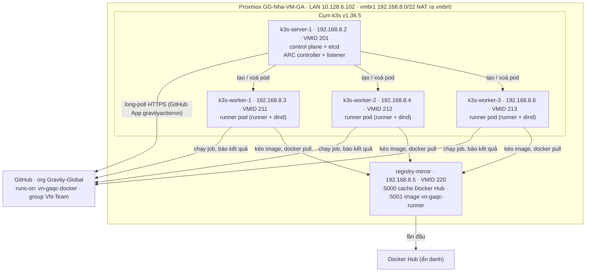

# Self-hosted GitHub Runner autoscale trên Proxmox với k3s + ARC

Cập nhật lần cuối: 2026-10-23 · @Y Nguyen

Tài liệu này có hai phần. Phần đầu là **hồ sơ hiện trạng**: hệ thống đang chạy thế nào, mọi giá trị cụ thể nằm ở đâu, các quyết định đã chốt và các sự cố đã gặp. Phần sau là **hướng dẫn vận hành và dựng lại** từ đầu. Đọc mục 0–5 là đủ để nắm toàn bộ bối cảnh mà không cần lục lại lịch sử chat.

## 0. Nguồn sự thật và quy tắc cập nhật

**Tài liệu này là nguồn bối cảnh duy nhất của hệ thống.** Thông tin nào không có ở đây coi như không ai biết. Khi tài liệu khác với thực tế, phải sửa tài liệu ngay.

**Ký hiệu xác minh** dùng trong mục 1–2:

- ✅ **Đã xác minh**: kèm ngày và cách xác minh (output lệnh, log job).
- ⚠️ **Chưa xác minh**: mới làm theo kế hoạch hoặc suy ra, chưa có output chứng minh.

Giá trị không có ký hiệu lấy từ output thật trong quá trình dựng hệ thống, ở ngày ghi trong mục 1.12.

**Kiểm tra lệch giữa tài liệu và thực tế:** chạy [`scripts/state-check.sh`](../scripts/state-check.sh) trong Proxmox Shell. Script chỉ đọc, không in secret. Nó in hiện trạng của host, các VM, k3s, Helm/ARC, registry và image trên từng worker. Đối chiếu từng dòng với mục 1, chỗ nào khác thì sửa tài liệu (hoặc sửa hệ thống) rồi ghi vào mục 1.12.

**Mỗi khi thay đổi hệ thống, cập nhật trong cùng một commit:**

1. **Bảng hiện trạng** ở mục 1.1–1.11 có liên quan.
2. **Mục 1.12:** thêm một dòng lịch sử, ghi ngày và Helm revision nếu có.
3. **Mục 2:** đánh dấu xong hoặc thêm việc mới.
4. **File cấu hình** trong repo (`k8s/`, `mirror/`, `scripts/k3s-plan.env.example`): phải trùng với bản đang chạy.
5. **Mục 5** nếu gặp lỗi mới: ghi triệu chứng, nguyên nhân và cách xử lý.

Tài liệu và file liên quan:

- [docs/github-app.md](github-app.md): GitHub App `gravityactionvn`, private key, đổi key và các lỗi xác thực.
- [scripts/](../scripts/):
    - `pve-discovery.sh`: kiểm tra host trước khi dựng.
    - `pve-create-vms.sh`: tạo VM.
    - `node-prep.sh`: chuẩn bị OS.
    - `join-worker.sh`: đưa worker vào cụm.
    - `resize-worker.sh`: đổi vCPU, RAM hoặc disk của worker.
    - `state-check.sh`: in hiện trạng thật để đối chiếu với tài liệu.
    - `k3s-plan.env.example`: kế hoạch IP, VMID, cấu hình VM.
- [k8s/](../k8s/): `controller-values.yaml`, `runner-values.yaml`, `runner-sudoers.yaml` (ConfigMap), `registries.yaml` (containerd). Đây là đúng bản đang cài.
- [mirror/](../mirror/): `config.yml` và `compose.yaml` (cache Docker Hub ở cổng 5000, registry nội bộ ở cổng 5001), đúng bản đang chạy.
- [runner-image/](../runner-image/): `Dockerfile` và `build.sh` của image `vn-gaqc-runner`.

---

## 1. Hiện trạng

### 1.1 Tóm tắt

- **Trạng thái:** đang chạy production cho `runs-on: vn-gaqc-docker` từ 2026-10-22 khoảng 15:00 UTC. Đã chạy thật job `SonarQube-Scan` của repo `gg-ai-command-center-app`.
- **Quy mô:** `minRunners: 0`, `maxRunners: 40` (phương án B, 2026-10-23), 3 worker, mỗi pod request 0,7 CPU. Mỗi job chạy trong một pod riêng, xong job thì pod bị xoá. Giới hạn thật là CPU của host, khoảng 15–18 thread cho cụm (mục 1.9).
- **Tương thích với LXC cũ:**
    - 2026-10-22: job chạy bằng root, `sudo` dùng được, có `docker compose`. Các job screenshot, check-console và SonarQube đều chạy được.
    - Lúc đó image chuẩn chưa có browser, nên bước "Install browsers" mất khoảng 6 phút mỗi job.
    - 2026-10-23: đã build image nội bộ `vn-gaqc-runner` có sẵn browser (mục 1.4). `k8s/runner-values.yaml` trong repo đã trỏ tới image này, và lần `helm upgrade` của phương án B dùng file đó. ⚠️ **Chưa xác minh** scale set đang chạy image mới: kiểm tra bằng `state-check.sh` (phần Helm, dòng `image:`) hoặc bằng `google-chrome --version` trong pod (mục 2).
- **Runner LXC cũ:** đã xoá hết (111–135 và 100–110) ngày 2026-10-22. Không còn đường quay lại hệ thống cũ.



### 1.2 Proxmox host

| Mục | Giá trị |
| --- | --- |
| Tên | `GG-Nha-VM-GA`, đơn node (không cluster) |
| Phiên bản | PVE 9.2.21, kernel 7.0.14-12-pve |
| CPU / RAM | Intel Xeon Silver 4109T, 32 thread / 376,5 GiB |
| Tải CPU (2026-10-22) | Bận 73–89% khi còn chạy các LXC runner cũ. Phần lớn đến từ 11 LXC 100–110 và các VM khác |
| Ổ đĩa | `sda`, `sdb` 893,8 GB và `sdc` 3,5 TB (PERC H740P, SSD) |
| Các VM khác trên host | `Maintain-Local` (205, 10 vCPU / 64 GiB, dùng khoảng 9 thread liên tục), `Cullat`, `Cullat6`–`Cullat10` (254–259, mỗi VM 8 vCPU / 16 GiB, tổng dùng khoảng 3 thread) |
| Storage | `local-lvm` (LVM-thin, còn khoảng 40 GB), `local-lvm2` (LVM thick). **Cụm dùng `local-lvm2`**. Dung lượng trống: 348 GB → 1762 GB sau khi xoá LXC 111–135 → 2392 GB sau khi xoá LXC 100–110 (22/10). Sau đó phương án B lấy thêm khoảng 400 GB (VM 213, disk 150 GB; 211/212 nâng lên 150 GB), nên ước tính còn khoảng 2000 GB. ⚠️ Số mới nhất xem bằng `state-check.sh` |
| Storage `local` | `/var/lib/vz`, đã bật content **Snippets** |
| `vmbr0` | LAN `10.128.6.102/24`, gateway `10.128.6.1`, chạy trên `bond0` (LACP `ens1f0np0` + `ens1f1np1`) |
| `vmbr1` | `192.168.8.1/22`, không gắn card vật lý, NAT ra `vmbr0` (MASQUERADE) |
| DHCP trên `vmbr1` | `dhcpd` (ISC) chạy trên host, cấp `192.168.8.10`–`192.168.11.254`, DNS `10.128.6.2`, `8.8.8.8` (file `/etc/dhcp/dhcpd.conf`) |
| IP tĩnh ngoài dải DHCP | Đang dùng `.2` (server), `.3`, `.4`, `.6` (worker), `.5` (mirror). **Còn trống: `.7`, `.8`, `.9`** |
| MTU đường ra Internet | Khoảng 1480, đã có **MSS clamp 1440** cho `192.168.8.0/22` (mục 6.2) |
| Backup job | Chưa có (discovery 22/10). Khi tạo, nhớ exclude 211, 212, 213, 220 |
| SSH key quản trị | `/root/.ssh/id_ed25519` (tạo ngày 2026-10-22, comment `proxmox-k3s-admin`). Public key đã được cài vào user `ubuntu` của mọi VM |

### 1.3 VM của cụm

| VMID | Tên | IP | vCPU / RAM / Disk | Vai trò |
| --- | --- | --- | --- | --- |
| 9000 | `ubuntu-2404-k3s-tpl` | – | 2 / 2 GiB / 3,5 GB | Template cloud-init Ubuntu 24.04 (noble), tag `k3s` |
| 201 | `k3s-server-1` | `192.168.8.2` | 2 / 4 GiB / 30 GB | k3s server (embedded etcd), có taint `CriticalAddonsOnly`; chạy ARC controller và listener |
| 211 | `k3s-worker-1` | `192.168.8.3` | 12 / 20 GiB / 150 GB | k3s agent, label `gha-runner=true`, chạy runner pod, `cpuunits 50`. Lịch sử: 8 → 10 vCPU (phương án A, 22/10) → 12 / 20 / 150 (phương án B, 23/10) |
| 212 | `k3s-worker-2` | `192.168.8.4` | 12 / 20 GiB / 150 GB | Như worker-1 |
| 213 | `k3s-worker-3` | `192.168.8.6` | 12 / 20 GiB / 150 GB | Như worker-1. Tạo ngày 2026-10-23 bằng `pve-create-vms.sh` + `join-worker.sh` |
| 220 | `registry-mirror` | `192.168.8.5` | 2 / 4 GiB / 50 GB | Docker + `registry:3`, cache Docker Hub |

Chung cho mọi VM: `--balloon 0`, `--cpu host`, `virtio-scsi-single` + `iothread`, full clone trên `local-lvm2`, `--onboot 1`, `--startup order` (server = 1, còn lại = 2), gateway `192.168.8.1`, DNS `10.128.6.2 8.8.8.8`, user `ubuntu`. Mật khẩu console nằm trong password manager. Worker 12 vCPU / 20 GiB có allocatable 11 CPU và khoảng 17 GiB RAM (`17869236Ki`). Mỗi pod request 0,7 CPU, nên mỗi worker chứa được 15 runner, 3 worker là 45 slot.

### 1.4 Phần mềm và phiên bản

| Thành phần | Phiên bản (cập nhật 2026-10-23) | Ghi chú |
| --- | --- | --- |
| OS của VM | Ubuntu 24.04.5 LTS, kernel 6.8.0-147 | Cloud image `noble-server-cloudimg-amd64.img` |
| k3s | `v1.36.5+k3s1` (containerd 2.3.4) | Cài qua `get.k3s.io` với `INSTALL_K3S_VERSION`, flannel `host-gw`, đã tắt traefik và servicelb |
| ARC (2 chart) | `0.15.0` | `gha-runner-scale-set-controller` + `gha-runner-scale-set` |
| Runner image | `192.168.8.5:5001/vn-gaqc-runner:2.338.1-202610230022` (build ngày 2026-10-23; ⚠️ chưa xác minh đang chạy, xem mục 1.1) | Image tự build từ `ghcr.io/actions/actions-runner:2.338.1`, có sẵn Chrome, Edge, Firefox, Node 24, Playwright, AWS CLI, OpenVPN, `docker compose`, sudo cho root ([runner-image/](../runner-image/)). Build lại khoảng hằng tháng bằng `build.sh` (mục 3) |
| dind | `docker:dind` (Docker 29.9.2 lúc cài) | Chưa pin version |
| `docker compose` trong runner | Plugin compose v5.x, lấy từ image `docker:dind` qua init container `init-compose-plugin` | Thêm ngày 2026-10-22: image runner chuẩn không có compose |
| helm | v3.22.1 | Cài trên `k3s-server-1` |
| Registry mirror | `registry:3` + Docker (`get.docker.com`) | |

### 1.5 GitHub

| Mục | Giá trị |
| --- | --- |
| Org | `Gravity-Global` (khoảng 1003 repo) |
| GitHub App | `gravityactionvn` (GravityActionVN). App ID **`1192728`**, Installation ID **`63354448`** |
| Quyền App | Organization `Self-hosted runners` = Read and write (thứ ARC cần), cùng nhiều quyền rộng khác: code, administration, workflows… (xem [github-app.md](github-app.md)) |
| Repository access của installation | All repositories |
| Private key ARC dùng | Tạo ngày 2026-10-22, fingerprint **`SHA256:HIWdluCnKDj2e85r2D5+LlbprcdZyt0d/LXvhydrvas=`**. File `.pem` chỉ lưu trong password manager và secret `github-app` của cụm. Các key khác của App thuộc hệ thống khác, **không được xoá** |
| Runner group | `VN-Team` (giống runner LXC cũ) |
| Scale set | `vn-gaqc-docker` (= `runs-on`), Helm release `vn-gaqc-docker`, namespace `arc-runners` |
| Workflow đã chạy thật | `Gravity-Global/gg-ai-command-center-app` → reusable `Gravity-Global/gravity-workflows-github-action-vn-team/.github/workflows/sonarqube-quality-gate.yml@production` (job `SonarQubeQualityGateCheck / SonarQube-Scan`) |
| Docker Hub | Không dùng tài khoản, mirror kéo ẩn danh |

### 1.6 Vị trí file

| Máy | Đường dẫn | Nội dung |
| --- | --- | --- |
| Proxmox host | `/root/selfhost-auto-scale/` | `k3s-plan.env`, `pve-discovery.sh`, `pve-create-vms.sh`, `node-prep.sh`, `join-worker.sh`, `resize-worker.sh` (tải từ repo, mục 6.1); thư mục con `runner-image/` (`Dockerfile`, `build.sh`) |
| Proxmox host | `/root/k3s-token` | Token của cụm k3s (quyền 600) |
| Proxmox host | `/root/.ssh/id_ed25519` | Private key SSH vào các VM |
| Proxmox host | `/etc/network/interfaces` | Khối `vmbr1`: NAT + MSS clamp (mục 6.2) |
| Proxmox host | `/etc/dhcp/dhcpd.conf` | Dải DHCP của `vmbr1` (do hệ thống khác quản lý, **không sửa**) |
| Proxmox host | `/var/lib/vz/snippets/k3s-vendor.yaml` | cloud-init vendor-data: cài `qemu-guest-agent`, `curl`, `chrony` |
| Proxmox host | `/var/lib/vz/template/iso/noble-server-cloudimg-amd64.img` | Cloud image dùng để tạo template |
| Mọi node k3s | `/etc/rancher/k3s/config.yaml` | Config k3s (có token) |
| Mọi node k3s | `/etc/rancher/k3s/registries.yaml` | Trỏ `docker.io` tới mirror `192.168.8.5:5000` và khai báo registry nội bộ `192.168.8.5:5001` (http). Bản trong repo: [k8s/registries.yaml](../k8s/registries.yaml) |
| Mọi node k3s | `/etc/sysctl.d/90-k3s-runners.conf`, `/etc/apt/apt.conf.d/52unattended-no-reboot` | Tạo bởi `node-prep.sh` |
| `k3s-server-1` | `~/controller-values.yaml`, `~/runner-values.yaml` | Values đang cài. Bản sao trong repo: [k8s/](../k8s/) |
| `k3s-server-1` | `~/.kube/config`, `~/.bashrc` (`KUBECONFIG`, `ARC_VERSION`, `RUNNER_VERSION`), `/etc/environment` (`KUBECONFIG`) | Để `kubectl`/`helm` chạy được, cả khi chạy qua SSH một dòng |
| `k3s-server-1` | `/var/lib/rancher/k3s/server/db/snapshots` | Snapshot etcd tự động 12 giờ/lần, giữ 10 bản |
| `registry-mirror` | `/opt/mirror/config.yml`, `/opt/mirror/compose.yaml`, `/srv/registry` | Config mirror và cache Docker Hub (cổng 5000). Bản sao trong repo: [mirror/](../mirror/) |
| `registry-mirror` | `/srv/registry-local`, `~/runner-image/Dockerfile` | Registry nội bộ (cổng 5001) chứa image tự build `vn-gaqc-runner`; thư mục build |
| Cụm | Secret `github-app` (namespace `arc-runners`) | `github_app_id`, `github_app_installation_id`, `github_app_private_key` |
| Cụm | ConfigMap `runner-sudoers` (namespace `arc-runners`) | `/etc/sudoers` cho container runner ([k8s/runner-sudoers.yaml](../k8s/runner-sudoers.yaml)) |

### 1.7 Secrets

| Secret | Lưu ở đâu | Dùng khi |
| --- | --- | --- |
| Mật khẩu console `ubuntu` (`CI_PASSWORD`) | Password manager | Vào Console noVNC khi SSH hỏng |
| Token cụm k3s | `/root/k3s-token` + password manager | Thêm node, cài lại k3s |
| Private key GitHub App (`.pem`) | Password manager + secret `github-app` trong cụm | Tạo lại secret, đổi key |
| SSH private key | `/root/.ssh/id_ed25519` trên Proxmox host | SSH vào VM |

Không secret nào nằm trong repo. **Không** commit `k3s-plan.env` nếu có thêm mật khẩu vào đó, và không commit `.pem` hay token.

### 1.8 Runner LXC cũ

| VMID | Tên | Trạng thái |
| --- | --- | --- |
| 100–110 | `github-runner-<id>-<ngày>` | Dừng lúc cài scale set, rồi đã xoá (`pct destroy --purge`) ngày 2026-10-22. Kiểm tra xem còn runner Offline trên GitHub không và xoá nếu có |
| 111–135 | `github-runner-<id>-20261020MAY` | Đã xoá (`pct destroy --purge`) ngày 2026-10-22 |

Các LXC này được tạo bởi script cũ, nằm trên branch `master` của repo: `lxc_create_github_actions_runner.master.sh` tạo LXC mẫu, `lxc_create_github_actions_runner.clone.sh` clone và đăng ký runner. Script cũ đã bị gỡ khỏi branch `v2` ở commit `facbe3d`. Đặc điểm của runner cũ:

- LXC privileged (`unprivileged 0`, `nesting=1,keyctl=1`), 5 core / 32 GiB / swap 32 GiB / disk 50 GB trên `local-lvm2`, `vmbr1` lấy IP qua DHCP, có `/dev/net/tun` (cho OpenVPN).
- Đăng ký bằng **PAT** (`GITHUB_TOKEN` có quyền `admin:org`), không dùng GitHub App. Labels: `vn-gaqc-docker,test-setup` cùng các label mặc định `self-hosted, linux, x64`. Group `VN-Team`. Runner `2.334`–`2.338`.
- Runner chạy bằng **root** (`RUNNER_ALLOW_RUNASROOT=1`, `svc.sh install root`), `LANG/LC_ALL=en_US.UTF-8`.
- Công cụ cài sẵn: Chrome, Edge, Firefox (PPA), Xvfb và thư viện đồ hoạ; Node.js 24 + npm; Playwright (global, có deps và browser); OpenVPN, net-tools, iptables, iproute2; Docker (`get.docker.com`, có `docker compose`); AWS CLI v2; git, curl, unzip.

Image `ghcr.io/actions/actions-runner` của ARC không có các công cụ trên (riêng `docker compose` đã được bổ sung qua init container), mặc định chạy bằng user `runner` (cụm đã cấu hình chạy root như LXC cũ) và không có `NET_ADMIN`/`tun`. Workflow nào tự cài thứ mình cần (ví dụ job screenshot tự cài browser) thì chạy được ngay. Image `vn-gaqc-runner` ([runner-image/Dockerfile](../runner-image/Dockerfile), build ngày 2026-10-23) bổ sung đủ các công cụ của LXC cũ, trừ quyền `NET_ADMIN`/`tun` cho OpenVPN. Quyền đó cần thêm vào pod nếu có workflow dùng VPN.

### 1.9 CPU host và giới hạn số runner

Đo ngày 2026-10-22 với `pvesh get /cluster/resources --type vm` khi có 7 job browser đang chạy:

| VM | Thread thật đang dùng |
| --- | --- |
| `Maintain-Local` (205, 10 vCPU / 64 GiB) | khoảng 9,2, gần như luôn chạy hết công suất |
| `Cullat`, `Cullat6`–`Cullat10` (254–259, mỗi VM 8 vCPU / 16 GiB) | khoảng 3 (cả 6 VM cộng lại) |
| Cụm k3s, 7 job browser | khoảng 8,7, tức **khoảng 1,2 thread mỗi job browser** |

Trong tổng 32 thread, cụm dùng được khoảng **18 thread** (32 − 12 cho các VM khác − 2 cho Proxmox/KVM). Từ đó suy ra:

- Khoảng **15–18 job browser** chạy cùng lúc (screenshot, check-console: Chrome có giao diện + Xvfb trong `docker compose`).
- Khoảng 50–60 job nhẹ (SonarQube, lint).
- 70–100 job browser cùng lúc **không chạy được** trên host này: cần khoảng 84–120 thread. Thêm vCPU hay thêm VM worker chỉ chia nhỏ số thread hiện có, nên job chậm hơn mà tổng số job làm xong không tăng.

Muốn chạy nhiều hơn thì có các hướng (mục 2, TODO):
- thêm host Proxmox làm worker (cần IP LAN, vì `vmbr1` chỉ tồn tại trong host này),
- dời `Maintain-Local` sang host khác,
- đẩy phần vượt sang runner của GitHub qua input `runOnExternal` của workflow,
- giảm CPU mỗi job (chạy `--headless`, dùng image có sẵn browser).

RAM (còn trống khoảng 185 GiB) và disk (`local-lvm2` còn khoảng 2392 GB sau khi xoá LXC) đều không phải giới hạn.

Ảnh chụp Node → Summary ngày 2026-10-23:
- CPU 53% / 32, load average 16 / 14 / 14 (tức khoảng 15 thread rảnh lúc đó).
- RAM 194 / 376 GiB, IO delay 0,01%.
- SWAP 81% (6,5 / 8 GiB): phần còn sót lại từ thời các LXC 32 GiB. Dọn lúc host rảnh bằng `swapoff -a && swapon -a`; RAM đang dư nên lệnh này an toàn.

**Phương án B cho 40 runner** (chốt ngày 2026-10-23):

| | Giá trị |
| --- | --- |
| Worker | 3 × 12 vCPU / 20 GiB / 150 GB (211, 212, 213 tại `.6`) |
| Request mỗi pod | 0,7 CPU (dind 500m + runner 200m), 1 GiB RAM, 6 GB ephemeral |
| Sức chứa mỗi worker | CPU 11 / 0,7 = 15 · RAM khoảng 17,5 / 1 = 17 · disk khoảng 120 / 6 = 20 → **15 pod** |
| Tổng | 3 worker = **45 slot**, đặt `maxRunners: 40` |
| `cpuunits` của worker | 50: cụm dùng CPU rảnh của host, nhưng khi host bận thì nhường cho các VM khác |

Cách đánh giá hiệu năng:
- 40 job nhẹ chạy cùng lúc thì ổn.
- 40 job browser cùng lúc thì mỗi job chậm khoảng 2,5–3 lần, nhưng tổng số job làm xong mỗi giờ không đổi.
- Hai workflow jenkins tự giới hạn `max-parallel: 10` cho mỗi run, nên chỉ dùng tới 40 runner khi nhiều run hoặc nhiều repo chạy cùng lúc.
- Nếu job browser bắt đầu bị timeout, giảm `maxRunners` về 24–30. Chỉ cần `helm upgrade`, không phải reboot worker.

### 1.10 Repo và workflow đang dùng runner

Mọi workflow dùng `runs-on: vn-gaqc-docker`, nên không phải sửa gì khi đổi hạ tầng. Dưới đây là các workflow đã chạy thật trên cụm và những điểm cần biết khi chúng lỗi.

| Repo | Workflow / job | Đặc thù | Đã kiểm tra |
| --- | --- | --- | --- |
| `Gravity-Global/gg-ai-command-center-app` | `quality-gate.yml` → reusable `Gravity-Global/gravity-workflows-github-action-vn-team/.github/workflows/sonarqube-quality-gate.yml@production`, job `SonarQubeQualityGateCheck / SonarQube-Scan` | Job nhẹ, chạy ngay khi cài scale set (2 job đầu tiên) | 2026-10-22 ✅ |
| `Gravity-Global/gravity-jenkins-automation-screenshot-v2-10-2023` | `.github/workflows/tool.excel.sharepoint.template.yml`, các job `prepare`, `process-chunks (N)` | `NUMBER_OF_CHUNKS: 100` (khoảng 73 job/run), `max-parallel: ${{ inputs.runOnExternal && 100 \|\| 10 }}`. Các bước: Setup Hosts → Setup Node.js (18) → Cache `node_modules` → **Install browsers** (`.github/scripts/setup-browsers.sh`: gọi `apt`/`apt-key` **không có sudo**, có `\|\| true` nên lỗi vẫn báo xanh) → Download artifact → `npm run step4-process-chunk N` (Selenium + Chrome local, BrowserStack Local, upload S3 `9w-internal-screenshot`). Secret: AWS, BrowserStack | 2026-10-22 ✅. Khoảng 8 phút/job, riêng Install browsers khoảng 6 phút khi chưa có image có sẵn browser |
| `Gravity-Global/gravity-jenkins-automation-check-console-04-2022` | `.github/workflows/tool.excel.sharepoint.template.yml`: `prepare-and-chunk` (trên `ubuntu-latest`), `process-chunks` và `merge-upload-summary` (trên `vn-gaqc-docker`) | `max-parallel: 10`. **Dùng `docker compose`**: service `crawler` = `mcr.microsoft.com/playwright:v1.63.0-noble`, `network_mode: host`, mount `.:/app` và `/etc/hosts:/etc/hosts:ro`. Bước xử lý chạy Xvfb + Chrome **có giao diện** (`--headless false`) bên trong dind | 2026-10-22 ✅ |

Các điểm dùng chung giữa các workflow:

- **Action `Gravity-Global/shared-github-actions/setup-hosts@production`:** ghi khối `# BEGIN VN_HOST … # END VN_HOST` (lấy từ biến org `vars.VN_HOST`, gồm danh sách site staging) vào `/etc/hosts`, dùng `sudo` nếu có. Vì vậy container runner phải chạy được `sudo` (ConfigMap `runner-sudoers`, hoặc dòng `root` trong image `vn-gaqc-runner`).
- **Input `runOnExternal`** của 2 workflow jenkins: khi bật, job chạy trên `ubuntu-latest` của GitHub (tốn phút Actions) và `max-parallel` lên 100. Đây là cách xả tải khi cần chạy nhiều hơn khoảng 18 job cùng lúc.
- **Kế thừa từ LXC cũ:** các workflow giả định chạy bằng root và có sẵn `docker compose` (mục 1.8).

### 1.11 Mạng bên trong runner pod

Mỗi pod có 2 container chính: `runner` (chạy các step của job) và `dind` (Docker daemon riêng). Hai container dùng chung một network namespace và chung các volume.

- **`/etc/hosts`:** kubelet tạo một file hosts cho mỗi pod và mount file đó vào mọi container trong pod. Khi `setup-hosts` sửa `/etc/hosts` trong container runner, dind cũng thấy thay đổi. Container mà job chạy bằng `docker compose` (mount `/etc/hosts` của dind) cũng thấy theo. Nhờ vậy check-console phân giải được các site staging.
- **`network_mode: host`** trong compose nghĩa là dùng network của pod, không phải của worker. Container đó có IP pod (`10.42.x.x`), ra Internet qua NAT của node rồi NAT của Proxmox host.
- **DNS:** pod dùng CoreDNS của k3s. CoreDNS chuyển tiếp ra DNS của node (`10.128.6.2`, `8.8.8.8`, do cloud-init cấu hình).
- **Thư mục làm việc:** `/home/runner/_work` là `emptyDir` dùng chung giữa runner và dind. Nhờ đó bind mount `.:/app` của compose trỏ đúng vào code đã checkout.
- **Kéo image:** `docker pull` bên trong job đi qua `--registry-mirror` của dind (`192.168.8.5:5000`). Image của pod (runner, dind) do containerd của node kéo theo `registries.yaml`.

### 1.12 Lịch sử thay đổi

| Thời gian | Thay đổi |
| --- | --- |
| 2026-10-22 | Chạy discovery nhiều lần; đổi kế hoạch IP sang `192.168.8.2`–`.5` (ngoài dải DHCP); bật Snippets; tạo SSH key trên host; thêm MSS clamp 1440 |
| 2026-10-22 | Xoá LXC 111–135 (đã dừng sẵn): `local-lvm2` tăng từ khoảng 348 GB lên 1762 GB trống |
| 2026-10-22 | `pve-create-vms.sh` tạo template 9000 và VM 201, 211, 212, 220; chạy `node-prep.sh`; cài k3s v1.36.5+k3s1 (3 node); dựng registry mirror |
| 2026-10-22 | Tạo private key ARC cho App `gravityactionvn`; tạo secret `github-app`; cài ARC controller 0.15.0 |
| 2026-10-22, khoảng 15:00 UTC | Dừng LXC 100–110; cài scale set `vn-gaqc-docker` (min 0, max 8). Nhận ngay 2 job SonarQube |
| 2026-10-22 | Sửa tương thích: init container `docker compose`; chạy root (`runAsUser: 0`, `RUNNER_ALLOW_RUNASROOT=1`); ConfigMap `runner-sudoers`. Job screenshot và check-console chạy được |
| 2026-10-22 | Xoá LXC 100–110 (hết runner cũ): `local-lvm2` lên 2392 GB trống. CPU host vẫn bận khoảng 69%, chủ yếu do `Maintain-Local` và job của cụm (mục 1.9) |
| 2026-10-22, khoảng 16:52 UTC | Phương án A: `resize-worker.sh` nâng 211/212 lên 10 vCPU; request 1 CPU/pod; `maxRunners: 18` (Helm revision 5) |
| 2026-10-23 | Thêm `registry-local` (cổng 5001) trên VM mirror và `registries.yaml` mới trên 3 node; build image `vn-gaqc-runner:2.338.1-202610230022` |
| 2026-10-23 | Phương án B: `resize-worker.sh` nâng 211/212 lên 12 vCPU / 20 GiB / 150 GB; tạo 213 (`k3s-worker-3`, `.6`) bằng `pve-create-vms.sh` + `join-worker.sh`; `cpuunits 50` cho 3 worker; request 0,7 CPU/pod; `maxRunners: 40`. ✅ Đã xác minh bằng output `kubectl get nodes` (3 worker allocatable 11 CPU, khoảng 17 GiB) và `autoscalingrunnerset` (MAX 40) |
| 2026-10-23 | Thêm `scripts/state-check.sh` và mục 0 (quy tắc nguồn sự thật); `build.sh` tự lấy danh sách worker từ cụm |

Xem lịch sử Helm: `helm history vn-gaqc-docker -n arc-runners` và `helm history arc -n arc-systems`.

---

## 2. Việc còn lại (TODO)

- [ ] Theo dõi 1–2 ngày: job `vn-gaqc-docker` xanh, không có OOM hay evict, thời gian chờ runner hợp lý.
- [ ] Chạy `state-check.sh` và đối chiếu với mục 1. Sửa các chỗ ⚠️ thành ✅ (hoặc sửa lại giá trị).
- [ ] Chạy load test (mục 6.9) để xác nhận cụm chạy song song đúng số job, xếp hàng phần còn lại và về lại 0.
- [x] Đã xoá LXC cũ 100–135 (2026-10-22).
- [ ] Xoá các runner `github-runner-*` còn Offline trên GitHub (Org → Settings → Actions → Runners).
- [x] Phương án A (2026-10-22): 211 và 212 lên 10 vCPU (allocatable 9 CPU), `maxRunners: 18`, request 1 CPU/pod (Helm revision 5).
- [x] Phương án B (2026-10-23): 3 worker × 12 vCPU / 20 GiB / 150 GB (allocatable 11 CPU), `cpuunits 50`, request 0,7 CPU/pod, `maxRunners: 40`.
- [ ] Sau khi chạy B: theo dõi CPU host và thời gian job browser. Nếu job bị timeout, giảm `maxRunners` về 24–30.
- [ ] (Tuỳ chọn) Dọn swap của host lúc rảnh: `swapoff -a && swapon -a`.
- [ ] Nếu cần nhiều hơn khoảng 18 job browser chạy cùng lúc: chọn giữa thêm host, dời `Maintain-Local`, `runOnExternal`, hoặc chạy headless (mục 1.9).
- [ ] Báo người quản lý App `gravityactionvn` rằng ARC đang dùng key có fingerprint ở mục 1.5.
- [ ] Cân nhắc tạo App riêng chỉ có quyền `Self-hosted runners` để giảm rủi ro ([github-app.md](github-app.md)).
- [ ] Đặt lịch hằng tháng cập nhật runner image, và hằng năm đổi private key.
- [ ] Sao lưu snapshot etcd ra ngoài VM 201 (mục 9.2): hiện snapshot chỉ nằm trên chính disk của server.
- [ ] Ghi lại người quản lý App `gravityactionvn` và người có quyền Owner của org vào mục 1.5.
- [x] Registry nội bộ `192.168.8.5:5001` (service `registry-local` trên VM mirror) và `registries.yaml` mới trên 3 node (2026-10-23).
- [x] Build image `192.168.8.5:5001/vn-gaqc-runner:2.338.1-202610230022` bằng [runner-image/build.sh](../runner-image/build.sh), đã kéo sẵn về 2 worker (2026-10-23). Image chỉ nằm trong mạng nội bộ, không đưa lên ghcr.
- [ ] ⚠️ Xác minh scale set đang chạy image `vn-gaqc-runner` (`helm get values vn-gaqc-docker -n arc-runners | grep image:`). Nếu chưa, chạy `helm upgrade` với `~/runner-values.yaml` trùng bản trong repo. Kiểm tra trong pod: `google-chrome --version`, `sudo -n true`, `docker compose version`. Sau đó chạy lại run screenshot và so thời gian (trước đó: khoảng 8 phút/job, riêng Install browsers khoảng 6 phút, 73 job với `max-parallel: 10`).
- [ ] Sau vài run ổn định: bỏ ConfigMap `runner-sudoers` và init container compose khỏi `runner-values.yaml`, vì image đã có sẵn cả hai.
- [ ] (Repo screenshot) Cân nhắc tăng `max-parallel` từ 10 lên 16–18 để dùng hết sức chứa của cụm.
- [ ] (Tuỳ chọn) Pin `docker:dind` theo major, gắn monitoring (Prometheus) và cảnh báo.

---

## 3. Cheat sheet

Lệnh `kubectl`/`helm` chạy trên `k3s-server-1`: vào bằng `ssh ubuntu@192.168.8.2`, hoặc chạy một dòng `ssh ubuntu@192.168.8.2 '<lệnh>'`. Lệnh `qm`/`pct`/`ssh` chạy trong Proxmox Shell. Nếu `ARC_VERSION` trống sau khi mở phiên mới, chạy `source ~/.bashrc`.

**Xem tình trạng**

```bash
kubectl get nodes -o wide
kubectl get autoscalingrunnerset,ephemeralrunners -n arc-runners
kubectl get pods -n arc-systems -o wide          # controller + listener phải ở k3s-server-1
kubectl get pods -n arc-runners -o wide          # runner pod đang chạy job
kubectl top nodes
kubectl logs -n arc-systems $(kubectl get pods -n arc-systems -o name | grep listener) --tail=30
```

**Đổi `maxRunners`** (ví dụ lên 16). Sửa cả file values để lần `helm upgrade -f` sau không bị quay về giá trị cũ:

```bash
sed -i 's/^maxRunners: .*/maxRunners: 16/' ~/runner-values.yaml
helm upgrade vn-gaqc-docker -n arc-runners -f ~/runner-values.yaml --version "${ARC_VERSION}" \
  oci://ghcr.io/actions/actions-runner-controller-charts/gha-runner-scale-set
```

Sau đó cập nhật [k8s/runner-values.yaml](../k8s/runner-values.yaml) trong repo cho khớp. Sức chứa hiện tại là 45 slot (3 worker × 15, mục 1.9). Giới hạn thật là CPU rảnh của host, xem bằng lệnh đo CPU bên dưới.

**Tạm dừng nhận job** (job đang chạy vẫn chạy cho xong, job mới xếp hàng):

```bash
helm upgrade vn-gaqc-docker -n arc-runners --reuse-values --set maxRunners=0 --version "${ARC_VERSION}" \
  oci://ghcr.io/actions/actions-runner-controller-charts/gha-runner-scale-set
# Bật lại:
helm upgrade vn-gaqc-docker -n arc-runners -f ~/runner-values.yaml --version "${ARC_VERSION}" \
  oci://ghcr.io/actions/actions-runner-controller-charts/gha-runner-scale-set
```

**Cập nhật runner version** (khoảng hằng tháng, bắt buộc: GitHub ngừng giao job cho runner quá cũ). Image `vn-gaqc-runner` build từ `ghcr.io/actions/actions-runner:<version>`, nên chỉ cần build lại với version mới:

```bash
# Proxmox Shell: lấy version mới nhất rồi build (script tự kéo sẵn image về mọi worker)
NEW=$(curl -s https://api.github.com/repos/actions/runner/releases/latest | sed -n 's/.*"tag_name": *"v\([^"]*\)".*/\1/p'); echo "$NEW"
cd /root/selfhost-auto-scale/runner-image && bash build.sh "$NEW"
# k3s-server-1: chạy lệnh sed + helm upgrade mà build.sh in ra
```

Sau đó cập nhật mục 1.4, mục 1.12 và [k8s/runner-values.yaml](../k8s/runner-values.yaml).

**Build image runner nội bộ `vn-gaqc-runner`** (Proxmox Shell; build trên VM mirror, push vào `192.168.8.5:5001`, kéo sẵn về worker):

```bash
cd /root/selfhost-auto-scale/runner-image          # có Dockerfile + build.sh
bash build.sh                                       # hoặc: bash build.sh <runner-version>
```

Script in ra tag mới (`<runner-version>-<thời gian>`) kèm lệnh `sed` để sửa 2 dòng `image:` trong `~/runner-values.yaml`, rồi `helm upgrade`. Mỗi lần build có tag riêng, vì vậy node không dùng nhầm bản cũ đã cache. Registry không tự xoá tag cũ. Khi disk của VM mirror (50 GB) gần đầy, xoá tag cũ rồi chạy `sudo docker compose exec registry-local registry garbage-collect /etc/distribution/config.yml`.

**Đổi private key GitHub App:** làm theo [github-app.md, mục "Đổi private key"](github-app.md#đổi-private-key-khuyến-nghị-1-lần-mỗi-năm-hoặc-ngay-khi-nghi-key-bị-lộ). Nhớ cập nhật fingerprint ở mục 1.5.

**Bảo trì 1 worker** (reboot, update kernel, nâng k3s):

```bash
NODE=k3s-worker-1
kubectl cordon "$NODE"
while kubectl get pods -n arc-runners --field-selector spec.nodeName="$NODE" --no-headers 2>/dev/null | grep -q .; do
  echo "$(date +%T) còn runner trên $NODE"; sleep 30
done
kubectl drain "$NODE" --ignore-daemonsets --delete-emptydir-data
# ... bảo trì, ví dụ: ssh ubuntu@192.168.8.3 'sudo apt-get update && sudo apt-get -y upgrade && sudo reboot'
kubectl uncordon "$NODE"
```

**Reboot Proxmox host:** các VM có `--onboot 1`, và server lên trước. Sau khi host lên lại:

```bash
iptables -t nat -S POSTROUTING | grep 192.168.8.0/22          # còn MASQUERADE
iptables -t mangle -S FORWARD | grep TCPMSS                   # còn MSS 1440
ssh ubuntu@192.168.8.2 'kubectl get nodes; kubectl get pods -n arc-systems'
ssh ubuntu@192.168.8.5 'cd /opt/mirror && sudo docker compose ps'   # restart: unless-stopped
```

**Đo CPU/RAM thật của từng VM** (Proxmox Shell). Dùng để quyết định `maxRunners`; nên đo cả lúc có job và lúc rảnh:

```bash
pvesh get /cluster/resources --type vm --output-format json | python3 -c '
import json,sys
d=[v for v in json.load(sys.stdin) if v.get("status")=="running" and v.get("type")=="qemu"]
d.sort(key=lambda v:-v.get("cpu",0)*v.get("maxcpu",0))
k3s={201,211,212,213,220}; s={"k3s":0,"khác":0}
for v in d:
    t=v.get("cpu",0)*v.get("maxcpu",0); s["k3s" if v["vmid"] in k3s else "khác"]+=t
    print(f"{v["vmid"]:>5} {v.get("name",""):<18} {t:5.1f} thread /{v.get("maxcpu",0):>3} vCPU  RAM {v.get("mem",0)/2**30:5.1f}/{v.get("maxmem",0)/2**30:5.1f} GiB")
print(f"Cụm k3s: {s["k3s"]:.1f} | VM khác: {s["khác"]:.1f} | tổng {sum(s.values()):.1f}/32 thread")'
ssh ubuntu@192.168.8.2 'kubectl get pods -n arc-runners --no-headers | wc -l; kubectl top nodes'
```

**Đọc log job GitHub từ máy có `gh`** (đăng nhập `gh auth login`; đây là cách đã dùng để tìm lỗi compose, browser và sudoers). Log chỉ tải được khi job đã chạy xong:

```bash
R=Gravity-Global/<repo>; J=<job-id>        # job-id là số cuối trong URL .../job/<id>
gh api repos/$R/actions/jobs/$J --jq '{status,conclusion,runner_name,steps:[.steps[]|"\(.number) \(.conclusion // .status) \(.name)"]}'
curl -fsSL -H "Authorization: Bearer $(gh auth token)" https://api.github.com/repos/$R/actions/jobs/$J/logs \
  | sed -E 's/\x1b\[[0-9;]*m//g' | grep -nE '##\[group\]Run|##\[error\]' | head
# Tổng hợp cả run: số job theo trạng thái
gh api --paginate "repos/$R/actions/runs/<run-id>/jobs?per_page=100" --jq '.jobs[] | "\(.status)/\(.conclusion)"' | sort | uniq -c
```

**Lịch sử và rollback Helm** (trên `k3s-server-1`):

```bash
helm history vn-gaqc-docker -n arc-runners
helm rollback vn-gaqc-docker <REVISION> -n arc-runners     # quay về revision trước nếu bản mới lỗi
```

Rollback chỉ đổi cấu hình scale set. Nếu bản lỗi còn liên quan tới ConfigMap hoặc secret, sửa riêng các thứ đó. Sau khi rollback, cập nhật `~/runner-values.yaml` và [k8s/runner-values.yaml](../k8s/runner-values.yaml) cho khớp.

**Đổi vCPU / RAM / disk của worker** (cordon, chờ hết job, reboot, rồi uncordon):

```bash
cd /root/selfhost-auto-scale
bash resize-worker.sh 211 k3s-worker-1 14            # chỉ vCPU
bash resize-worker.sh 212 k3s-worker-2 12 24 200     # vCPU, RAM (GiB), disk (GB, chỉ tăng)
```

Làm lần lượt từng worker. Sau đó chỉnh `maxRunners` cho khớp: mỗi worker chứa được khoảng `(vCPU − 1) / 0,7` pod theo CPU, và còn phải đủ RAM (1 GiB/pod) và disk (6 GB/pod). Cập nhật mục 1.3 và 1.9.

**Thêm worker:**

1. Trong `/root/selfhost-auto-scale/k3s-plan.env`, thêm VMID và IP mới, ví dụ `WORKER_IDS="211 212 213 214"` và `WORKER_IPS="192.168.8.3 192.168.8.4 192.168.8.6 192.168.8.7"`.
2. Chạy `set -a; source k3s-plan.env; set +a`, rồi `bash pve-discovery.sh`, rồi `DRY_RUN=1 bash pve-create-vms.sh`, rồi `bash pve-create-vms.sh`. VM đã có sẽ được bỏ qua.
3. Đưa VM mới vào cụm: `bash join-worker.sh 192.168.8.7 <runner-image>`. Script chạy node-prep, ghi `registries.yaml`, cài k3s agent đúng version của server, chờ node Ready, rồi kéo sẵn image. Lấy `<runner-image>` từ `grep -m1 vn-gaqc-runner ~/runner-values.yaml` trên server.
4. `qm set <id> --cpuunits 50`, rồi tăng `maxRunners` cho khớp sức chứa mới.

Mỗi worker 12 vCPU / 20 GiB thêm khoảng 15 slot (request 0,7 CPU/pod). Cập nhật mục 1.3.

---

## 4. Thiết kế và các quyết định

| Quyết định | Lý do | Phương án đã loại |
| --- | --- | --- |
| ARC (Actions Runner Controller) trên k3s | Giải pháp GitHub hỗ trợ chính thức (GA), scale-to-zero, mỗi job một pod ephemeral | Tự viết autoscaler; GARM; Runner Scale Set Client (mới ở bản preview) |
| Mỗi pod có dind riêng | Runner Docker cũ chết giữa chừng vì nhiều job dùng chung `docker.sock` (`prune`, `rm -f`, trùng tên), vì OOM và vì disk đầy | Mount `docker.sock` của node |
| `vmbr1` (NAT qua host) | Không tốn IP LAN; cụm tách khỏi LAN vì dind chạy privileged | `vmbr0` (tốn IP LAN) |
| IP tĩnh `192.168.8.2`–`.5` | `dhcpd` của host cấp `.10`–`.11.254`. Kế hoạch đầu tiên dùng `.201/.211/.212/.220` nằm trong dải DHCP nên đã đổi | IP trong dải DHCP |
| Storage `local-lvm2` (thick) | `local-lvm` (thin) chỉ còn khoảng 40 GB | |
| 2 worker 8 vCPU / 16 GiB, `maxRunners: 8` (lúc đầu) | CPU host đã bận 73–89%, RAM cấp phát đã gấp 3,6 lần RAM vật lý | 4 worker 16 vCPU / 32 GiB, 100 runner |
| Phương án B: 3 worker × 12 vCPU, request 0,7 CPU/pod, `maxRunners: 40`, `cpuunits 50` | Cho nhiều run hoặc repo chạy cùng lúc mà không phải chờ; RAM và disk dư nhiều; 3 worker giúp hỏng một worker chỉ mất khoảng 1/3 job; `cpuunits` bảo vệ các VM khác | 2 worker × 16 vCPU (hỏng một worker mất khoảng 20 job); 4 worker × 10 vCPU (tốn thêm IP và phần reserved) |
| Phương án A: worker 10 vCPU, request 1 CPU/pod, `maxRunners: 18` | Job browser dùng khoảng 1,2 thread; cụm chỉ có khoảng 18 thread thật (mục 1.9). Request sát thực tế giúp scheduler không nhồi quá tải, job dư xếp hàng | `maxRunners` 70–100 với request 0,5 CPU: job chậm gấp 4–5 lần, dễ timeout, tổng thời gian chạy không giảm |
| Scale set tên `vn-gaqc-docker` ngay từ đầu, dừng LXC trước khi cài | Workflow không phải sửa; không có lúc nào cả LXC lẫn scale set cùng nhận job | Chạy thử với tên tạm |
| GitHub App có sẵn `gravityactionvn` + key riêng cho ARC | Có sẵn quyền `Self-hosted runners`; không hết hạn; thêm key không ảnh hưởng hệ thống khác | PAT (gắn với người, có hạn dùng); tạo App mới (có thể làm sau) |
| Controller + listener chạy trên server | App có quyền rộng; job privileged trên worker không được đọc được key | Để Kubernetes tự xếp |
| Làm mọi thứ từ Proxmox Shell | Người vận hành chỉ dùng web UI; host là gateway của `vmbr1` | SSH từ laptop qua ProxyJump |
| MSS clamp 1440 | MTU đường ra Internet khoảng 1480; tránh `git clone`/`docker pull` bị treo khi ICMP bị chặn | `--mtu` cho dind |
| Registry mirror ẩn danh | Không có tài khoản Docker Hub. Cache giảm số lần pull | Tài khoản + token (thêm sau nếu gặp `toomanyrequests`) |
| Embedded etcd (`cluster-init`) | Sau này nâng lên 3 server HA mà không phải cài lại | SQLite |

Request/limit của mỗi runner pod (phương án B): runner 200m CPU / 512Mi (limit 2Gi), dind 500m / 512Mi (limit 2Gi). Không đặt CPU limit. Ephemeral storage request: runner 2Gi, dind 4Gi. `emptyDir`: work 10Gi, Docker 20Gi. Sau khoảng 1 tuần chạy thật, chỉnh request về mức dùng p90 (`kubectl top pod -n arc-runners --containers`).

### Rủi ro bảo mật đã chấp nhận

| Rủi ro | Vì sao chấp nhận | Giảm thiểu đang có / có thể làm |
| --- | --- | --- |
| Private key của App `gravityactionvn` (quyền rộng: code, admin, workflows trên mọi repo) nằm trong cụm | Dùng App có sẵn cho nhanh | Controller và listener chỉ chạy trên server; runner (privileged) chỉ chạy trên worker. Có thể làm thêm: tạo App riêng chỉ có `Self-hosted runners` |
| dind chạy privileged; job chạy bằng root | Giống LXC cũ (LXC privileged, runner root); workflow cần `docker compose` và `apt` | Cụm nằm trên `vmbr1`, tách khỏi LAN; runner group `VN-Team` chỉ gồm repo nội bộ, không cho public repo |
| Mirror và registry nội bộ không có xác thực | Chỉ truy cập được trong `vmbr1` | Không NAT hay port-forward cổng 5000/5001 ra ngoài |
| `vmbr1` dùng chung với các VM khác (`Cullat*`, `Maintain-Local`, máy nhận DHCP `192.168.11.x`) | Hạ tầng sẵn có | Có thể làm thêm: đặt cụm vào VLAN hoặc bridge riêng |
| Repo `ynguyengravity/setup-github-runner` public, guide có thông tin hạ tầng (IP, tên host, App ID, fingerprint) | Không có secret trong repo; tiện cho `curl` | Chuyển repo sang private nếu cần; khi đó `curl` cần token |

---

## 5. Sự cố đã gặp và cách xử lý

| Sự cố | Nguyên nhân | Cách xử lý / phòng tránh |
| --- | --- | --- |
| Chạy script xong thì phiên Shell tự `logout` | Script được `source` hoặc dán thẳng, nên lệnh `exit` thoát luôn shell | Bọc toàn bộ script trong `main() ( ... )` (subshell). Chạy bằng `bash script.sh` |
| Hàng trăm dòng `[1] 835988` khi quét IP | Thông báo job control của shell tương tác | `set +m` và chuyển hướng stderr của vòng ping |
| Discovery báo thiếu RAM / ZFS ARC 375 GiB | Script tính cả RAM của VM đang tắt; tính ARC dù không có pool ZFS | Tính theo `MemAvailable`; bỏ qua ARC khi không có pool |
| IP `.201/.211/.212/.220` bị báo "trống" nhưng nằm trong dải DHCP | Script chưa đọc `dhcpd.conf` | Đọc dải DHCP (dhcpd, dnsmasq, Kea, SDN) và báo FAIL nếu IP nằm trong dải; đổi sang `.2`–`.5` |
| Có 3 rule MASQUERADE trùng nhau | `post-up iptables -A` chạy lại mỗi lần `ifreload` hay Apply Configuration | Dùng dạng `-C ... \|\| -A ...`. Các rule trùng vô hại |
| `Chưa có /root/admin.pub` | Biến `SSH_PUBKEY` cũ còn sót trong shell | `unset SSH_PUBKEY`; key nằm ở đường dẫn mặc định `/root/.ssh/id_ed25519.pub` |
| Tên DHCP server hiện trống `( )` | Lệnh `sed` cắt mất tên tiến trình | Đã sửa trong script |
| `kubectl` qua `ssh ... 'kubectl ...'` báo `permission denied` với `/etc/rancher/k3s/k3s.yaml` | SSH không tương tác không đọc `~/.bashrc` | Thêm `KUBECONFIG=/home/ubuntu/.kube/config` vào `/etc/environment` (mục 6.6) |
| Job trên GitHub kẹt ở "Job is about to start running on the runner" | Giao diện GitHub cập nhật chậm; runner đã nhận job | Tải lại trang; xem `kubectl get ephemeralrunners -n arc-runners` |
| Log dind có `Failed to find nft tool` | Docker 29 dò `nftables` trước, không có thì dùng iptables | Vô hại |
| Job `check-console` lỗi `unknown flag: --rm` ở bước `docker compose run --rm ...` | Image runner chuẩn của ARC chỉ có `docker` + buildx, không có plugin compose (LXC cũ có, vì cài Docker bằng `get.docker.com`) | Thêm init container `init-compose-plugin` copy `docker-compose` từ `docker:dind` vào `/usr/local/libexec/docker/cli-plugins` của container runner ([k8s/runner-values.yaml](../k8s/runner-values.yaml)) |
| Job `screenshot` lỗi `Initialize Browser: Server terminated early with status 127` | `.github/scripts/setup-browsers.sh` của repo gọi `apt-key`/`apt` không có `sudo` → `E: This command can only be used by root`, Chrome không được cài (bước vẫn xanh vì `\|\| true`), chromedriver thoát 127 | Container runner chạy bằng root như LXC cũ: `runAsUser: 0` + `RUNNER_ALLOW_RUNASROOT=1` ([k8s/runner-values.yaml](../k8s/runner-values.yaml)). Lâu dài: image có sẵn browser để khỏi cài lại mỗi job |
| Sau khi chạy root, action `setup-hosts` lỗi `root is not in the sudoers file` | Image `actions-runner` ghi đè `/etc/sudoers` chỉ còn dòng `%sudo`, mất dòng `root` | ConfigMap `runner-sudoers` ([k8s/runner-sudoers.yaml](../k8s/runner-sudoers.yaml)) mount vào `/etc/sudoers` của container runner (subPath, mode 0440) |
| `resize-worker.sh` báo xong nhưng allocatable vẫn cũ; bản sau thì kẹt ở "Chờ ... Ready" | Bản 1: chờ Ready quá sớm, đọc phải trạng thái cũ. Bản 2: tham số jsonpath có `( )` và `"` bị shell trên server phân tích sai khi chạy `kubectl` qua SSH | Chờ bootID của node thay đổi rồi kiểm tra `nproc`; quote từng tham số bằng `printf %q` trước khi gửi qua SSH. Nếu bị kẹt giữa chừng, node còn cordon: `kubectl uncordon <node>` |
| Dán HTML nguồn của trang GitHub để lấy thông tin | | Không dán HTML nguồn (có giá trị gắn với phiên đăng nhập). Chụp màn hình hoặc copy chữ |

---

## 6. Dựng lại từ đầu

Làm theo đúng thứ tự đã chạy ngày 2026-10-22. Mọi lệnh chạy trong Proxmox Shell, trừ khi ghi rõ chạy trên `k3s-server-1` hay VM khác.

### 6.1 Tải script về host

```bash
REF=v2          # hoặc mã commit cụ thể để cố định nội dung
BASE=https://raw.githubusercontent.com/ynguyengravity/setup-github-runner/$REF
mkdir -p /root/selfhost-auto-scale && cd /root/selfhost-auto-scale
curl -fsSL "$BASE/scripts/k3s-plan.env.example" -o k3s-plan.env
for f in pve-discovery.sh pve-create-vms.sh node-prep.sh; do curl -fsSL "$BASE/scripts/$f" -o "$f"; done
bash -n pve-discovery.sh && bash -n pve-create-vms.sh && bash -n node-prep.sh && echo OK
```

Repo `ynguyengravity/setup-github-runner` đang public. Nếu chuyển sang private, `curl` sẽ cần token; khi đó có thể dán nội dung file bằng `nano` thay cho `curl`.

### 6.2 Chuẩn bị host (một lần)

**SSH key:**

```bash
ls /root/.ssh/id_ed25519.pub 2>/dev/null || ssh-keygen -t ed25519 -f /root/.ssh/id_ed25519 -N '' -C 'proxmox-k3s-admin'
```

**Snippets:** vào Datacenter → Storage → `local` → Edit → Content, tick thêm **Snippets** (giữ nguyên các mục đang có).

**NAT và MSS clamp trên `vmbr1`.** Khối `vmbr1` trong `/etc/network/interfaces` phải như dưới đây:

```
auto vmbr1
iface vmbr1 inet static
        address 192.168.8.1/22
        bridge-ports none
        bridge-stp off
        bridge-fd 0
        post-up echo 1 > /proc/sys/net/ipv4/ip_forward
        post-up iptables -t nat -C POSTROUTING -s '192.168.8.0/22' -o vmbr0 -j MASQUERADE 2>/dev/null || iptables -t nat -A POSTROUTING -s '192.168.8.0/22' -o vmbr0 -j MASQUERADE
        post-down iptables -t nat -D POSTROUTING -s '192.168.8.0/22' -o vmbr0 -j MASQUERADE
        post-up iptables -t mangle -C FORWARD -s 192.168.8.0/22 -o vmbr0 -p tcp --tcp-flags SYN,RST SYN -j TCPMSS --set-mss 1440 2>/dev/null || iptables -t mangle -A FORWARD -s 192.168.8.0/22 -o vmbr0 -p tcp --tcp-flags SYN,RST SYN -j TCPMSS --set-mss 1440
        post-down iptables -t mangle -D FORWARD -s 192.168.8.0/22 -o vmbr0 -p tcp --tcp-flags SYN,RST SYN -j TCPMSS --set-mss 1440
```

Hiện trên host, dòng MASQUERADE có thể vẫn ở dạng cũ `-A`. Cách đó vẫn chạy được, chỉ để lại rule trùng mỗi lần reload.

`vmbr1` còn có VM khác đang dùng, nên **không chạy `ifreload -a`** và không bấm Apply Configuration. Muốn rule có hiệu lực ngay thì chạy trực tiếp:

```bash
iptables -t mangle -C FORWARD -s 192.168.8.0/22 -o vmbr0 -p tcp --tcp-flags SYN,RST SYN -j TCPMSS --set-mss 1440 2>/dev/null \
  || iptables -t mangle -A FORWARD -s 192.168.8.0/22 -o vmbr0 -p tcp --tcp-flags SYN,RST SYN -j TCPMSS --set-mss 1440
iptables -t mangle -S FORWARD | grep TCPMSS
```

### 6.3 Discovery

```bash
cd /root/selfhost-auto-scale
unset SSH_PUBKEY
set -a; source ./k3s-plan.env; set +a
bash ./pve-discovery.sh
```

Script chỉ đọc, không thay đổi gì trên host. Nó kiểm tra CPU/RAM thật, storage, bridge/NAT/DHCP/MTU, IP và VMID, backup job, kết nối tới GitHub/Docker Hub, rồi gợi ý `maxRunners`. Phải không còn `FAIL` mới đi tiếp. Thêm `SCAN=1` để in danh sách IP trống (đã loại dải DHCP); thêm `CPU_SAMPLE_SEC=30` để đo CPU lâu hơn.

### 6.4 Tạo VM

```bash
DRY_RUN=1 bash ./pve-create-vms.sh            # chỉ in lệnh, không tạo gì
read -rsp 'Mật khẩu console cho user ubuntu: ' CI_PASSWORD; echo; export CI_PASSWORD
bash ./pve-create-vms.sh                      # gõ YES khi được hỏi; mất khoảng 10–20 phút
unset CI_PASSWORD
```

Script lần lượt: ghi snippet, tải cloud image (kiểm tra SHA256), tạo template 9000, clone 4 VM, rồi chờ từng VM lên SSH, chạy xong cloud-init, có guest agent và ra được github.com. VM đã có thì bỏ qua. Nếu bị ngắt giữa chừng mà một VM tạo dở, chạy `qm stop <id>; qm destroy <id> --purge` (chỉ với VMID của cụm) rồi chạy lại.

### 6.5 Chuẩn bị OS (`node-prep.sh`)

```bash
ssh -o StrictHostKeyChecking=accept-new ubuntu@192.168.8.2 'bash -s' < node-prep.sh    # server
# Worker: join-worker.sh (mục 6.6) tự chạy node-prep.sh. Muốn chạy riêng thì:
# for ip in 192.168.8.3 192.168.8.4 192.168.8.6; do ssh -o StrictHostKeyChecking=accept-new ubuntu@$ip 'bash -s' < node-prep.sh; done
# Mong đợi: inotify=8192, swap: off, time: Normal
```

Script tăng giới hạn inotify/file (mọi container dind dùng chung giới hạn inotify của root), tắt auto-reboot của unattended-upgrades và bật chrony.

### 6.6 Cài k3s

```bash
cd /root/selfhost-auto-scale
[ -f /root/k3s-token ] || (umask 077; openssl rand -hex 32 > /root/k3s-token)
export K3S_TOKEN=$(cat /root/k3s-token)
# Dựng lại đúng bản đang chạy: K3S_VERSION=v1.36.5+k3s1. Muốn bản stable mới nhất thì dùng dòng dưới
export K3S_VERSION=$(curl -sI https://update.k3s.io/v1-release/channels/stable | awk -F/ 'tolower($1) ~ /^location:/ {print $NF}' | tr -d '\r')
echo "K3S_VERSION=$K3S_VERSION"

# Server
ssh ubuntu@192.168.8.2 "sudo mkdir -p /etc/rancher/k3s && sudo tee /etc/rancher/k3s/config.yaml >/dev/null" <<EOF
cluster-init: true
token: "${K3S_TOKEN}"
tls-san:
  - 192.168.8.2
disable:
  - traefik
  - servicelb
flannel-backend: host-gw
node-taint:
  - "CriticalAddonsOnly=true:NoExecute"
kubelet-arg:
  - "system-reserved=cpu=500m,memory=1Gi"
  - "kube-reserved=cpu=500m,memory=1Gi"
etcd-snapshot-schedule-cron: "0 */12 * * *"
etcd-snapshot-retention: 10
EOF
ssh ubuntu@192.168.8.2 "curl -sfL https://get.k3s.io | sudo INSTALL_K3S_VERSION='${K3S_VERSION}' sh -s - server"

# Worker: join-worker.sh lo node-prep, registries.yaml, config agent (label gha-runner=true,
# kubelet reserved/eviction như trong script) và cài agent cùng version với server.
# Image runner chưa có thì bỏ tham số thứ 2; kéo sau ở mục 6.8.
for ip in 192.168.8.3 192.168.8.4 192.168.8.6; do bash join-worker.sh "$ip"; done

# kubectl + helm cho user ubuntu trên server (cả khi chạy qua ssh một dòng)
ssh ubuntu@192.168.8.2 'bash -s' <<'EOF'
set -e
mkdir -p ~/.kube
sudo cp /etc/rancher/k3s/k3s.yaml ~/.kube/config
sudo chown "$(id -u):$(id -g)" ~/.kube/config && chmod 600 ~/.kube/config
grep -q 'KUBECONFIG=' ~/.bashrc || echo 'export KUBECONFIG=~/.kube/config' >> ~/.bashrc
grep -q KUBECONFIG /etc/environment || echo 'KUBECONFIG=/home/ubuntu/.kube/config' | sudo tee -a /etc/environment >/dev/null
curl -fsSL https://raw.githubusercontent.com/helm/helm/main/scripts/get-helm-3 | bash
sudo apt-get install -y -qq jq >/dev/null
EOF
sleep 20
ssh ubuntu@192.168.8.2 'kubectl get nodes -o wide'    # 3 node Ready
```

Một số điểm cần nhớ:

- `flannel-backend: host-gw` phải chọn trước khi cài, vì đổi về sau rất phức tạp. Cách này chạy được vì mọi node cùng L2 trên `vmbr1`.
- Server có taint `CriticalAddonsOnly`, nên runner không bao giờ chạy trên server. Riêng controller và listener được cấp toleration để chạy ở đó.
- Kiểm tra mạng từ trong pod: `kubectl run nettest --rm -i --restart=Never --image=busybox:1.36 -- sh -c 'nslookup github.com && wget -qO- https://api.github.com/zen'`.

### 6.7 Registry mirror

```bash
ssh ubuntu@192.168.8.5 'curl -fsSL https://get.docker.com | sudo sh >/dev/null 2>&1 && sudo mkdir -p /opt/mirror /srv/registry'
curl -fsSL "$BASE/mirror/config.yml"   | ssh ubuntu@192.168.8.5 'sudo tee /opt/mirror/config.yml >/dev/null && sudo chmod 600 /opt/mirror/config.yml'
curl -fsSL "$BASE/mirror/compose.yaml" | ssh ubuntu@192.168.8.5 'sudo tee /opt/mirror/compose.yaml >/dev/null'
ssh ubuntu@192.168.8.5 'cd /opt/mirror && sudo docker compose up -d && sudo docker compose ps'

# Worker đã có registries.yaml (join-worker.sh ghi); server thì ghi ở đây
curl -fsSL "$BASE/k8s/registries.yaml" | ssh ubuntu@192.168.8.2 "sudo tee /etc/rancher/k3s/registries.yaml >/dev/null"
ssh ubuntu@192.168.8.2 'sudo systemctl restart k3s'

ssh ubuntu@192.168.8.3 'sudo k3s crictl pull docker.io/library/alpine:3.20'
curl -s http://192.168.8.5:5000/v2/_catalog          # {"repositories":["library/alpine"]}
```

Biến `$BASE` lấy từ mục 6.1. [k8s/registries.yaml](../k8s/registries.yaml) khai báo 2 registry trên VM mirror: `docker.io` đi qua cache ở cổng 5000, và registry nội bộ `192.168.8.5:5001` (http) cho image tự build. Mirror chạy ẩn danh. Cách thêm tài khoản Docker Hub được ghi ở đầu file [mirror/config.yml](../mirror/config.yml). Nếu mirror chết, containerd và dockerd tự kéo thẳng từ Docker Hub. Không NAT hay port-forward port 5000 ra ngoài `vmbr1`.

### 6.8 GitHub App, ARC controller và scale set

**Secret `github-app`** (trên `k3s-server-1`):

1. Dán key vào file bằng `nano ~/arc-app.pem`.
2. Kiểm tra key và fingerprint. Fingerprint phải khớp với giá trị ở mục 1.5:
    ```bash
    openssl rsa -in ~/arc-app.pem -check -noout && \
      echo "SHA256:$(openssl rsa -in ~/arc-app.pem -pubout -outform DER 2>/dev/null | openssl sha256 -binary | openssl base64)"
    ```
3. Tạo secret rồi xoá file key:
    ```bash
    kubectl create namespace arc-systems
    kubectl create namespace arc-runners
    kubectl create secret generic github-app -n arc-runners \
      --from-literal=github_app_id=1192728 \
      --from-literal=github_app_installation_id=63354448 \
      --from-file=github_app_private_key=$HOME/arc-app.pem
    shred -u ~/arc-app.pem
    ```

Chi tiết và cách xử lý lỗi xem [docs/github-app.md](github-app.md).

**Controller** (trên `k3s-server-1`):

```bash
REF=v2; BASE=https://raw.githubusercontent.com/ynguyengravity/setup-github-runner/$REF
curl -fsSL "$BASE/k8s/controller-values.yaml" -o ~/controller-values.yaml
curl -fsSL "$BASE/k8s/runner-values.yaml"     -o ~/runner-values.yaml
export ARC_VERSION=0.15.0          # bản mới nhất: helm show chart oci://ghcr.io/actions/actions-runner-controller-charts/gha-runner-scale-set-controller | grep ^version
grep -q ARC_VERSION ~/.bashrc || echo "export ARC_VERSION=$ARC_VERSION" >> ~/.bashrc
helm install arc --namespace arc-systems -f ~/controller-values.yaml --version "${ARC_VERSION}" \
  oci://ghcr.io/actions/actions-runner-controller-charts/gha-runner-scale-set-controller
kubectl get pods -n arc-systems -o wide            # Running trên k3s-server-1
kubectl get crd | grep actions.github.com          # 4 CRD
```

**ConfigMap sudoers** (trên `k3s-server-1`, phải có trước khi cài scale set):

```bash
curl -fsSL "$BASE/k8s/runner-sudoers.yaml" | kubectl apply -f -
```

**Build image runner `vn-gaqc-runner`** (Proxmox Shell). Script build trên VM mirror, push vào registry nội bộ `192.168.8.5:5001`, rồi kéo sẵn về worker. Mất khoảng 10–25 phút.

```bash
mkdir -p /root/selfhost-auto-scale/runner-image && cd /root/selfhost-auto-scale/runner-image
curl -fsSL "$BASE/runner-image/Dockerfile" -o Dockerfile
curl -fsSL "$BASE/runner-image/build.sh"   -o build.sh
bash build.sh                                   # in ra tag mới, ví dụ 192.168.8.5:5001/vn-gaqc-runner:2.338.1-<thời gian>
# build.sh tự kéo sẵn image về mọi worker (label gha-runner=true); join-worker.sh đã kéo docker:dind
```

Sửa 2 dòng `image:` trong `~/runner-values.yaml` thành tag vừa in ra; `build.sh` có in sẵn lệnh `sed` cho việc này. Nếu không build image riêng, có thể dùng thẳng `ghcr.io/actions/actions-runner:<version>`: job vẫn chạy được, chỉ phải tự cài browser ở mỗi job.

**Scale set** (trên `k3s-server-1`). Lần đầu cài, các runner LXC cũ đã được dừng trước (mục 7):

```bash
helm template vn-gaqc-docker -n arc-runners -f ~/runner-values.yaml --version "${ARC_VERSION}" \
  oci://ghcr.io/actions/actions-runner-controller-charts/gha-runner-scale-set >/dev/null && echo VALUES_OK
helm install vn-gaqc-docker --namespace arc-runners -f ~/runner-values.yaml --version "${ARC_VERSION}" \
  oci://ghcr.io/actions/actions-runner-controller-charts/gha-runner-scale-set
kubectl get autoscalingrunnerset -n arc-runners    # vn-gaqc-docker 0 40 Running
kubectl get pods -n arc-systems -o wide            # ...-listener Running trên k3s-server-1
kubectl logs -n arc-systems $(kubectl get pods -n arc-systems -o name | grep listener) | tail -20
```

Log listener bình thường sẽ có `getting access token for GitHub App auth`, `Starting listener` và `Calculated target runner count`, không có `401`/`403`/`404`. Trên GitHub (Org → Settings → Actions → Runners), scale set `vn-gaqc-docker` hiện ra trong group `VN-Team`.

Cách hoạt động của các phần trong `runner-values.yaml`:

| Thiết lập | Vai trò |
| --- | --- |
| dind sidecar `restartPolicy: Always` | Mỗi pod có Docker riêng; sidecar tắt theo runner, pod kết thúc sạch |
| `dind-storage` tại `/var/lib/docker` | Docker dùng `overlay2` trên disk của node. Thiếu mount này, Docker rơi về `vfs`, rất chậm và nhanh đầy disk |
| `sizeLimit` | Job ghi quá giới hạn thì chỉ pod đó bị evict |
| `--registry-mirror` | `docker pull` trong job đi qua mirror |
| `RUNNER_WAIT_FOR_DOCKER_IN_SECONDS` | Runner chờ dockerd sẵn sàng rồi mới nhận job |
| `init-compose-plugin` + volume `docker-plugins` | Có `docker compose` trong job; plugin lấy từ image `docker:dind` đã có sẵn trên node |
| `runAsUser: 0` + `RUNNER_ALLOW_RUNASROOT=1` | Job chạy bằng root như LXC cũ (script gọi `apt` không `sudo` vẫn chạy). Container runner vẫn không privileged; chỉ dind privileged |
| Volume `sudoers` (ConfigMap `runner-sudoers`) | `/etc/sudoers` có dòng `root`, để các action gọi `sudo` vẫn chạy khi job chạy bằng root |
| `listenerTemplate` / `nodeSelector` của controller | Credential GitHub không nằm trên worker |
| `topologySpreadConstraints` | Rải runner đều giữa các worker |

### 6.9 Load test

Image runner rất tối giản và có thể thiếu tool mà LXC cũ có sẵn. Job cần tool nào thì dùng action `setup-*`, chạy job trong `container:`, hoặc build image riêng `FROM ghcr.io/actions/actions-runner:<version>`.

Số job nên test vào khoảng 2 × `maxRunners`. Tạo `.github/workflows/arc-load-test.yml` trong một repo mà group `VN-Team` cho phép:

```yaml
name: arc-load-test
on:
  workflow_dispatch:
    inputs:
      sleep:
        description: "Giây giữ mỗi job"
        default: "60"
jobs:
  load:
    runs-on: vn-gaqc-docker
    timeout-minutes: 15
    strategy:
      fail-fast: false
      matrix:
        a: [0, 1, 2, 3]
        b: [0, 1, 2, 3]
    steps:
      - run: echo "job ${{ matrix.a }}${{ matrix.b }} on $(hostname), $(nproc) cpu"
      - run: docker run --rm alpine:3.20 sh -c 'wget -qO- https://api.github.com/zen'
      - run: sleep ${{ inputs.sleep }}
```

Theo dõi trên server:

```bash
watch -n2 'kubectl get autoscalingrunnerset -n arc-runners; kubectl get pods -n arc-runners -o wide --no-headers | awk "{print \$3, \$7}" | sort | uniq -c; kubectl top nodes'
```

Tiêu chí đạt:

- 16 pod chạy cùng lúc (dưới `maxRunners: 40`), rải đều 3 worker (khoảng 5–6 pod mỗi worker).
- Muốn thử xếp hàng thì dùng matrix lớn hơn `maxRunners`, ví dụ `a: [0..6]` × `b: [0..6]` = 49 job: 40 job chạy, 9 job chờ.
- 16/16 job xanh, không có `toomanyrequests` hay `OOMKilled`/`Evicted` (kiểm tra bằng `kubectl get events -n arc-runners`).
- Chạy xong thì về 0 pod.

---

## 7. Dừng và dọn runner LXC cũ

**Dừng** (đã làm ngày 2026-10-22, trước khi cài scale set):

```bash
for id in $(pct list | awk '$NF ~ /^github-runner-/ && $2 == "running" { print $1 }'); do   # còn job không (không in gì = không)
  pct exec "$id" -- pgrep -fa Runner.Worker 2>/dev/null | sed "s/^/$id đang chạy job: /"
done
for id in $(pct list | awk '$NF ~ /^github-runner-/ && $2 == "running" { print $1 }'); do pct stop "$id"; done
pct list | awk 'NR == 1 || $NF ~ /^github-runner-/'
```

**Dọn** (đã làm ngày 2026-10-22). Thao tác này **không hoàn tác được**, và sau khi xoá thì không quay lại LXC được nữa.

1. GitHub → Org → Settings → Actions → Runners: xoá các runner cũ đang Offline trong group `VN-Team`.
2. Xoá LXC (Proxmox Shell):
    ```bash
    ids=$(pct list | awk '$NF ~ /^github-runner-/ && $2 == "stopped" { print $1 }')
    echo "Sẽ xoá: $ids"; read -rp 'Gõ YES để xoá: ' ok
    [ "$ok" = YES ] && for id in $ids; do pct destroy "$id" --purge --destroy-unreferenced-disks 1; done
    pct list | awk '$NF ~ /^github-runner-/'      # không in gì là đã xoá hết
    ```
    Nếu một LXC báo lỗi `protection`, chạy `pct set <ID> --protection 0` rồi xoá lại.
3. Chạy lại discovery (mục 6.3) rồi tăng `maxRunners` (mục 3).
4. Cập nhật mục 1.8 và mục 2.

---

## 8. Nâng cấp

- **ARC bản patch** (ví dụ 0.15.0 → 0.15.1): `helm upgrade` controller rồi đến scale set, dùng cùng version mới. Cập nhật `ARC_VERSION` trong `~/.bashrc` và mục 1.4.
- **ARC bản minor** (ví dụ 0.15 → 0.16): Helm không nâng cấp CRD, nên làm theo thứ tự:
    1. `--set maxRunners=0` rồi chờ về 0 pod.
    2. `helm uninstall vn-gaqc-docker -n arc-runners`, rồi `helm uninstall arc -n arc-systems`.
    3. Nếu bản mới đổi CRD: `kubectl get crd -o name | grep actions.github.com | xargs kubectl delete`.
    4. Cài lại controller và scale set (mục 6.8) với version mới.

    Trong lúc làm, job xếp hàng trên GitHub (tối đa 24 giờ).
- **k3s**: nâng từng minor một, server trước, worker sau. Mỗi node làm theo quy trình cordon ở mục 3, rồi chạy lại lệnh cài với `INSTALL_K3S_VERSION` mới (`sh -s - server` hoặc `sh -s - agent`). Config giữ nguyên. Không dùng system-upgrade-controller kèm drain tự động, vì nó sẽ evict runner đang chạy job.
- **Lên 3 server HA**: tạo thêm 2 VM bằng IP còn trống `.7`/`.8` (`.6` đã là worker 3). Dùng config giống server đầu, chỉ thay `cluster-init: true` bằng `server: "https://192.168.8.2:6443"`, rồi cài với `sh -s - server`.

---

## 9. Khôi phục khi có sự cố lớn

Có thể dựng lại toàn bộ cụm chỉ từ repo cộng các secret trong password manager (mục 1.7): mọi cấu hình đều nằm trong `scripts/`, `k8s/`, `mirror/`, `runner-image/` và mục 6. Job đang xếp hàng trên GitHub chờ tối đa 24 giờ.

### 9.1 Mất một worker (VM hỏng, disk hỏng)

Job đang chạy trên worker đó sẽ lỗi; các worker còn lại vẫn nhận job.

1. `kubectl delete node k3s-worker-N` (trên server).
2. Xoá VM hỏng: `qm stop <id>; qm destroy <id> --purge`.
3. Chạy `pve-create-vms.sh` (VM khác đã có sẽ được bỏ qua) → `bash join-worker.sh <ip> <runner-image>`. Script lo node-prep, `registries.yaml`, cài agent (cần `/root/k3s-token`), kéo sẵn image. Sau đó đặt `qm set <id> --cpuunits 50`.
4. Nếu có thay đổi vCPU, chạy `resize-worker.sh`. Kiểm tra bằng `kubectl get nodes`.

### 9.2 Mất `k3s-server-1`

Toàn bộ cụm ngừng nhận job: listener và controller đều chạy trên server. Có 2 cách:

- **Khôi phục từ snapshot etcd** (nhanh, nếu còn file snapshot): snapshot nằm ở `/var/lib/rancher/k3s/server/db/snapshots` trên chính VM 201. Disk mất thì snapshot mất theo, nên cần sao lưu ra ngoài (TODO). Trên VM server mới cùng IP, cài k3s cùng version, rồi chạy:
    ```bash
    sudo k3s server --cluster-reset --cluster-reset-restore-path=<file-snapshot>
    sudo systemctl start k3s
    ```
- **Dựng lại sạch** (khoảng 30–60 phút, không cần snapshot): tạo lại VM 201 → cài server (mục 6.6) với **cùng token** `/root/k3s-token` → worker tự kết nối lại (nếu không, restart `k3s-agent`) → kubectl/helm (6.6) → tạo lại secret `github-app` từ `.pem` trong password manager → ConfigMap `runner-sudoers` → controller → scale set (6.8).

### 9.3 Mất VM `registry-mirror`

- **Docker Hub:** containerd và dockerd tự kéo thẳng từ Docker Hub (chậm hơn, dễ gặp `toomanyrequests`).
- **Image `vn-gaqc-runner`:** chỉ có trong registry nội bộ. Worker đã có image trong cache vẫn chạy bình thường (`IfNotPresent`); worker mới hoặc worker đã bị dọn image sẽ báo `ImagePullBackOff`.
- **Cách khôi phục:**
    1. Dựng lại VM 220 (`pve-create-vms.sh`).
    2. Cài Docker, rồi copy `mirror/config.yml` và `compose.yaml` sang (mục 6.7) và chạy `docker compose up -d`.
    3. Chạy `runner-image/build.sh`, rồi sửa tag trong `runner-values.yaml` và `helm upgrade`.
- **Phương án tạm** (chưa có registry): đổi `image:` về `ghcr.io/actions/actions-runner:<version>` rồi `helm upgrade`. Job vẫn chạy được, chỉ phải tự cài browser ở mỗi job.

### 9.4 GitHub App mất hiệu lực

Dấu hiệu là listener báo `401` hoặc `403` và job đứng ở "Waiting for a runner". Nguyên nhân có thể là key bị xoá, App bị gỡ hoặc bị đổi quyền. Cách xử lý:

1. Kiểm tra trang App `gravityactionvn` và trang installation `63354448`.
2. Tạo key mới, rồi ghi đè secret và restart listener ([github-app.md, mục Đổi private key](github-app.md)).
3. Phương án tạm: dùng PAT `admin:org` cho secret `github-token` (mục 6.8).

### 9.5 Mất Proxmox host

Toàn bộ cụm cùng mất. Các workflow jenkins có thể tạm chạy trên runner của GitHub bằng input `runOnExternal: true`. Workflow khác thì chờ trong hàng đợi.

Để dựng lại trên host mới: chạy discovery, sửa `k3s-plan.env` theo host mới (bridge, storage, IP), rồi làm lại toàn bộ mục 6.

---

## 10. Xử lý sự cố

```bash
# k3s-server-1
kubectl get events -n arc-runners --sort-by=.lastTimestamp | tail -30
kubectl logs -n arc-systems deploy/arc-gha-rs-controller --tail=50
kubectl logs -n arc-runners <pod> -c runner --tail=50
kubectl logs -n arc-runners <pod> -c dind --tail=30
kubectl get pod -n arc-runners <pod> -o jsonpath='{range .status.containerStatuses[*]}{.name}{" "}{.lastState.terminated.reason}{"\n"}{end}'
# Proxmox Shell
ssh ubuntu@192.168.8.3 'sudo journalctl -u k3s-agent --since "1 hour ago" | tail -50; sudo dmesg -T | grep -iE "oom|killed process" | tail'
dmesg -T | grep -iE 'oom|killed process' | tail          # host có kill VM vì hết RAM không
```

| Triệu chứng | Nguyên nhân thường gặp | Xử lý |
| --- | --- | --- |
| Job "Waiting for a runner", không có pod nào được tạo | `runs-on` khác `vn-gaqc-docker`; repo không thuộc group `VN-Team`; listener không chạy; runner LXC cũ vẫn còn đăng ký | So `runs-on`; xem Repository access của group; xem log listener; xoá runner Offline |
| Job kẹt ở "about to start running" | Giao diện GitHub cập nhật chậm | Tải lại trang; xem `kubectl get ephemeralrunners -n arc-runners` |
| Listener `401`/`403`/`404`, lỗi JWT | Sai App ID, Installation ID hoặc key; App thiếu quyền; node lệch giờ | [github-app.md, mục Xử lý lỗi](github-app.md#xử-lý-lỗi) |
| Pod `Pending` | Thiếu CPU, RAM hoặc disk trên worker | Giảm `maxRunners` hoặc thêm worker |
| `OOMKilled` | Job vượt RAM limit 2Gi | Tăng limit trong `runner-values.yaml` |
| `Evicted` vì ephemeral-storage | Vượt `sizeLimit` hoặc disk node đầy | Tăng `sizeLimit` hoặc disk worker |
| `Cannot connect to the Docker daemon` | dind chưa sẵn sàng | Xem log `dind`; kiểm tra mount `/var/run` |
| `toomanyrequests` khi pull | Hạn mức ẩn danh của Docker Hub | Thêm tài khoản vào `mirror/config.yml`; kiểm tra `curl http://192.168.8.5:5000/v2/_catalog` |
| `git clone`/`npm install` treo | Mất rule MSS (ví dụ sau khi reboot host) | `iptables -t mangle -S FORWARD \| grep TCPMSS`; kiểm tra `post-up` trong `/etc/network/interfaces` |
| `too many open files` | Thiếu sysctl | Chạy lại `node-prep.sh` |
| `kubectl` qua SSH báo `permission denied` | Thiếu `KUBECONFIG` trong `/etc/environment` | Mục 6.6 |
| Nhiều job trên cùng worker chết với `lost communication` | Node hết RAM hoặc disk, VM bị pause, host hết RAM | `kubectl describe node` (phần Conditions), Task log của Proxmox, `dmesg` trên host |

---

## 11. Nguồn

- [GitHub Changelog – ARC 0.15.0](https://github.blog/changelog/2026-09-30-actions-runner-controller-release-0-15-0/)
- [GitHub Changelog – ARC 0.14.0](https://github.blog/changelog/2026-03-19-actions-runner-controller-release-0-14-0/)
- [GitHub Docs – Deploying runner scale sets with ARC](https://docs.github.com/en/actions/tutorials/use-actions-runner-controller/deploy-runner-scale-sets)
- [Docker Hub pull usage and limits](https://docs.docker.com/docker-hub/usage/pulls/)
