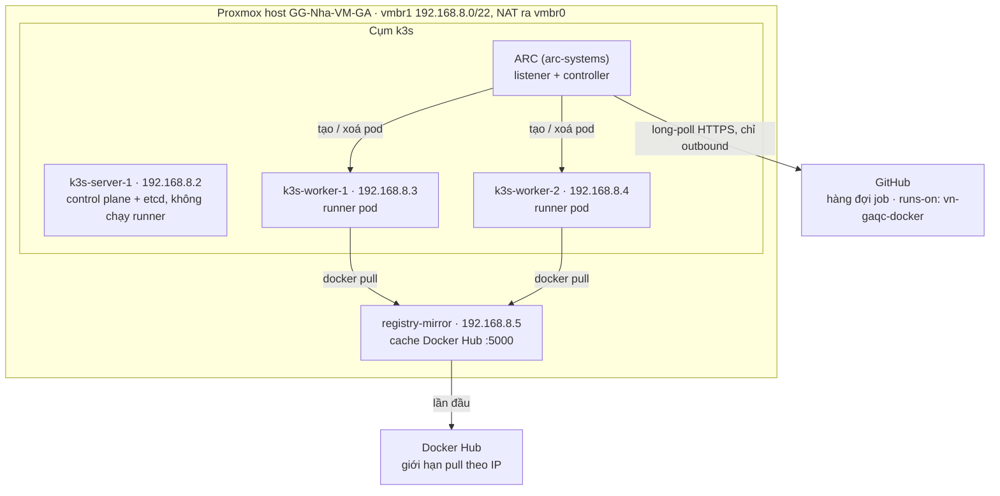

# Self-hosted GitHub Runner autoscale trên Proxmox với k3s + ARC (0 → 100)

Oct 22, 2026 · @Y Nguyen

Guide viết cho host Proxmox `GG-Nha-VM-GA` (đơn node, PVE 9.2) và các workflow đang dùng `runs-on: vn-gaqc-docker`. Giá trị cụ thể (IP, storage, cấu hình VM) nằm trong [`scripts/k3s-plan.env.example`](../scripts/k3s-plan.env.example). Dùng cho host khác thì sửa file đó, chạy lại [`scripts/pve-discovery.sh`](../scripts/pve-discovery.sh), rồi thay các giá trị tương ứng trong lệnh.

## Tổng quan kiến trúc

Kết quả cuối: một cụm k3s gồm 1 server + 2 worker VM trên Proxmox chạy Actions Runner Controller (ARC). Mỗi job GitHub chạy trong 1 pod ephemeral riêng, tự scale từ 0 lên `maxRunners` pod và xoá pod ngay khi job xong. Khởi đầu với `maxRunners: 8`, vì CPU host đang bận 73–89%. Sau khi gỡ các runner LXC cũ thì tăng dần, mục tiêu 100.



Mỗi runner pod (runner + dind) chạy đúng 1 job rồi bị xoá.

Listener chỉ gọi ra ngoài nên không cần mở port. Runner pod cũng tự kết nối GitHub để chạy job và báo kết quả, và kéo image qua mirror.

Luồng một job:

1. Workflow khai báo `runs-on: vn-gaqc-docker`, job vào hàng đợi trên GitHub.
2. Listener pod của ARC long-poll GitHub qua HTTPS outbound và nhận số job đang chờ. Không cần webhook, không mở port inbound.
3. ARC controller tạo `EphemeralRunner` → 1 pod (runner + dind sidecar) với JIT config, chỉ nhận đúng 1 job.
4. Job xong → runner tự huỷ đăng ký, pod bị xoá. Không còn job → 0 pod.

### Quyết định thiết kế

| Hạng mục | Chọn | Lý do |
| --- | --- | --- |
| Scale tầng pod | ARC runner scale set, `minRunners: 0`, `maxRunners: 8` lúc đầu, tăng dần tới 100 | Giải pháp chính chủ GitHub, đã GA |
| Scale tầng node | 2 worker VM cố định; thêm worker sau khi gỡ runner LXC cũ | Đơn giản, ít điểm hỏng; worker rảnh chỉ tốn khoảng 1 GiB RAM |
| Mạng | `vmbr1` (nội bộ, NAT qua Proxmox host) | Không tốn IP LAN, cụm tách khỏi LAN công ty |
| Docker trong job | dind sidecar riêng cho từng pod | Không share `docker.sock`, job này không giết được job khác |
| Xác thực GitHub | GitHub App | Không phụ thuộc PAT cá nhân, rate limit cao hơn |
| Control plane | 1 server, embedded etcd (`cluster-init`) | Sau này thêm lên 3 server HA mà không cài lại |
| Kéo image | Pull-through registry mirror nội bộ | 100 runner sau 1 IP sẽ chạm rate limit Docker Hub |
| Cấp đăng ký runner | Organization | Repo dưới tài khoản cá nhân thì mỗi repo cần 1 scale set riêng |
| Nơi chạy lệnh | Proxmox Shell trên web UI; `kubectl`/`helm` chạy trên `k3s-server-1` | Không cần máy admin riêng hay SSH từ laptop |

### Giá trị dùng trong guide

| Mục | Giá trị |
| --- | --- |
| Proxmox host | `GG-Nha-VM-GA`, IP LAN `10.128.6.102` |
| Mạng của cụm | `vmbr1`, `192.168.8.0/22`, gateway + NAT là chính host `192.168.8.1` |
| Dải DHCP của host trên vmbr1 | `192.168.8.10`–`192.168.11.254` (`dhcpd`), nên IP tĩnh của cụm dùng `192.168.8.2`–`.9` |
| k3s server | `k3s-server-1`, VMID 201, `192.168.8.2`, 2 vCPU / 4 GiB / 30 GB |
| k3s worker | `k3s-worker-1..2`, VMID 211–212, `192.168.8.3`–`.4`, 8 vCPU / 16 GiB / 100 GB |
| Registry mirror | `registry-mirror`, VMID 220, `192.168.8.5`, 2 vCPU / 4 GiB / 50 GB |
| IP dự phòng | `192.168.8.6`–`.9`, cho worker thêm hoặc server HA |
| Template | VMID 9000, `ubuntu-2404-k3s-tpl` |
| Storage | `local-lvm2` (LVM thick) |
| GitHub org | `<ORG>` |
| Tên scale set (= `runs-on`) | `vn-gaqc-docker`; giai đoạn chạy thử dùng `vn-gaqc-docker-k3s` (phần Chuyển đổi) |
| Nơi chạy lệnh | `qm`, `pct`, `ssh`: Proxmox Shell trên web UI. `kubectl`, `helm`: trên `k3s-server-1` (`ssh ubuntu@192.168.8.2`) |

## Vì sao runner Docker cũ chết giữa chừng

Với mô hình "mỗi container 1 runner, dùng chung Docker của host", job chết giữa chừng gần như luôn rơi vào một trong các nguyên nhân dưới đây. Guide này khắc phục từng cái ở cột cuối.

| Nguyên nhân | Dấu hiệu | Cách kiểm tra trên hệ thống cũ | Cách guide này xử lý |
| --- | --- | --- | --- |
| OOM: container hoặc cả host hết RAM, kernel kill process | Job báo `The runner has received a shutdown signal` hoặc `lost communication with the server` | `dmesg -T \| grep -i -E 'oom\|killed process'`; `docker inspect -f '{{.State.OOMKilled}}' <id>` | Request/limit RAM từng pod, kubelet reserved + eviction, Proxmox tắt balloon và không overcommit RAM |
| Job dùng chung `docker.sock` của host: một job chạy `docker system prune -af`, `docker rm -f $(docker ps -aq)`, hoặc trùng tên container/network | Nhiều runner chết cùng lúc, ngẫu nhiên | `docker events --since 24h --filter event=kill --filter event=destroy`; grep `prune`, `docker rm` trong workflow | Mỗi pod có Docker daemon riêng (dind sidecar), chết cùng pod |
| Disk đầy (`/var/lib/docker`, thư mục `_work`) vì runner không ephemeral, rác tích luỹ | `No space left on device`, Docker treo | `df -h`; `docker system df` | Pod ephemeral, `emptyDir` có `sizeLimit`, image GC của kubelet |
| Runner tự update rồi restart process, container exit theo | Container restart đúng lúc có bản runner mới | Log `_diag/Runner_*.log` có `Runner update` | Runner image pin version, ARC nâng cấp có kiểm soát |
| Trùng tên runner hoặc registration token hết hạn (1 giờ): container restart đăng ký lại đè runner đang chạy | Runner offline/đổi tên trên UI GitHub, job mất runner | Trang Settings → Actions → Runners | JIT config dùng 1 lần, tên do ARC sinh, không bao giờ tái sử dụng |
| `restart: always` / healthcheck / script scale-down kill container đang chạy job | Job chết đúng lúc scale-down | Log của script scale, `docker events` | ARC không bao giờ xoá runner đang bận |
| Host reboot do unattended-upgrades, Proxmox backup snapshot/suspend VM | Nhiều job chết cùng một giờ mỗi ngày | `last -x reboot`; lịch vzdump | Tắt auto-reboot, loại worker khỏi backup (bước 1, 2) |
| Thiếu `inotify`/`nofile` khi chạy nhiều container | `too many open files`, `no space left on device` dù disk còn trống | `sysctl fs.inotify.max_user_instances` | Tăng sysctl ở bước 2 |
| MTU sai (VLAN/SDN/VPN) làm kết nối dài bị treo | `git clone`/`npm install` treo, runner mất kết nối | `ping -M do -s 1472 github.com` | MSS clamp trên host (phần vmbr1), flannel `host-gw` (bước 3) |

Nếu hệ thống cũ còn chạy, hãy chạy 3 lệnh kiểm tra đầu tiên trên host Docker cũ: kết quả cho biết nguyên nhân thật và giúp chọn đúng con số request/limit ở phần sizing.

## Sizing

### Cấu hình hiện tại trên GG-Nha-VM-GA

Host có 32 thread, nhưng `pve-discovery.sh` đo CPU đã bận 73–89% và RAM cấp cho VM đã gấp khoảng 3,6 lần RAM vật lý. Vì vậy cụm khởi đầu nhỏ:

| VM | Số lượng | vCPU | RAM | Disk (thick, `local-lvm2`) |
| --- | --- | --- | --- | --- |
| `k3s-server-1` | 1 | 2 | 4 GiB | 30 GB |
| `k3s-worker` | 2 | 8 | 16 GiB | 100 GB |
| `registry-mirror` | 1 | 2 | 4 GiB | 50 GB |
| **Tổng** | **4** | **20** | **40 GiB** | **280 GB** |

- Theo RAM/CPU của VM, 2 worker chứa được khoảng 20 runner. Nhưng host chỉ còn khoảng 4–9 thread rảnh, nên đặt `maxRunners: 8`.
- Sau khi gỡ các runner LXC cũ (phần Chuyển đổi), chạy lại `pve-discovery.sh`, tăng `maxRunners` theo gợi ý, và thêm worker bằng các IP dự phòng khi cần.
- Phần dưới là cách tính cho mục tiêu 100 runner, dùng khi host có đủ tài nguyên.

### Mục tiêu 100 runner

100 runner nhẹ cần khoảng 50 vCPU và 100 GiB RAM ở mức request. Để chạy được, bạn cần 4 worker VM, mỗi VM 16 vCPU / 32 GiB, và host Proxmox còn trống khoảng 156 GiB RAM. Host nhỏ hơn thì giảm `maxRunners` theo công thức bên dưới, phần job dư sẽ xếp hàng.

### Request/limit cho mỗi runner pod

| Container | CPU request | CPU limit | RAM request | RAM limit | Ephemeral storage request |
| --- | --- | --- | --- | --- | --- |
| `runner` | 250m | không đặt | 512Mi | 2Gi | 2Gi |
| `dind` (sidecar) | 250m | không đặt | 512Mi | 2Gi | 4Gi |
| **Tổng 1 pod** | **500m** | — | **1Gi** | **4Gi** | **6Gi** |

- **Không đặt CPU limit**: CPU limit gây CFS throttling, job chậm hẳn. Request đã đảm bảo chia CPU công bằng khi node bận.
- **Có RAM limit**: job vượt 2Gi thì chỉ container đó bị OOMKilled, các job khác trên node không bị ảnh hưởng.
- **Request phải gần mức dùng thật**: request thấp hơn thực tế thì scheduler nhồi quá nhiều pod vào một node, node hết RAM và kubelet phải evict. Sau 1 tuần chạy, xem `kubectl top pod -n arc-runners --containers` rồi đặt request ≈ mức dùng p90.

### VM cần tạo

| VM | Số lượng | vCPU | RAM | Disk (thin) |
| --- | --- | --- | --- | --- |
| `k3s-server` | 1 | 4 | 8 GiB | 60 GB |
| `k3s-worker` | 4 | 16 | 32 GiB | 300 GB |
| `registry-mirror` | 1 | 2 | 4 GiB | 200 GB |
| **Tổng** | **6** | **70** | **140 GiB** | **1,46 TB** |

Mỗi worker sau khi trừ reserved còn khoảng 15 vCPU và 29,5 GiB allocatable, chứa được khoảng 28 pod. Bốn worker cho khoảng 112 slot: đủ 100 runner, phần dư dành cho listener, controller và các pod hệ thống.

Yêu cầu với host Proxmox:

- **RAM vật lý** ≥ 140 GiB của VM + 8–16 GiB cho Proxmox và ZFS ARC. Thực tế là host 192 GiB. Không overcommit RAM: host OOM sẽ kill nguyên 1 worker VM, kéo theo khoảng 25 job chết cùng lúc.
- **CPU**: 70 vCPU trên 24–32 thread vật lý là overcommit 2–3 lần, chấp nhận được với job nhẹ. Job nặng CPU (build lớn) thì cần nhiều core hơn.
- **Disk**: SSD/NVMe, thin provisioning (LVM-thin hoặc ZFS). Dung lượng dùng thật thường thấp hơn nhiều so với 1,46 TB cấp phát.

### Tính lại `maxRunners` khi host nhỏ hơn

```math
\text{maxRunners} \approx \min\left( \frac{\sum \text{RAM allocatable} - 2\,\text{GiB}}{\text{RAM request/pod}},\ \frac{\sum \text{CPU allocatable} - 1}{\text{CPU request/pod}} \right)
```

RAM allocatable của mỗi worker ≈ RAM VM − 2,5 GiB; CPU allocatable ≈ vCPU − 1.

| RAM host | Worker | RAM allocatable | `maxRunners` nên đặt |
| --- | --- | --- | --- |
| 192 GiB | 4 × 32 GiB | \~118 GiB | 100 |
| 128 GiB | 3 × 32 GiB | \~88 GiB | 80 |
| 64 GiB | 2 × 20 GiB | \~35 GiB | 30 |

Với host 64 GiB, bạn có thể bỏ VM registry-mirror và chạy mirror ngay trong cụm.

## IP và mạng: cụm tốn bao nhiêu IP?

Cả cụm chỉ tốn **1 IP tĩnh cho mỗi VM**, không phụ thuộc số runner. Với kế hoạch hiện tại là 4 IP (1 server, 2 worker, 1 mirror) trong `192.168.8.0/22` của `vmbr1`, tức **0 IP của LAN công ty**. Mỗi worker thêm sau này tốn thêm 1 IP; nâng lên 3 server HA tốn thêm 2 IP.

| Lớp | Dải địa chỉ | Ai cấp | Tốn IP LAN? |
| --- | --- | --- | --- |
| VM (node k3s, mirror) | Subnet của bridge, ở đây `192.168.8.0/22` (`vmbr1`) | Bạn đặt tĩnh qua cloud-init | **1 IP / VM** (0 IP LAN khi dùng `vmbr1`) |
| Pod (runner, listener, controller…) | `10.42.0.0/16`, mỗi node nhận một `/24` | flannel trong k3s | Không |
| Service Kubernetes | `10.43.0.0/16` | k3s | Không |
| Container do job chạy trong dind | `172.17.0.0/16`, riêng trong từng pod | dockerd của pod đó | Không |

Vì sao pod không tốn IP LAN:

- IP pod là địa chỉ nội bộ, chỉ tồn tại bên trong cụm. Router và DHCP của bạn không bao giờ thấy chúng.
- Khi runner pod gọi ra GitHub, flannel NAT (masquerade) gói tin sang IP của worker đang chứa pod. Từ router nhìn vào chỉ thấy IP của các worker (với `vmbr1` thì chỉ thấy IP của Proxmox host), và từ Internet chỉ thấy IP public NAT của bạn.
- Với `flannel-backend: host-gw`, mỗi node tự thêm route tới dải `/24` pod của các node khác qua IP LAN của node đó. Router không cần cấu hình gì thêm.
- Mỗi node có một `/24` (254 địa chỉ), dư cho giới hạn 110 pod/node.

Ba điều cần làm đúng:

1. **IP tĩnh phải nằm ngoài dải DHCP** của router, hoặc tạo DHCP reservation, để không bị cấp trùng. Node k3s đổi IP là cụm hỏng, nên không dùng DHCP động.
2. **Ba dải nội bộ không được trùng mạng thật** mà runner cần truy cập (LAN, VPN, mạng văn phòng). Nếu trùng `10.42/16` hoặc `10.43/16`, đặt `cluster-cidr` / `service-cidr` khác trong config server **trước khi cài** k3s, vì không đổi được sau. Nếu trùng `172.17/16`, thêm `--bip=<dải khác>` vào args của dind.
3. Tất cả runner đi ra Internet chung một IP public, nên bị rate limit chung (Docker Hub). Đó là lý do có registry mirror ở bước 4.

`scripts/pve-discovery.sh` (bước 0) tự kiểm tra các IP dự kiến có đang bị dùng hay không và các dải nội bộ có trùng mạng nào không.

### Phương án đang dùng: bridge nội bộ + NAT (vmbr1)

`vmbr1` là bridge không gắn card mạng vật lý: IP host `192.168.8.1/22`, mọi lưu lượng ra ngoài được NAT qua IP LAN của Proxmox host. Cả 4 VM của cụm nằm trên đó, nên cụm không tốn IP nào của LAN công ty.

| | `vmbr0` (LAN) | `vmbr1` (nội bộ + NAT) |
| --- | --- | --- |
| IP LAN tiêu tốn | 1 / VM | 0 |
| Cách ly cụm (dind chạy privileged) | Chung LAN với máy khác | Tách hẳn khỏi LAN |
| Truy cập VM | Trực tiếp từ LAN | Từ Proxmox Shell (host là gateway), hoặc qua ProxyJump |
| Khi Proxmox có nhiều node | Chạy được ngay | Bridge không có port vật lý chỉ tồn tại trong 1 node; cần VLAN/SDN |

Cần 3 thứ:

1. **NAT và MSS clamp trên Proxmox host.** Khối `vmbr1` trong `/etc/network/interfaces` cần có các dòng dưới đây. Dạng `-C ... || -A ...` chỉ thêm rule khi chưa có, nên reload nhiều lần cũng không tạo rule trùng.

    ```
    auto vmbr1
    iface vmbr1 inet static
            address 192.168.8.1/22
            bridge-ports none
            bridge-stp off
            bridge-fd 0
            post-up echo 1 > /proc/sys/net/ipv4/ip_forward
            post-up iptables -t nat -C POSTROUTING -s '192.168.8.0/22' -o vmbr0 -j MASQUERADE 2>/dev/null || iptables -t nat -A POSTROUTING -s '192.168.8.0/22' -o vmbr0 -j MASQUERADE
            post-down iptables -t nat -D POSTROUTING -s '192.168.8.0/22' -o vmbr0 -j MASQUERADE
            post-up iptables -t mangle -C FORWARD -s 192.168.8.0/22 -o vmbr0 -p tcp --tcp-flags SYN,RST SYN -j TCPMSS --set-mss 1440 2>/dev/null || iptables -t mangle -A FORWARD -s 192.168.8.0/22 -o vmbr0 -p tcp --tcp-flags SYN,RST SYN -j TCPMSS --set-mss 1440
            post-down iptables -t mangle -D FORWARD -s 192.168.8.0/22 -o vmbr0 -p tcp --tcp-flags SYN,RST SYN -j TCPMSS --set-mss 1440
    ```

    Trên host này đã có VM khác dùng `vmbr1`. Vì vậy sau khi sửa file, **đừng chạy `ifreload -a` hay bấm Apply Configuration** trong mục Network của web UI. File chỉ dùng cho lần boot sau. Để có hiệu lực ngay, chạy trực tiếp:

    ```bash
    iptables -t mangle -C FORWARD -s 192.168.8.0/22 -o vmbr0 -p tcp --tcp-flags SYN,RST SYN -j TCPMSS --set-mss 1440 2>/dev/null \
      || iptables -t mangle -A FORWARD -s 192.168.8.0/22 -o vmbr0 -p tcp --tcp-flags SYN,RST SYN -j TCPMSS --set-mss 1440
    iptables -t mangle -S FORWARD | grep TCPMSS
    ```

    **Vì sao cần MSS clamp:** đường ra Internet của host chỉ nhận gói tối đa 1480 byte, trong khi VM gửi gói 1500 byte. Nếu ICMP "gói quá lớn" bị chặn trên đường đi, các kết nối lớn như `git clone`, `docker pull` hay `npm install` sẽ treo giữa chừng. Rule trên sửa MSS trong gói SYN thành 1440 (= 1480 − 40), nên hai bên tự gửi gói vừa cỡ. Rule chỉ áp cho traffic từ `192.168.8.0/22` ra `vmbr0` và chỉ giảm, không tăng MSS. Script discovery báo MTU đường ra ở mục 7 và kiểm tra rule này đã có hay chưa.

    Nếu bật Proxmox firewall cho các VM này, thêm cả `post-up iptables -t raw -I PREROUTING -i fwbr+ -j CT --zone 1` (và dòng `-D` tương ứng ở `post-down`) để conntrack không làm hỏng NAT.

    Nếu `iptables -t nat -S POSTROUTING` hiện một rule MASQUERADE nhiều lần, đó là do bản `post-up` cũ dạng `-A` đã chạy lặp. Các rule trùng vô hại. Muốn dọn thì chạy `iptables -t nat -D ...` với đúng rule đó, số lần bằng số bản trùng trừ 1, để giữ lại 1 bản.

2. **IP tĩnh ngoài dải DHCP.** Host chạy `dhcpd` cho `vmbr1` với `range 192.168.8.10 192.168.11.254;` trong `/etc/dhcp/dhcpd.conf`. IP tĩnh của cụm **phải nằm ngoài dải đó**; nếu nằm trong dải, DHCP có thể cấp trùng IP cho VM khác, nhất là khi VM của cụm đang tắt. Ngoài dải chỉ còn `192.168.8.2`–`.9`: cụm dùng `.2`–`.5`, giữ `.6`–`.9` để dự phòng. Script discovery và `pve-create-vms.sh` đều báo FAIL nếu IP nằm trong dải DHCP. Nếu sau này cần hơn 8 IP tĩnh, có thể thu hẹp `range` (ví dụ bắt đầu từ `.50`, sau khi kiểm tra không có lease nào trong đoạn bị cắt) rồi `systemctl restart isc-dhcp-server`. Việc này ảnh hưởng tới các VM khác đang lấy IP qua DHCP, nên chỉ làm khi thật cần.

3. **Làm việc từ Proxmox Shell.** Proxmox host là gateway của `vmbr1`, nên từ Proxmox Shell trên web UI vào thẳng được `192.168.8.x` bằng SSH. Không cần máy admin riêng.

    ```bash
    # Tạo SSH key trên Proxmox host (một lần). Public key được cài vào user ubuntu của mọi VM
    ls /root/.ssh/id_ed25519.pub 2>/dev/null || ssh-keygen -t ed25519 -f /root/.ssh/id_ed25519 -N '' -C 'proxmox-k3s-admin'
    ```

    Private key `/root/.ssh/id_ed25519` chỉ nằm trên host. `kubectl` và `helm` cài trên `k3s-server-1` (bước 3.4), không cài lên Proxmox host. Trường hợp SSH hỏng (đặt nhầm IP, firewall), dùng Console noVNC của VM trên web UI với mật khẩu `CI_PASSWORD` (bước 1.2).

    Nếu sau này muốn làm từ laptop, thêm vào `~/.ssh/config` của laptop rồi copy public key của laptop vào VM:

    ```
    Host pve
        HostName 10.128.6.102
        User root
    Host 192.168.8.* 192.168.9.* 192.168.10.* 192.168.11.*
        User ubuntu
        ProxyJump pve
    ```

`192.168.8.0/22` không trùng `10.42/16`, `10.43/16` hay `172.17/16`.

## Bước 0 – Chạy discovery trên Proxmox

Trước khi tạo bất kỳ VM nào, hãy chạy [`scripts/pve-discovery.sh`](../scripts/pve-discovery.sh) trên Proxmox host để bắt lỗi kế hoạch. Script chỉ đọc, không thay đổi gì trên host. Nó kiểm tra:

- Phiên bản Proxmox, NTP, cluster nhiều node.
- RAM/CPU còn lại sau khi trừ VM hiện có, Proxmox và ZFS ARC. Từ đó tính số worker tối đa và `maxRunners` gợi ý.
- Storage: tồn tại, có thin provisioning, còn bao nhiêu chỗ, đã bật snippets chưa, có SSD không.
- Mạng: bridge, MTU, gateway; IP dự kiến có nằm đúng subnet, có bị trùng VM khác hay thiết bị đang chạy; dải pod/service/dind có trùng mạng nào không.
- VMID và tên VM dự kiến còn trống không.
- Backup job có vô tình gồm cả worker không.
- Kết nối HTTPS tới GitHub, ghcr.io, Docker Hub, k3s, Ubuntu cloud images, và MTU đường ra.

### Cách chạy

Mọi lệnh chạy bằng root trong Proxmox Shell (web UI). Kế hoạch được lưu một lần trong `/root/k3s-plan.env` và dùng chung cho cả `pve-discovery.sh` lẫn `pve-create-vms.sh`.

```bash
# 1. Tạo file kế hoạch và script trên host: mở nano, dán nội dung file tương ứng trong repo, lưu lại
nano /root/k3s-plan.env        # nội dung: scripts/k3s-plan.env.example
nano /root/pve-discovery.sh    # nội dung: scripts/pve-discovery.sh

# 2. Nạp kế hoạch vào shell hiện tại, rồi chạy
set -a; source /root/k3s-plan.env; set +a
bash /root/pve-discovery.sh
```

Biến nạp bằng `set -a; source` tồn tại tới khi đóng Shell, nên các script chạy sau trong cùng phiên đều thấy. Mở Shell mới thì nạp lại.

Script chạy trong subshell, nên dán thẳng nội dung script vào terminal (sau khi đã nạp biến) hay chạy bằng `source` cũng không làm thoát phiên shell. Không có file kế hoạch thì có thể đặt biến ngay trước lệnh, ví dụ `BRIDGE=vmbr1 STORAGE=local-lvm2 bash /root/pve-discovery.sh`.

### Các biến

Biến không đặt thì script dùng giá trị mặc định chung (`vmbr0`, `local-lvm`, `10.10.10.x`, 4 worker). `k3s-plan.env.example` đã đặt sẵn các giá trị của host này.

| Biến | Ý nghĩa | Mặc định | Cách chọn |
| --- | --- | --- | --- |
| `BRIDGE` | Bridge Proxmox mà VM sẽ dùng | `vmbr0` | `vmbr1` nếu dùng mạng nội bộ + NAT |
| `GATEWAY` | Gateway của VM | Tự dò: default route của bridge, nếu không có thì IP host trên bridge | Thường để trống |
| `PREFIX` | Độ dài subnet | Lấy theo IP host trên bridge | Thường để trống |
| `STORAGE` | Storage chứa disk VM | `local-lvm` | Storage còn đủ chỗ; script in danh sách ở mục 3 |
| `SNIPPET_STORAGE` | Storage chứa cloud-init snippet | `local` | Thường giữ nguyên |
| `SERVER_IP`, `MIRROR_IP` | IP tĩnh của k3s server và registry mirror | `10.10.10.11`, `.30` | Chọn trong danh sách IP trống mà script in ra |
| `WORKER_IPS` | IP các worker, cách nhau bởi dấu cách | `10.10.10.21` … `.24` | Số IP phải bằng số `WORKER_IDS` |
| `TEMPLATE_ID`, `SERVER_ID`, `MIRROR_ID` | VMID của template, server, mirror | `9000`, `201`, `220` | Giữ nguyên nếu mục 5 báo trống |
| `WORKER_IDS` | VMID các worker; số lượng = số worker | `211 212 213 214` | Đặt theo số worker host chịu được |
| `WORKER_CORES` / `WORKER_MEM_GB` / `WORKER_DISK_GB` | Cấu hình mỗi worker | `16` / `32` / `300` | Theo phần Sizing |
| `SERVER_CORES` / `SERVER_MEM_GB` / `SERVER_DISK_GB` | Cấu hình k3s server | `4` / `8` / `60` | Cụm nhỏ: `2` / `4` / `30` |
| `MIRROR_CORES` / `MIRROR_MEM_GB` / `MIRROR_DISK_GB` | Cấu hình registry mirror | `2` / `4` / `200` | Disk theo lượng image cần cache |
| `POD_CPU` / `POD_MEM_GB` | Request của 1 runner pod, dùng để tính `maxRunners` | `0.5` / `1` | Giữ như `runner-values.yaml` |
| `HOST_RESERVE_GB` | RAM chừa cho chính Proxmox | `8` | Giữ nguyên |
| `CPU_SAMPLE_SEC` | Số giây đo tải CPU host | `10` | `30`–`60` để kết quả ổn định hơn |
| `SCAN` | Quét IP trống trong subnet của bridge | `auto` (chỉ quét khi IP có vấn đề) | `1` để luôn quét, `0` để tắt |
| `SSH_PUBKEY` | Public key sẽ đưa vào VM | `/root/.ssh/id_ed25519.pub` | Giữ mặc định: key tạo trên Proxmox host (phần vmbr1, mục 3) |
| `POD_CIDR` / `SVC_CIDR` / `DIND_CIDR` | Các dải mạng nội bộ cần kiểm tra trùng | `10.42/16` / `10.43/16` / `172.17/16` | Chỉ đổi khi đã đổi trong config k3s hoặc dind |

### Thứ tự chạy

1. **Lần 1, để dò:** chỉ đặt bridge, storage, cấu hình worker, và `SCAN=1`. Các dòng FAIL vì IP sai subnet là bình thường; mục đích là lấy danh sách IP trống, danh sách storage và tải CPU/RAM thật.
2. **Lần 2, để xác nhận:** điền các IP chọn từ danh sách lần 1, rồi chạy lại cho đến khi không còn FAIL.

Kết quả mỗi dòng có dạng `[OK]`, `[WARN]` hoặc `[FAIL]`, cuối cùng là phần tổng kết với `maxRunners` gợi ý. Sửa hết các mục `FAIL` rồi mới sang bước 1. Sau khi tạo xong VM có thể chạy lại script: các IP và VMID đúng kế hoạch sẽ được báo `[INFO]` thay vì lỗi.

Kết quả trên `GG-Nha-VM-GA` ngày 2026-10-22: 0 FAIL. Các cảnh báo còn lại là CPU host bận 73–89%, RAM cấp phát gấp 3,6 lần RAM vật lý, storage LVM thick, và có DHCP trên `vmbr1`. Đây đều là điều kiện đã biết và đã tính vào kế hoạch.

## Bước 1 – Tạo VM trên Proxmox

Bước này tạo 1 template Ubuntu 24.04 cloud-init, rồi clone ra 4 VM (server, 2 worker, mirror). Cấu hình tránh các lỗi làm chết job: không balloon, không backup worker, IP tĩnh ngoài dải DHCP. Mọi lệnh chạy bằng root trong Proxmox Shell.

### 1.1 Chuẩn bị một lần

- **Snippets:** vào Datacenter → Storage → `local` → Edit → Content, tick thêm **Snippets** (giữ nguyên các mục đang có), rồi bấm OK. Snippet là file cloud-init giúp VM tự cài `qemu-guest-agent`, `curl` và `chrony` ở lần boot đầu. Lệnh `pvesm set local --content ...` cũng làm được việc này, nhưng nó **ghi đè** cả danh sách content, nên dùng web UI an toàn hơn.
- **SSH key trên host:** xem phần vmbr1, mục 3.
- **NAT và MSS clamp trên `vmbr1`:** xem phần vmbr1, mục 1.
- `pve-discovery.sh` báo 0 FAIL (bước 0).

### 1.2 Cách nhanh: `scripts/pve-create-vms.sh`

Script làm đúng các lệnh ở 1.3–1.4:

1. Ghi snippet.
2. Tải cloud image và kiểm tra SHA256.
3. Tạo template.
4. Clone 4 VM.
5. Chờ từng VM: lên SSH, xong cloud-init, guest agent đang chạy, và ra được `github.com`.

Trước khi tạo, script kiểm tra lại VMID, IP (ping/ARP, config của VM khác, dải DHCP) và dung lượng storage. VM của kế hoạch đã có (đúng VMID, tên và IP) thì được bỏ qua, nên chạy lại sau khi lỗi giữa chừng là an toàn. Script không sửa hay xoá VM nào đang có.

```bash
nano /root/pve-create-vms.sh          # nội dung: scripts/pve-create-vms.sh
set -a; source /root/k3s-plan.env; set +a

# Lần 1: chỉ kiểm tra và in các lệnh sẽ chạy, không tạo gì
DRY_RUN=1 bash /root/pve-create-vms.sh

# Lần 2: tạo thật. Mật khẩu console được nhập ẩn, không vào lịch sử shell. Gõ YES khi script hỏi
read -rsp 'Mật khẩu console cho user ubuntu: ' CI_PASSWORD; echo; export CI_PASSWORD
bash /root/pve-create-vms.sh
unset CI_PASSWORD
```

`CI_PASSWORD` là mật khẩu của user `ubuntu` trong các VM. Nó chỉ dùng được ở Console noVNC hoặc `qm terminal`, để cứu hộ khi SSH hỏng; cloud image Ubuntu tắt đăng nhập SSH bằng mật khẩu. Proxmox lưu bản đã hash trong config. Đừng ghi mật khẩu này vào `k3s-plan.env` hay bất kỳ file nào trong repo.

### 1.3 Làm tay: snippet và template

Đây là các lệnh tương đương với script, dùng khi muốn làm từng bước.

```bash
cat > /var/lib/vz/snippets/k3s-vendor.yaml <<'EOF'
#cloud-config
package_update: true
packages:
  - qemu-guest-agent
  - curl
  - chrony
runcmd:
  - systemctl enable --now qemu-guest-agent
EOF

cd /var/lib/vz/template/iso
wget https://cloud-images.ubuntu.com/noble/current/noble-server-cloudimg-amd64.img

qm create 9000 --name ubuntu-2404-k3s-tpl --ostype l26 \
  --memory 2048 --cores 2 --cpu host \
  --net0 virtio,bridge=vmbr1 \
  --scsihw virtio-scsi-single --agent enabled=1 \
  --serial0 socket --vga serial0 \
  --scsi0 local-lvm2:0,import-from=/var/lib/vz/template/iso/noble-server-cloudimg-amd64.img,discard=on,iothread=1,ssd=1 \
  --ide2 local-lvm2:cloudinit --boot order=scsi0 \
  --ciuser ubuntu --sshkeys /root/.ssh/id_ed25519.pub \
  --cicustom vendor=local:snippets/k3s-vendor.yaml --tags k3s
read -rsp 'Mật khẩu console: ' P; echo; qm set 9000 --cipassword "$P"; unset P
qm template 9000
```

Muốn dùng Ubuntu 26.04 thì chỉ cần đổi URL image.

### 1.4 Làm tay: clone 4 VM

```bash
GW=192.168.8.1
DNS=$(grep -h 'domain-name-servers' /etc/dhcp/dhcpd.conf | grep -oE '([0-9]{1,3}\.){3}[0-9]{1,3}' | head -2 | tr '\n' ' ')
echo "DNS cho VM: $DNS"      # pve-create-vms.sh lấy DNS theo cùng cách

# create_vm <vmid> <tên> <ip> <vcpu> <RAM GiB> <disk GB> <thứ tự khởi động>
create_vm() {
  qm clone 9000 "$1" --name "$2" --full 1 --storage local-lvm2
  qm set "$1" --cores "$4" --memory $(( $5 * 1024 )) --balloon 0 --onboot 1 --startup "order=$7" \
    --ipconfig0 "ip=$3/22,gw=$GW" --nameserver "$DNS" --tags k3s
  qm disk resize "$1" scsi0 "${6}G"
  qm start "$1"
}
create_vm 201 k3s-server-1    192.168.8.2 2  4  30 1
create_vm 211 k3s-worker-1    192.168.8.3 8 16 100 2
create_vm 212 k3s-worker-2    192.168.8.4 8 16 100 2
create_vm 220 registry-mirror 192.168.8.5 2  4  50 2

# Kiểm tra từng VM (chờ cloud-init chạy xong)
for ip in 192.168.8.2 192.168.8.3 192.168.8.4 192.168.8.5; do
  ssh -o StrictHostKeyChecking=accept-new ubuntu@$ip 'cloud-init status --wait; hostname'
done
```

Cloud image tự giãn root filesystem theo kích thước disk khi boot. Nếu sau này Proxmox thành cluster nhiều node, hãy rải worker sang các node khác nhau bằng `qm migrate`. Khi đó, mất 1 node vật lý chỉ làm mất phần job của worker trên node đó.

### 1.5 Giới hạn ZFS ARC (nếu host dùng ZFS)

Host hiện tại không có pool ZFS (theo discovery), nên bỏ qua mục này.

Trên host có ZFS, ARC có thể chiếm tới 50% RAM (các bản cài Proxmox mới mặc định 10%) và tranh RAM với VM. Ví dụ giới hạn ARC ở 8 GiB:

```bash
cat /sys/module/zfs/parameters/zfs_arc_max          # 0 = mặc định
echo "options zfs zfs_arc_max=8589934592" > /etc/modprobe.d/zfs.conf
update-initramfs -u -k all
echo 8589934592 > /sys/module/zfs/parameters/zfs_arc_max   # áp dụng ngay
```

### 1.6 Loại worker khỏi backup

Vzdump ở mode snapshot/suspend làm VM đứng từ vài giây tới vài phút, đủ để runner mất kết nối. Worker cũng không có dữ liệu nào cần giữ. Host hiện chưa có backup job nào. Khi tạo job mới:

- Datacenter → Backup → sửa job → Selection mode: **Exclude selected VMs** → chọn 211, 212 và 220.
- Server 201 chứa etcd. k3s đã tự snapshot etcd mỗi 12 giờ vào `/var/lib/rancher/k3s/server/db/snapshots`. Backup VM 201 ngoài giờ chạy job, hoặc copy các snapshot này ra ngoài.

### 1.7 Vì sao cấu hình như vậy

| Thiết lập | Tác dụng |
| --- | --- |
| `--balloon 0` | Kubernetes lập lịch theo lượng RAM cố định. Balloon thu hồi RAM sẽ làm pod bị OOM giữa job |
| `--cpu host` | Giữ nguyên tập lệnh CPU (AVX, AES…), build nhanh hơn. Nếu cần live-migrate giữa các CPU khác đời thì dùng `x86-64-v3` |
| `discard=on,ssd=1` | Với thin storage, dung lượng được trả lại khi xoá file. `local-lvm2` là LVM thick nên không có tác dụng, nhưng vô hại |
| `virtio-scsi-single` + `iothread=1` | Mỗi disk có 1 IO thread riêng, giảm nghẽn I/O khi nhiều pod cùng pull image |
| `--full 1 --storage local-lvm2` | Node k3s sống lâu dài nên dùng full clone, không phụ thuộc template. LVM thick cũng không hỗ trợ linked clone |
| `--onboot 1 --startup order=...` | Host reboot thì cụm tự lên lại, server lên trước worker |
| IP `/22`, gateway `192.168.8.1` | Đúng subnet của `vmbr1`; IP nằm ngoài dải DHCP `192.168.8.10`–`192.168.11.254` |

### 1.8 Mạng và firewall

- **MTU:** NIC của VM giữ MTU 1500. Đường ra Internet của host chỉ có MTU 1480, nhưng đã được xử lý bằng MSS clamp trên `vmbr1` (phần vmbr1, mục 1).
- **Cách ly:** cụm nằm trên `vmbr1`, tách khỏi LAN công ty. Điều này quan trọng vì job chạy code từ repo và dind chạy privileged.
- **Outbound:** VM cần ra được HTTPS 443 tới `github.com`, `api.github.com`, `*.actions.githubusercontent.com`, `ghcr.io`, `pkg-containers.githubusercontent.com` và các registry mà job dùng.
- **Inbound:** không cần mở port nào từ Internet. Nếu bật Proxmox firewall ở cấp VM, cho phép trong `192.168.8.0/22`: TCP 22 (SSH từ host), TCP 6443 (API), TCP 10250 (kubelet), TCP 2379–2380 (etcd, khi có nhiều server), UDP 8472 (flannel VXLAN, chỉ khi không dùng `host-gw`), TCP 5000 tới registry mirror.

## Bước 2 – Chuẩn bị OS các node k3s

Trên 3 node k3s (server + 2 worker), bạn cần tăng giới hạn inotify/file và chặn reboot tự động. Đây là hai nguyên nhân hay gặp khi chạy nhiều container dind trên một node. VM registry-mirror không cần bước này.

Trong Proxmox Shell, lưu script sau thành `/root/node-prep.sh` (`nano /root/node-prep.sh`):

```bash
#!/usr/bin/env bash
set -euo pipefail

# 1) Giới hạn kernel cho nhiều container. Mọi container dind chạy uid 0 nên DÙNG CHUNG
#    giới hạn inotify của root; mặc định 128 instance sẽ cạn khi có khoảng 20 pod.
sudo tee /etc/sysctl.d/90-k3s-runners.conf >/dev/null <<'EOF'
fs.inotify.max_user_instances = 8192
fs.inotify.max_user_watches   = 1048576
fs.file-max                   = 2097152
vm.max_map_count              = 262144
EOF
sudo sysctl --system >/dev/null

# 2) Không bao giờ tự reboot. Reboot làm theo quy trình ở phần Vận hành
sudo tee /etc/apt/apt.conf.d/52unattended-no-reboot >/dev/null <<'EOF'
Unattended-Upgrade::Automatic-Reboot "false";
EOF

# 3) Đồng bộ thời gian (chrony đã cài qua cloud-init)
sudo systemctl enable --now chrony

# 4) Kiểm tra nhanh
echo "host=$(hostname) cpu=$(nproc) mem=$(free -g | awk '/Mem/{print $2}')G"
df -h / | tail -1
swapon --show | grep -q . && echo 'WARN: swap đang bật' || echo 'swap: off'
chronyc tracking | grep -E 'Leap status'
```

Chạy trên cả 3 node, từ Proxmox Shell:

```bash
for ip in 192.168.8.2 192.168.8.3 192.168.8.4; do
  ssh -o StrictHostKeyChecking=accept-new ubuntu@$ip 'bash -s' < /root/node-prep.sh
done
```

Kết quả mong đợi trên mỗi worker: `cpu=8 mem=15G`, `/` khoảng 97G, `swap: off`, `Leap status : Normal`. Hostname được cloud-init đặt theo tên VM (`k3s-worker-1`…), và hostname phải khác nhau giữa các node.

## Bước 3 – Cài k3s

Bước này cài 1 server (embedded etcd, bị taint để không nhận runner) và 2 agent. Agent có kubelet reserved và eviction để node không bao giờ hết RAM.

### 3.1 Chuẩn bị trong Proxmox Shell

```bash
# Token chung của cụm. Lưu vào file trên host để các phiên Shell sau dùng lại,
# và cất thêm một bản vào password manager
[ -f /root/k3s-token ] || (umask 077; openssl rand -hex 32 > /root/k3s-token)
export K3S_TOKEN=$(cat /root/k3s-token)

# Lấy bản k3s stable hiện tại, rồi PIN cố định cho mọi node
curl -sI https://update.k3s.io/v1-release/channels/stable | grep -i '^location'
# -> .../releases/tag/v1.xx.y+k3s1
export K3S_VERSION='v1.xx.y+k3s1'   # thay bằng giá trị vừa thấy, ghi lại vào /root/k3s-plan.env
```

Các bước 3.2–3.3 chạy trong Proxmox Shell. `kubectl` và `helm` sẽ được cài trên `k3s-server-1` ở bước 3.4.

### 3.2 Cài server

```bash
ssh ubuntu@192.168.8.2 "sudo mkdir -p /etc/rancher/k3s && sudo tee /etc/rancher/k3s/config.yaml >/dev/null" <<EOF
cluster-init: true                 # embedded etcd, sau này thêm server HA được
token: "${K3S_TOKEN}"
tls-san:
  - 192.168.8.2
disable:
  - traefik                        # không cần ingress
  - servicelb
flannel-backend: host-gw           # mọi node cùng L2 trên vmbr1: không encapsulation, không lo MTU
node-taint:
  - "CriticalAddonsOnly=true:NoExecute"   # runner không được chạy trên server
kubelet-arg:
  - "system-reserved=cpu=500m,memory=1Gi"
  - "kube-reserved=cpu=500m,memory=1Gi"
etcd-snapshot-schedule-cron: "0 */12 * * *"
etcd-snapshot-retention: 10
EOF

ssh ubuntu@192.168.8.2 "curl -sfL https://get.k3s.io | sudo INSTALL_K3S_VERSION='${K3S_VERSION}' sh -s - server"
ssh ubuntu@192.168.8.2 "sudo k3s kubectl get nodes"
```

Chọn `flannel-backend` trước khi cài, vì đổi về sau rất phức tạp. `host-gw` chỉ dùng được khi mọi node cùng một L2. Nếu các node nằm ở subnet khác nhau, hãy bỏ dòng đó để dùng VXLAN mặc định. Các thành phần có sẵn của k3s (CoreDNS, metrics-server, local-path) đều tolerate taint `CriticalAddonsOnly`, nên vẫn chạy được trên server.

### 3.3 Cài 2 worker (agent)

```bash
for ip in 192.168.8.3 192.168.8.4; do
  ssh ubuntu@$ip "sudo mkdir -p /etc/rancher/k3s && sudo tee /etc/rancher/k3s/config.yaml >/dev/null" <<EOF
server: "https://192.168.8.2:6443"
token: "${K3S_TOKEN}"
node-label:
  - "gha-runner=true"
kubelet-arg:
  - "system-reserved=cpu=500m,memory=1Gi,ephemeral-storage=10Gi"
  - "kube-reserved=cpu=500m,memory=1Gi,ephemeral-storage=5Gi"
  - "eviction-hard=memory.available<500Mi,nodefs.available<10%,nodefs.inodesFree<5%,imagefs.available<10%"
  - "max-pods=110"
  - "image-gc-high-threshold=75"
  - "image-gc-low-threshold=60"
EOF
  ssh ubuntu@$ip "curl -sfL https://get.k3s.io | sudo INSTALL_K3S_VERSION='${K3S_VERSION}' sh -s - agent"
done
```

- `system-reserved` / `kube-reserved` giữ 1 vCPU và 2 GiB cho OS + k3s. Pod không thể ăn vào phần này, nên khi node đầy thì kubelet vẫn còn sống.
- `eviction-hard` phải ghi đủ cả 4 ngưỡng: ngưỡng nào bỏ trống có thể mất giá trị mặc định.
- Image GC bắt đầu dọn khi disk image dùng 75%, dọn đến khi còn 60%, trước khi chạm ngưỡng eviction.

### 3.4 kubectl, helm và kiểm tra (trên k3s-server-1)

Từ bước này, mọi lệnh `kubectl` và `helm` chạy trên `k3s-server-1`. Từ Proxmox Shell, vào server:

```bash
ssh ubuntu@192.168.8.2
```

Trong `k3s-server-1`, chạy một lần:

```bash
# kubeconfig cho user ubuntu (k3s đã tạo sẵn lệnh kubectl)
mkdir -p ~/.kube
sudo cp /etc/rancher/k3s/k3s.yaml ~/.kube/config
sudo chown "$(id -u):$(id -g)" ~/.kube/config && chmod 600 ~/.kube/config
echo 'export KUBECONFIG=~/.kube/config' >> ~/.bashrc && export KUBECONFIG=~/.kube/config

# helm và jq
curl -fsSL https://raw.githubusercontent.com/helm/helm/main/scripts/get-helm-3 | bash
sudo apt-get install -y jq

kubectl get nodes -o wide                       # 3 node Ready
kubectl get nodes -l gha-runner=true            # 2 worker
kubectl describe node k3s-worker-1 | grep -A7 '^Allocatable'
# cpu ~7, memory ~14000000Ki (~13.5 GiB), pods 110

# Thử DNS + mạng ra ngoài từ 1 pod
kubectl run nettest --rm -it --restart=Never --image=busybox:1.36 -- \
  sh -c 'nslookup github.com && wget -qO- https://api.github.com/zen'
```

Các file values (`controller-values.yaml`, `runner-values.yaml`) cũng được tạo trên server, trong thư mục home của `ubuntu`. Sau khi sửa, hãy copy nội dung về repo này để lưu vào git.

Sau này muốn nâng lên 3 server HA: tạo thêm 2 VM bằng IP dự phòng (`192.168.8.6`–`.9`), dùng config giống server đầu nhưng thay `cluster-init: true` bằng `server: "https://192.168.8.2:6443"`, rồi cài với `sh -s - server`.

## Bước 4 – Registry mirror (pull-through cache)

100 runner cùng ra internet qua một IP NAT sẽ chạm nhanh giới hạn pull theo IP của Docker Hub, và job lỗi với `toomanyrequests`. Một pull-through cache nội bộ giải quyết vấn đề này: mỗi image chỉ kéo từ Docker Hub một lần, lần sau lấy từ LAN. Mức giới hạn hiện hành xem tại [Docker Hub pull usage and limits](https://docs.docker.com/docker-hub/usage/pulls/).

### 4.1 Dựng mirror trên VM 192.168.8.5

Từ Proxmox Shell, vào VM mirror rồi chạy các lệnh bên trong:

```bash
ssh ubuntu@192.168.8.5
curl -fsSL https://get.docker.com | sudo sh
sudo mkdir -p /opt/mirror /srv/registry && cd /opt/mirror

# Docker Hub: dùng account (kể cả free) + Personal Access Token để có hạn mức cao hơn ẩn danh
sudo tee config.yml >/dev/null <<'EOF'
version: 0.1
log:
  level: info
storage:
  filesystem:
    rootdirectory: /var/lib/registry
  delete:
    enabled: true
http:
  addr: :5000
proxy:
  remoteurl: https://registry-1.docker.io
  username: <DOCKERHUB_USER>
  password: <DOCKERHUB_TOKEN>
  ttl: 168h
EOF
sudo chmod 600 config.yml

sudo tee compose.yaml >/dev/null <<'EOF'
services:
  registry:
    image: registry:3
    restart: unless-stopped
    ports:
      - "5000:5000"
    volumes:
      - ./config.yml:/etc/distribution/config.yml:ro
      - /srv/registry:/var/lib/registry
EOF
sudo docker compose up -d
```

Image `registry:3` đọc config tại `/etc/distribution/config.yml`. Nếu dùng `registry:2` thì mount vào `/etc/docker/registry/config.yml`. Mỗi instance chỉ proxy được một upstream. Muốn cache thêm `ghcr.io` hay `quay.io` thì chạy thêm instance ở port khác (5001, 5002…).

### 4.2 Cho containerd của k3s dùng mirror

Chạy trong Proxmox Shell:

```bash
for ip in 192.168.8.2 192.168.8.3 192.168.8.4; do
  ssh ubuntu@$ip "sudo tee /etc/rancher/k3s/registries.yaml >/dev/null" <<'EOF'
mirrors:
  docker.io:
    endpoint:
      - "http://192.168.8.5:5000"
EOF
done
ssh ubuntu@192.168.8.2 'sudo systemctl restart k3s'
for ip in 192.168.8.3 192.168.8.4; do
  ssh ubuntu@$ip 'sudo systemctl restart k3s-agent'
done
```

Restart `k3s`/`k3s-agent` không giết các container đang chạy, nhưng vẫn nên làm việc này trước khi có runner. Docker bên trong mỗi runner (dind) được trỏ vào mirror qua tham số `--registry-mirror` ở bước 7.

Cả containerd và dockerd đều tự fallback về Docker Hub khi mirror không phản hồi. Mirror chết thì job vẫn chạy, chỉ mất phần cache.

### 4.3 Kiểm tra

```bash
# Trong Proxmox Shell. Trên 1 worker: kéo image qua containerd
ssh ubuntu@192.168.8.3 'sudo k3s crictl pull docker.io/library/alpine:3.20'
# Image đã vào cache của mirror
curl -s http://192.168.8.5:5000/v2/_catalog      # {"repositories":["library/alpine"]}
```

Mirror nằm trên `vmbr1` nên LAN công ty không truy cập được. Đừng NAT hay port-forward port 5000 ra ngoài: mirror không có auth và đang dùng token Docker Hub của bạn.

## Bước 5 – GitHub App, secret và runner group

ARC xác thực với GitHub bằng một GitHub App thuộc org. App chỉ cần quyền quản lý self-hosted runner, không cần webhook.

### 5.1 Tạo GitHub App

1. Vào `https://github.com/organizations/<ORG>/settings/apps` → **New GitHub App**.
2. Điền thông tin:
   - **GitHub App name**: `arc-proxmox-<ORG>`; **Homepage URL**: URL của org.
   - **Webhook**: bỏ tick **Active**.
   - **Repository permissions**: `Metadata` = Read-only.
   - **Organization permissions**: `Self-hosted runners` = Read and write.
   - **Where can this GitHub App be installed?**: Only on this account.
3. **Create GitHub App** → ghi lại **App ID**.
4. Kéo xuống **Private keys** → **Generate a private key**, file `.pem` được tải về.
5. Menu trái **Install App** → cài vào org → chọn **All repositories** hoặc các repo cần dùng.
6. Sau khi cài, URL có dạng `https://github.com/organizations/<ORG>/settings/installations/<INSTALLATION_ID>`. Ghi lại số cuối URL.

Repo nằm dưới tài khoản cá nhân (không phải org): cài App vào tài khoản đó, thêm quyền `Administration` = Read and write ở mục Repository, và mỗi repo cần một scale set riêng với `githubConfigUrl` là URL của repo.

### 5.2 Runner group (khuyến nghị)

Vào Org → Settings → Actions → Runner groups → **New runner group**:

- Name: `proxmox`
- Repository access: **Selected repositories**, chỉ chọn repo nội bộ tin cậy.
- **Không** tick "Allow public repositories". Pod dind chạy privileged, PR từ fork có thể chiếm quyền node.

Nếu gói GitHub của bạn không tạo được runner group, hãy bỏ dòng `runnerGroup` trong values ở bước 7 để dùng group `Default`.

**Lưu ý khi chuyển từ runner LXC cũ:** xem các runner `vn-gaqc-docker` hiện tại đang thuộc group nào, và group đó cho phép những repo nào (Org → Settings → Actions → Runner groups). Group của scale set mới phải cho phép **đúng những repo đó**; nếu không, job sẽ đứng ở trạng thái "Waiting for a runner". Nếu runner cũ đang ở `Default`, cách đơn giản nhất là scale set mới cũng dùng `Default`.

### 5.3 Tạo namespace và secret

Chạy trên `k3s-server-1`. Để đưa file `.pem` (tải về trên máy bạn ở 5.1) lên server: mở file đó bằng trình soạn thảo trên máy bạn, copy toàn bộ nội dung (gồm cả các dòng `-----BEGIN` và `-----END`), rồi trên server chạy `nano ~/arc-app.pem`, dán vào và lưu lại.

```bash
kubectl create namespace arc-systems
kubectl create namespace arc-runners

kubectl create secret generic github-app -n arc-runners \
  --from-literal=github_app_id=<APP_ID> \
  --from-literal=github_app_installation_id=<INSTALLATION_ID> \
  --from-file=github_app_private_key=$HOME/arc-app.pem

kubectl get secret github-app -n arc-runners -o jsonpath='{.data}' | jq 'keys'
# ["github_app_id","github_app_installation_id","github_app_private_key"]
```

Sau đó cất file `.pem` vào password manager, xoá bản trên server bằng `shred -u ~/arc-app.pem`, rồi xoá luôn bản trong thư mục Downloads trên máy bạn. Ai có key này đều đăng ký được runner vào org.

## Bước 6 – Cài ARC controller

Controller là một Deployment duy nhất trong `arc-systems`, quản lý mọi scale set. Bản mới nhất tại thời điểm viết là [ARC 0.15.0](https://github.blog/changelog/2026-09-30-actions-runner-controller-release-0-15-0/). Trước khi cài, kiểm tra trang [releases](https://github.com/actions/actions-runner-controller/releases) và pin đúng một version cho cả hai chart.

Chỉ dùng ARC bản GitHub hỗ trợ (CRD nhóm `actions.github.com`, chart `gha-runner-scale-set*`). Đừng cài song song ARC cộng đồng bản cũ (`actions.summerwind.dev`, `RunnerDeployment`).

Mọi lệnh ở bước 6 và 7 chạy trên `k3s-server-1`. Tạo file values bằng `nano` trong thư mục home.

### 6.1 Values cho controller

`~/controller-values.yaml`:

```yaml
replicaCount: 1

resources:
  requests:
    cpu: 100m
    memory: 256Mi
  limits:
    memory: 1Gi

flags:
  logLevel: "info"

# Prometheus metrics cho controller và listener (dùng ở bước 9)
metrics:
  controllerManagerAddr: ":8080"
  listenerAddr: ":8080"
  listenerEndpoint: "/metrics"
```

### 6.2 Cài đặt

```bash
export ARC_VERSION=0.15.0      # pin, dùng chung cho cả 2 chart

helm install arc \
  --namespace arc-systems \
  -f ~/controller-values.yaml \
  --version "${ARC_VERSION}" \
  oci://ghcr.io/actions/actions-runner-controller-charts/gha-runner-scale-set-controller
```

### 6.3 Kiểm tra

```bash
kubectl get pods -n arc-systems
# arc-gha-rs-controller-xxxxx   1/1   Running

kubectl get crd | grep actions.github.com
# autoscalinglisteners.actions.github.com
# autoscalingrunnersets.actions.github.com
# ephemeralrunners.actions.github.com
# ephemeralrunnersets.actions.github.com

kubectl get sa -n arc-systems     # arc-gha-rs-controller, dùng ở values bước 7
```

Tên release `arc` quyết định tên ServiceAccount `arc-gha-rs-controller`. Nếu đặt tên release khác, nhớ sửa `controllerServiceAccount.name` ở bước 7.

## Bước 7 – Runner scale set (min 0, max 8 → 100)

Scale set là nơi đặt `minRunners: 0`, `maxRunners` và template của runner pod. Guide dùng template dind viết tay thay cho `containerMode.type: dind`, vì với shortcut đó ARC tự chèn giá trị và bạn không chỉnh được resources, mirror hay storage.

### 7.1 `~/runner-values.yaml`

```yaml
githubConfigUrl: "https://github.com/<ORG>"
githubConfigSecret: github-app

runnerScaleSetName: "vn-gaqc-docker"   # = runs-on của workflow. Giai đoạn chạy thử: "vn-gaqc-docker-k3s" (phần Chuyển đổi)
runnerGroup: "proxmox"             # bỏ dòng này nếu dùng group Default

minRunners: 0
maxRunners: 8          # CPU host còn ít; tăng dần sau khi gỡ runner LXC cũ, mục tiêu 100

controllerServiceAccount:
  namespace: arc-systems
  name: arc-gha-rs-controller

template:
  spec:
    nodeSelector:
      gha-runner: "true"
    # Rải đều runner sang các worker, chết 1 node chỉ mất phần job trên node đó
    topologySpreadConstraints:
      - maxSkew: 2
        topologyKey: kubernetes.io/hostname
        whenUnsatisfiable: ScheduleAnyway
        labelSelector:
          matchLabels:
            actions.github.com/scale-set-name: vn-gaqc-docker   # luôn trùng runnerScaleSetName

    initContainers:
      - name: init-dind-externals
        image: ghcr.io/actions/actions-runner:<RUNNER_VERSION>
        command: ["cp", "-r", "/home/runner/externals/.", "/home/runner/tmpDir/"]
        volumeMounts:
          - name: dind-externals
            mountPath: /home/runner/tmpDir

      # Docker daemon riêng của pod, chạy dạng native sidecar (Kubernetes >= 1.29)
      - name: dind
        image: docker:dind            # nên pin major, ví dụ docker:<major>-dind
        restartPolicy: Always
        args:
          - dockerd
          - --host=unix:///var/run/docker.sock
          - --group=$(DOCKER_GROUP_GID)
          - --registry-mirror=http://192.168.8.5:5000
          - --insecure-registry=192.168.8.5:5000
          # Không cần --mtu: MTU 1480 của đường ra Internet đã xử lý bằng MSS clamp trên host
        env:
          - name: DOCKER_GROUP_GID
            value: "123"
        securityContext:
          privileged: true
        startupProbe:
          exec:
            command: ["docker", "info"]
          initialDelaySeconds: 0
          failureThreshold: 24
          periodSeconds: 5
        resources:
          requests:
            cpu: 250m
            memory: 512Mi
            ephemeral-storage: 4Gi
          limits:
            memory: 2Gi
        volumeMounts:
          - name: work
            mountPath: /home/runner/_work
          - name: dind-sock
            mountPath: /var/run
          - name: dind-externals
            mountPath: /home/runner/externals
          - name: dind-storage
            mountPath: /var/lib/docker

    containers:
      - name: runner
        image: ghcr.io/actions/actions-runner:<RUNNER_VERSION>
        imagePullPolicy: IfNotPresent
        command: ["/home/runner/run.sh"]
        env:
          - name: DOCKER_HOST
            value: unix:///var/run/docker.sock
          - name: RUNNER_WAIT_FOR_DOCKER_IN_SECONDS
            value: "120"
        resources:
          requests:
            cpu: 250m
            memory: 512Mi
            ephemeral-storage: 2Gi
          limits:
            memory: 2Gi
        volumeMounts:
          - name: work
            mountPath: /home/runner/_work
          - name: dind-sock
            mountPath: /var/run

    volumes:
      - name: work
        emptyDir:
          sizeLimit: 10Gi
      - name: dind-sock
        emptyDir: {}
      - name: dind-externals
        emptyDir: {}
      - name: dind-storage
        emptyDir:
          sizeLimit: 20Gi
```

### 7.2 Phần nào xử lý lỗi nào

| Thiết lập | Vai trò |
| --- | --- |
| `minRunners: 0` / `maxRunners` | Không có job thì 0 pod. Tối đa `maxRunners` pod cùng lúc, job dư xếp hàng trên GitHub và được nhận khi có slot trống |
| dind sidecar + `restartPolicy: Always` | Mỗi pod có Docker riêng, sidecar tự tắt khi runner xong, pod kết thúc sạch |
| `dind-storage` mount vào `/var/lib/docker` | Docker dùng được driver `overlay2` trên disk node. Thiếu mount này, dind chạy overlay lồng overlay hoặc rơi về `vfs`: rất chậm và nhanh đầy disk |
| `sizeLimit` trên `emptyDir` | Job nào ghi quá 10 GiB (work) hoặc 20 GiB (Docker) thì chỉ pod đó bị evict, node và các job khác không bị ảnh hưởng. Job cần nhiều hơn thì tăng số này |
| `--registry-mirror` + `--insecure-registry` | `docker pull` trong job đi qua cache LAN ở bước 4, tránh rate limit |
| `RUNNER_WAIT_FOR_DOCKER_IN_SECONDS` | Runner chờ dockerd sẵn sàng rồi mới nhận job, tránh lỗi `Cannot connect to the Docker daemon` ở bước đầu |
| `imagePullPolicy: IfNotPresent` + tag pin | Image runner chỉ kéo 1 lần mỗi node, pod khởi động nhanh |

### 7.3 Biến thể không Docker (nếu job không dùng `docker`, `services:`, `container:`)

Nhẹ hơn khoảng một nửa và không cần privileged. Thay toàn bộ `template.spec` bằng:

```yaml
template:
  spec:
    nodeSelector:
      gha-runner: "true"
    containers:
      - name: runner
        image: ghcr.io/actions/actions-runner:<RUNNER_VERSION>
        imagePullPolicy: IfNotPresent
        command: ["/home/runner/run.sh"]
        resources:
          requests: { cpu: 250m, memory: 512Mi, ephemeral-storage: 2Gi }
          limits: { memory: 2Gi }
        volumeMounts:
          - name: work
            mountPath: /home/runner/_work
    volumes:
      - name: work
        emptyDir:
          sizeLimit: 10Gi
```

Có thể cài cả hai scale set song song, ví dụ `vn-gaqc-docker` (có Docker) và `vn-gaqc-lite` (không Docker), mỗi cái có `maxRunners` riêng. Khi đó tổng hai `maxRunners` không được vượt sức chứa đã tính ở phần sizing.

### 7.4 Cài đặt

```bash
# Trên k3s-server-1: lấy bản runner mới nhất và pin vào values
export RUNNER_VERSION=$(curl -s https://api.github.com/repos/actions/runner/releases/latest \
  | sed -n 's/.*"tag_name": *"v\([^"]*\)".*/\1/p')
echo "$RUNNER_VERSION"
sed -i.bak "s/<RUNNER_VERSION>/${RUNNER_VERSION}/g" ~/runner-values.yaml
```

```bash
# Trong Proxmox Shell: kéo sẵn image lên các worker để job đầu tiên không phải chờ pull
RUNNER_VERSION='<giá trị vừa in ở trên>'
for ip in 192.168.8.3 192.168.8.4; do
  ssh ubuntu@$ip "sudo k3s crictl pull ghcr.io/actions/actions-runner:${RUNNER_VERSION} \
    && sudo k3s crictl pull docker.io/library/docker:dind"
done
```

```bash
# Trên k3s-server-1: cài scale set. Tên release nên trùng runnerScaleSetName
helm install vn-gaqc-docker \
  --namespace arc-runners \
  -f ~/runner-values.yaml \
  --version "${ARC_VERSION}" \
  oci://ghcr.io/actions/actions-runner-controller-charts/gha-runner-scale-set
```

Lần cài đầu tiên là **giai đoạn chạy thử**. Trong `runner-values.yaml`, đặt `runnerScaleSetName` và `labelSelector` thành `vn-gaqc-docker-k3s`, và đặt tên release cũng là `vn-gaqc-docker-k3s` (phần Chuyển đổi).

### 7.5 Kiểm tra

```bash
kubectl get autoscalingrunnerset -n arc-runners
# NAME             MINIMUM RUNNERS   MAXIMUM RUNNERS   CURRENT RUNNERS   ...
# vn-gaqc-docker   0                 8                 0

kubectl get pods -n arc-systems        # có thêm pod ...-listener ở trạng thái Running
kubectl logs -n arc-systems -f \
  $(kubectl get pods -n arc-systems -o name | grep listener)
```

Trên GitHub: Org → Settings → Actions → Runners, scale set `vn-gaqc-docker` (hoặc tên chạy thử) xuất hiện với 0 runner. Nếu listener báo `401`/`403`, kiểm tra lại App ID, Installation ID và quyền của App.

## Bước 8 – Dùng trong workflow và load test

Các workflow đang dùng `runs-on: vn-gaqc-docker`. Sau khi chuyển đổi xong (scale set mang đúng tên này), workflow **không phải sửa gì**. Trong giai đoạn chạy thử, chỉ workflow thử dùng `runs-on: vn-gaqc-docker-k3s`.

### 8.1 Workflow thường

```yaml
jobs:
  build:
    runs-on: vn-gaqc-docker
    timeout-minutes: 60          # job treo không giữ runner mãi
    steps:
      - uses: actions/checkout@v5
      - run: make test
```

Runner image `actions-runner` rất tối giản, khác với `ubuntu-latest` của GitHub và có thể khác cả image trong LXC runner cũ. Nếu job cần tool mà LXC cũ có sẵn, hãy dùng các action `setup-*` (`actions/setup-node`, `actions/setup-python`…), chạy job trong `container:` có sẵn toolchain, hoặc build image runner riêng `FROM ghcr.io/actions/actions-runner:<RUNNER_VERSION>`.

### 8.2 Load test

Số job nên bằng khoảng 2 × `maxRunners`, để thấy được cả lúc cụm chạy đầy lẫn lúc job xếp hàng. Với `maxRunners: 8`, dùng matrix 4 × 4 = 16 job. Tạo `.github/workflows/arc-load-test.yml` trong một repo thuộc runner group:

```yaml
name: arc-load-test
on:
  workflow_dispatch:
    inputs:
      sleep:
        description: "Giây giữ mỗi job"
        default: "60"

jobs:
  load:
    runs-on: vn-gaqc-docker-k3s   # giai đoạn chạy thử; sau chuyển đổi dùng vn-gaqc-docker
    timeout-minutes: 15
    strategy:
      fail-fast: false
      matrix:
        a: [0, 1, 2, 3]
        b: [0, 1, 2, 3]
    steps:
      - name: Info
        run: echo "job ${{ matrix.a }}${{ matrix.b }} on $(hostname), $(nproc) cpu"
      - name: Docker qua mirror
        run: docker run --rm alpine:3.20 sh -c 'wget -qO- https://api.github.com/zen'
      - name: Giữ runner
        run: sleep ${{ inputs.sleep }}
```

Trong lúc chạy, theo dõi trên `k3s-server-1`:

```bash
watch -n2 'kubectl get autoscalingrunnerset -n arc-runners; \
  kubectl get pods -n arc-runners --no-headers | awk "{print \$3}" | sort | uniq -c; \
  kubectl top nodes'
```

### 8.3 Tiêu chí đạt

- [ ] Trong 1–2 phút sau khi bấm Run, có 8 pod `Running` (= `maxRunners`). 8 job còn lại ở trạng thái "Waiting for a runner" rồi lần lượt được nhận khi có slot trống.
- [ ] Pod rải đều, khoảng 4 pod mỗi worker: `kubectl get pods -n arc-runners -o wide | awk '{print $7}' | sort | uniq -c`.
- [ ] 16/16 job xanh trên GitHub, bước `docker run` không bị `toomanyrequests`.
- [ ] Không có OOM hay evict: `kubectl get events -n arc-runners | grep -E 'OOMKilled|Evicted'` trả về rỗng.
- [ ] Xong job thì về 0 pod, `CURRENT RUNNERS` = 0.
- [ ] Mỗi lần tăng `maxRunners`, chạy lại với matrix khoảng 2 × `maxRunners`, và xem CPU host (Node → Summary) trong lúc chạy.

Nếu pod bị `Pending` quá lâu, chạy `kubectl describe pod <pod> -n arc-runners` và xem phần Events. Thường gặp nhất là `Insufficient memory/cpu`, tức `maxRunners` đang vượt sức chứa của các worker.

## Bước 9 – Monitoring

Cần theo dõi 3 con số: thời gian job chờ runner, số runner lỗi, và RAM/disk của worker. Controller và listener đã mở metrics ở cổng `:8080/metrics` (bước 6.1).

### 9.1 Kiểm tra nhanh không cần Prometheus

```bash
kubectl get autoscalingrunnerset -n arc-runners
kubectl get ephemeralrunners -n arc-runners          # trạng thái từng runner, cột STATUS
kubectl top nodes
kubectl top pod -n arc-runners --containers | sort -k4 -h | tail   # pod tốn RAM nhất
kubectl get events -n arc-runners --sort-by=.lastTimestamp | tail -30
```

### 9.2 Prometheus + Grafana (khuyến nghị khi đã chạy ổn)

Cài `kube-prometheus-stack` (Prometheus, Grafana, node-exporter, kube-state-metrics). Stack này tốn khoảng 2–3 GiB RAM, nên cộng thêm phần đó vào sizing hoặc đặt Prometheus ở ngoài cụm.

```bash
helm repo add prometheus-community https://prometheus-community.github.io/helm-charts
helm install monitoring prometheus-community/kube-prometheus-stack \
  --namespace monitoring --create-namespace \
  --set prometheus.prometheusSpec.podMonitorSelectorNilUsesHelmValues=false
```

PodMonitor thu metrics của controller và listener:

```yaml
apiVersion: monitoring.coreos.com/v1
kind: PodMonitor
metadata:
  name: arc
  namespace: arc-systems
spec:
  selector: {}                 # mọi pod trong arc-systems
  podMetricsEndpoints:
    - port: metrics            # nếu port không có tên, thay bằng portNumber: 8080
      path: /metrics
```

Nên thêm `prometheus-pve-exporter` để thấy RAM/CPU của chính host Proxmox: host hết RAM là mất cả VM.

### 9.3 Metrics và cảnh báo nên có

| Metric | Ý nghĩa | Cảnh báo khi |
| --- | --- | --- |
| `gha_job_startup_duration_seconds` | Thời gian từ lúc job được giao đến lúc bắt đầu chạy | p95 > 120 giây: thiếu chỗ hoặc pull image chậm |
| `gha_assigned_jobs` so với `gha_max_runners` | Số job đang cần runner so với trần | `assigned > max` kéo dài > 15 phút: hàng đợi nghẽn, cân nhắc thêm worker |
| `gha_controller_failed_ephemeral_runners` | Runner khởi động lỗi | > 0 |
| `kube_pod_container_status_last_terminated_reason{namespace="arc-runners",reason="OOMKilled"}` | Job vượt RAM limit | > 0: tăng limit cho job đó hoặc tách scale set riêng |
| `node_memory_MemAvailable_bytes` / `node_filesystem_avail_bytes` | RAM, disk của worker | RAM còn < 10% hoặc disk còn < 20% |

Tên metric có thể thay đổi giữa các bản ARC. Sau khi cài, chạy `curl <listener-pod-ip>:8080/metrics | grep ^gha_` để xem danh sách thật.

## Chuyển đổi từ runner LXC cũ (`vn-gaqc-docker`)

Hiện có khoảng 25 LXC runner (VMID 100–124 trở lên, tên `github-runner-*`) phục vụ `runs-on: vn-gaqc-docker`, và chúng chiếm phần lớn CPU của host. Nên chuyển sang cụm mới theo 3 giai đoạn để CI không bị gián đoạn và luôn quay lại được.

Lý do không đặt tên `vn-gaqc-docker` cho scale set ngay từ đầu: khi runner LXC (dùng label) và scale set mang cùng một tên cùng tồn tại, không chắc GitHub sẽ chia job cho bên nào.

### Giai đoạn 1 – Chạy thử song song

1. Cài scale set với tên tạm `vn-gaqc-docker-k3s` (bước 7.4): đổi cả `runnerScaleSetName` lẫn `labelSelector`, và dùng tên release `vn-gaqc-docker-k3s`.
2. Chạy load test ở bước 8, rồi sửa `runs-on` của **một** workflow thật sang `vn-gaqc-docker-k3s` và chạy vài lần. Chú ý các job cần tool mà LXC cũ có sẵn (xem 8.1).
3. Trong suốt giai đoạn này, các workflow khác vẫn chạy trên LXC như cũ.

### Giai đoạn 2 – Chuyển hẳn (lúc không có job đang chạy)

```bash
# Trong Proxmox Shell: danh sách LXC runner (cột cuối của pct list là tên)
pct list | awk 'NR == 1 || $NF ~ /^github-runner-/'

# Kiểm tra không còn job đang chạy (không in gì là không có job)
for id in $(pct list | awk '$NF ~ /^github-runner-/ { print $1 }'); do
  pct exec "$id" -- pgrep -fa Runner.Worker 2>/dev/null | sed "s/^/$id: /"
done

# Dừng (CHƯA xoá) để còn quay lại được
for id in $(pct list | awk '$NF ~ /^github-runner-/ { print $1 }'); do pct stop "$id"; done
```

```bash
# Trên k3s-server-1: đổi scale set sang tên thật
helm uninstall vn-gaqc-docker-k3s -n arc-runners
sed -i 's/vn-gaqc-docker-k3s/vn-gaqc-docker/g' ~/runner-values.yaml
grep -n 'vn-gaqc' ~/runner-values.yaml        # runnerScaleSetName và labelSelector đều là vn-gaqc-docker
helm install vn-gaqc-docker -n arc-runners -f ~/runner-values.yaml --version "${ARC_VERSION}" \
  oci://ghcr.io/actions/actions-runner-controller-charts/gha-runner-scale-set
```

Sau đó trả `runs-on` của workflow thử về `vn-gaqc-docker` và chạy lại vài workflow thật. Nếu job vẫn đứng ở "Waiting for a runner" dù scale set đã mang đúng tên, hãy xoá các runner cũ đang Offline trên GitHub (Org → Settings → Actions → Runners) và kiểm tra runner group (bước 5.2).

**Quay lại nếu có sự cố:** chạy `helm uninstall vn-gaqc-docker -n arc-runners` rồi `pct start` lại các LXC. Cách này chỉ dùng được khi chưa xoá các runner cũ khỏi GitHub.

### Giai đoạn 3 – Dọn dẹp và tăng sức chứa (sau 1–2 ngày chạy ổn)

1. Xoá các runner cũ đang Offline trên GitHub.
2. Xoá LXC. Bước này **không hoàn tác được**, nên xem lại danh sách trước khi xoá:

    ```bash
    pct list | awk 'NR == 1 || $NF ~ /^github-runner-/'
    for id in $(pct list | awk '$NF ~ /^github-runner-/ { print $1 }'); do pct destroy "$id" --purge; done
    ```

3. Chạy lại `pve-discovery.sh` để đo CPU, RAM và storage sau khi đã giải phóng tài nguyên.
4. Tăng `maxRunners` theo gợi ý của script, chạy `helm upgrade`, rồi load test lại (8.3).
5. Cần thêm sức chứa thì thêm worker (phần Vận hành, mục Thay đổi sức chứa).

## Vận hành: nâng cấp và bảo trì không giết job

Quy tắc chung: không bao giờ `kubectl drain` hay reboot một worker khi nó còn runner pod. Luôn `cordon` trước, chờ job chạy xong, rồi mới làm tiếp. Lưu toàn bộ file cấu hình vào git, ví dụ ngay trong repo này: config k3s, `controller-values.yaml`, `runner-values.yaml`, `registries.yaml`, `k3s-plan.env`. Không lưu token, mật khẩu hay file `.pem`. Lệnh `kubectl`/`helm` chạy trên `k3s-server-1`; lệnh `ssh`/`qm` chạy trong Proxmox Shell.

### Bảo trì 1 worker (reboot, update kernel, nâng k3s)

```bash
NODE=k3s-worker-1
kubectl cordon "$NODE"            # không nhận pod mới

# Chờ các job đang chạy trên node xong
while kubectl get pods -n arc-runners --field-selector spec.nodeName="$NODE" \
      --no-headers 2>/dev/null | grep -q .; do
  echo "$(date +%T) còn runner trên $NODE"; sleep 30
done

kubectl drain "$NODE" --ignore-daemonsets --delete-emptydir-data
# ... apt upgrade / reboot / cài k3s bản mới ...
kubectl uncordon "$NODE"
```

Trong lúc bảo trì, cụm mất phần sức chứa của worker đó, phần job vượt sẽ xếp hàng. Làm lần lượt từng node.

### Dừng nhận job toàn cụm (maintenance window)

```bash
helm upgrade vn-gaqc-docker -n arc-runners --reuse-values \
  --set maxRunners=0 --version "${ARC_VERSION}" \
  oci://ghcr.io/actions/actions-runner-controller-charts/gha-runner-scale-set
# Job đang chạy vẫn chạy xong, job mới xếp hàng. Chờ 0 pod:
kubectl get pods -n arc-runners
# Xong việc thì trả về giá trị trong values file:
helm upgrade vn-gaqc-docker -n arc-runners -f ~/runner-values.yaml --version "${ARC_VERSION}" \
  oci://ghcr.io/actions/actions-runner-controller-charts/gha-runner-scale-set
```

### Cập nhật runner image (bắt buộc, khoảng hàng tháng)

GitHub ngừng giao job cho runner quá cũ. Từ [ARC 0.14.0](https://github.blog/changelog/2026-03-19-actions-runner-controller-release-0-14-0/), khi runner thoát với mã 7 (phiên bản quá cũ), controller **tắt autoscaling** của scale set đó. Quên cập nhật thì cả cụm ngừng chạy job.

1. Lấy `RUNNER_VERSION` mới (lệnh ở bước 7.4) và sửa tag trong `runner-values.yaml`.
2. Kéo sẵn image mới lên các worker (lệnh trong Proxmox Shell ở bước 7.4).
3. `helm upgrade vn-gaqc-docker -n arc-runners -f ~/runner-values.yaml --version "${ARC_VERSION}" oci://ghcr.io/actions/actions-runner-controller-charts/gha-runner-scale-set`
4. Theo dõi `kubectl get ephemeralrunners -n arc-runners`. Pod mới dùng image mới; nên làm ngoài giờ cao điểm.

Có thể tự động hoá bước 1 bằng Renovate hoặc Dependabot theo dõi `ghcr.io/actions/actions-runner` trong repo chứa values.

### Nâng cấp ARC

- **Patch** (ví dụ 0.15.0 → 0.15.1): từ 0.15.0, bản patch cập nhật tài nguyên tại chỗ. Chỉ cần `helm upgrade` controller rồi đến scale set, cùng version.
- **Minor** (ví dụ 0.15 → 0.16): Helm không nâng cấp CRD được, nên làm theo quy trình của GitHub:

```bash
# 1. Dừng nhận job (maxRunners=0 như trên) và chờ 0 pod
# 2. Gỡ scale set, chờ tài nguyên dọn xong
helm uninstall vn-gaqc-docker -n arc-runners
kubectl get autoscalingrunnersets,ephemeralrunnersets,ephemeralrunners -n arc-runners
# 3. Gỡ controller
helm uninstall arc -n arc-systems
# 4. Nếu bản mới đổi CRD: xoá CRD nhóm actions.github.com
kubectl get crd -o name | grep actions.github.com | xargs kubectl delete
# 5. Đổi ARC_VERSION, cài lại bước 6 rồi bước 7
```

Job trong thời gian này xếp hàng trên GitHub (tối đa 24 giờ), không bị mất.

### Nâng cấp k3s

- Nâng lần lượt từng minor (1.33 → 1.34 → …), không nhảy cóc.
- Server trước, worker sau. Mỗi node làm theo quy trình cordon ở trên, rồi chạy lại script cài với `INSTALL_K3S_VERSION` mới (`sh -s - server` hoặc `sh -s - agent`). Config file giữ nguyên.
- Không dùng system-upgrade-controller với drain tự động, vì nó sẽ evict runner đang chạy job.

### Thay đổi sức chứa

- **Thêm worker**: thêm VMID và IP dự phòng vào `WORKER_IDS` / `WORKER_IPS` trong `/root/k3s-plan.env` (ví dụ `211 212 213` / `192.168.8.3 192.168.8.4 192.168.8.6`). Sau đó chạy lại `pve-discovery.sh` và `pve-create-vms.sh`; VM đã có sẽ được bỏ qua. Với worker mới, làm tiếp `node-prep.sh` (bước 2), ghi `registries.yaml` (4.2) và cài agent (3.3). Worker 8 vCPU / 16 GiB thêm khoảng 12 slot; worker 16 vCPU / 32 GiB thêm khoảng 28 slot.
- **Đổi trần**: sửa `maxRunners` trong `runner-values.yaml` rồi `helm upgrade`. ARC không hỗ trợ min/max theo lịch; cần thì dùng CronJob chạy `helm upgrade`.
- **Giảm thời gian chờ job đầu tiên**: đặt `minRunners: 2`–`5` trong giờ làm việc. Đổi lại, sẽ luôn có vài pod chạy không.

## Troubleshooting

Phần lớn sự cố đọc ra được từ 3 chỗ: log listener, `kubectl describe pod`, và lý do container kết thúc. Runner pod bị xoá ngay khi job xong nên log cũng mất theo. Nếu cần giữ log để điều tra, hãy cài thêm log shipper (Loki + Alloy).

| Triệu chứng | Nguyên nhân thường gặp | Xử lý |
| --- | --- | --- |
| Job "Waiting for a runner" mãi, không có pod nào được tạo | `runs-on` sai tên (đang ở giai đoạn thử `vn-gaqc-docker-k3s`?); repo không thuộc runner group; listener không chạy | So `runs-on` với `runnerScaleSetName`; kiểm tra Repository access của group; xem log listener |
| Listener `CrashLoopBackOff`, log có `401`/`404` | Sai App ID / Installation ID, App chưa cài vào org, `githubConfigUrl` sai | Tạo lại secret (bước 5.3), rồi xoá pod listener để nó khởi động lại |
| Pod `Pending` | `Insufficient memory/cpu/ephemeral-storage` | Giảm `maxRunners` hoặc thêm worker |
| Pod `ImagePullBackOff` | Tag runner sai, worker không ra được `ghcr.io` | `kubectl describe pod`; thử `sudo k3s crictl pull` trên worker |
| `EphemeralRunner` ở trạng thái `Failed` | Pod lỗi khi khởi động, ARC thử lại vài lần rồi bỏ | `kubectl describe ephemeralrunner <tên> -n arc-runners`, sửa nguyên nhân rồi xoá ephemeralrunner đó |
| Container `runner`/`dind` báo `OOMKilled` | Job vượt RAM limit 2Gi | Tăng limit, hoặc tách scale set riêng cho job nặng |
| Pod `Evicted`, lý do ephemeral-storage | `emptyDir` vượt `sizeLimit` hoặc disk node đầy | Tăng `sizeLimit` hoặc disk worker; kiểm tra image GC |
| `Cannot connect to the Docker daemon` | dind chưa sẵn sàng hoặc `DOCKER_HOST` sai | Xem log container `dind`; kiểm tra mount `/var/run` ở cả hai container |
| Docker trong job rất chậm, log dind có `vfs` hoặc lỗi mount overlay | Thiếu volume `dind-storage` tại `/var/lib/docker` | Thêm lại volume theo bước 7.1 |
| `toomanyrequests` khi pull | Không đi qua mirror | Kiểm tra args dind và `registries.yaml`; `curl http://192.168.8.5:5000/v2/_catalog` |
| `too many open files`, lỗi inotify | Giới hạn kernel mặc định | Chạy lại sysctl ở bước 2 |
| `git clone`/`npm install` treo rồi timeout | MTU không khớp trên đường đi (đường ra của host là 1480) | Trên Proxmox host: `iptables -t mangle -S FORWARD \| grep TCPMSS` phải có rule MSS 1440 (phần vmbr1). Rule mất sau reboot nghĩa là `/etc/network/interfaces` thiếu dòng `post-up` |
| Nhiều job cùng một worker chết với `lost communication with the server` | Node bị áp lực RAM/disk, VM bị pause (backup), host Proxmox hết RAM | `kubectl describe node` phần Conditions; Task log của Proxmox; `dmesg` trên host |

### Lệnh debug hay dùng

```bash
# Listener: có nhận job không, scale lên bao nhiêu
kubectl logs -n arc-systems -f $(kubectl get pods -n arc-systems -o name | grep listener)

# Controller: tạo/xoá runner, lỗi reconcile
kubectl logs -n arc-systems -f deploy/arc-gha-rs-controller

# Một runner pod cụ thể
kubectl logs -n arc-runners <pod> -c runner
kubectl logs -n arc-runners <pod> -c dind
kubectl describe pod -n arc-runners <pod>

# Lý do từng container kết thúc (OOMKilled, Error, Completed...)
kubectl get pod -n arc-runners <pod> -o jsonpath='{range .status.containerStatuses[*]}{.name}{" "}{.state.terminated.reason}{" "}{.lastState.terminated.reason}{"\n"}{end}'

# Sự kiện gần nhất trong namespace runner
kubectl get events -n arc-runners --sort-by=.lastTimestamp | tail -30

# Sức khoẻ node (kubectl trên k3s-server-1, ssh trong Proxmox Shell)
kubectl describe node k3s-worker-1 | grep -A8 Conditions
ssh ubuntu@192.168.8.3 'sudo journalctl -u k3s-agent --since "1 hour ago" | tail -100'
ssh ubuntu@192.168.8.3 'sudo dmesg -T | grep -i -E "oom|killed process" | tail'
# Host Proxmox có kill VM vì hết RAM không
dmesg -T | grep -i -E 'oom|killed process' | tail
```

## Checklist

- [ ] (Tuỳ chọn) Chạy các lệnh kiểm tra OOM / `docker events` trên hệ thống cũ để biết nguyên nhân job chết
- [ ] `/root/k3s-plan.env` trên host; `pve-discovery.sh` báo 0 FAIL
- [ ] SSH key trên Proxmox host; Snippets đã bật cho `local`
- [ ] `vmbr1`: MASQUERADE dạng `-C || -A`, rule MSS 1440 đang chạy và có trong `/etc/network/interfaces`
- [ ] `pve-create-vms.sh`: template 9000 + 4 VM (201, 211, 212, 220) lên SSH, xong cloud-init, guest agent đang chạy, ra được github.com
- [ ] Worker và mirror không nằm trong backup job nào
- [ ] `node-prep.sh` đã chạy trên 3 node
- [ ] k3s: 3 node `Ready`, worker có label `gha-runner=true`; `kubectl`/`helm` dùng được trên `k3s-server-1`
- [ ] Registry mirror chạy trên `192.168.8.5`, `registries.yaml` trên 3 node, `_catalog` có image
- [ ] GitHub App (Self-hosted runners RW) đã cài vào org; runner group cho phép đúng các repo đang dùng `vn-gaqc-docker`
- [ ] Secret `github-app` trong `arc-runners`; file `.pem` đã cất vào password manager và xoá khỏi server
- [ ] ARC controller (version pin) Running, có 4 CRD
- [ ] Giai đoạn 1: scale set `vn-gaqc-docker-k3s` chạy, load test đạt (8.3), có workflow thật chạy được
- [ ] Giai đoạn 2: LXC runner đã dừng, scale set đổi sang `vn-gaqc-docker`, workflow thật xanh
- [ ] Giai đoạn 3: runner cũ đã xoá khỏi GitHub, LXC đã xoá, discovery chạy lại, `maxRunners` đã tăng
- [ ] Monitoring + cảnh báo cho thời gian chờ job, runner failed, OOM, RAM/disk
- [ ] Lịch cập nhật runner image hàng tháng (Renovate/Dependabot)
- [ ] Commit các file cấu hình vào git (không có token, mật khẩu, `.pem`)

## Nguồn

- [GitHub Changelog – Actions Runner Controller 0.15.0](https://github.blog/changelog/2026-09-30-actions-runner-controller-release-0-15-0/)
- [GitHub Changelog – Actions Runner Controller 0.14.0](https://github.blog/changelog/2026-03-19-actions-runner-controller-release-0-14-0/)
- [GitHub Docs – Deploying runner scale sets with ARC](https://docs.github.com/en/actions/tutorials/use-actions-runner-controller/deploy-runner-scale-sets)
- [Docker Hub pull usage and limits](https://docs.docker.com/docker-hub/usage/pulls/)
